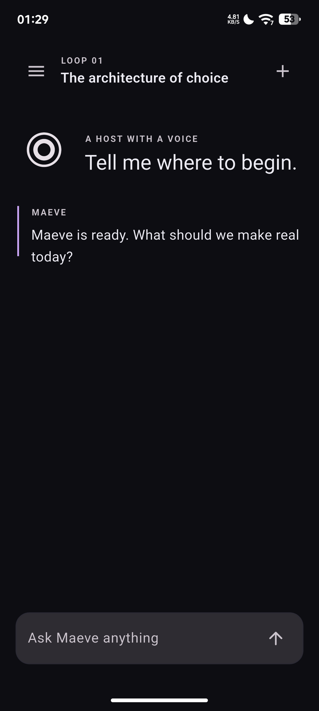
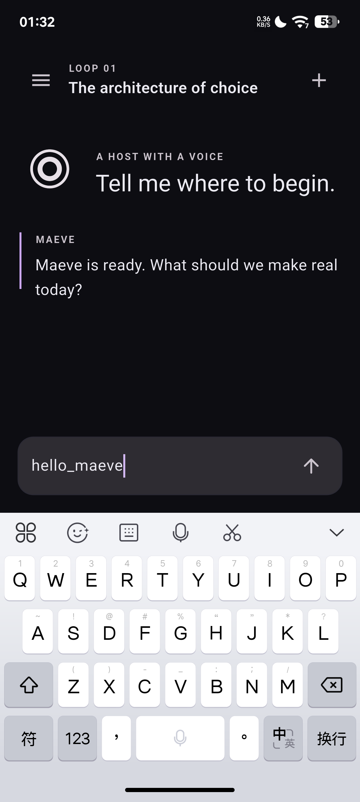

# Maeve Flutter migration

## Direction

Maeve Android uses Flutter for its user interface and Kotlin for Android platform capabilities. Flutter presents a cohesive iOS-inspired visual language; this does not make the module an iOS application and does not use SwiftUI or Xcode.

Flutter owns the user-visible shell, responsive navigation, themes, chat composition, Runs, Memory and Settings surfaces. Kotlin remains the Android capability layer for accessibility, sandbox execution, web takeover, voice, notifications, permissions and device services. Existing Kotlin/Compose surfaces can be retired only after the Flutter equivalents have real behavior and regression coverage.

## Current module

- Flutter module: `flutter/`
- Dart SDK constraint: `^3.13.5`
- Shared visual tokens: `flutter/lib/design/maeve_tokens.dart`
- Tiered glass-like surfaces: `flutter/lib/widgets/glass_surface.dart`
- Bridge contracts: `maeve/ui` (method) and `maeve/ui/events` (event)
- Module notes: [`flutter/README.md`](flutter/README.md)

Toolchain, SDK and cache locations are environment facts, not repository constants. The module
is not a Gradle subproject: `:app` consumes the debug AAR that its build writes under
`flutter/`, so the Flutter module must be built before the Android host compiles.

The current Flutter shell includes:

- Maeve eclipse mark, plum accent and unified light/dark design tokens
- Layered chrome, sheet, card and pill surfaces without runtime backdrop blur
- Responsive rail/sidebar navigation and searchable, switchable, creatable in-memory conversations
- User and Maeve message presentation, composer, thinking state and stop action
- Runs readiness state, Memory add/delete interactions, and appearance/platform settings

## Prototype limits

- Chat responses are local delayed demo replies; no model API, streaming, Kotlin Agent execution, tool calls or approval flow is connected.
- Conversations and memories exist only in Flutter process memory. They are not persisted to disk or Android storage.
- Runs is a visual readiness view and has no real execution history.
- Attachments are not connected to the Android file picker.
- The host registers `maeve/ui` for `open_settings` / `status` and `maeve/ui/events` for status; chat, model calls, persistence and agent execution are still not connected.
- Runtime `BackdropFilter`/`RenderEffect` blur is intentionally avoided due to prior Android RenderThread instability.

## Device verification

The workbench was checked on a PZ261A running Android 16:





## Migration order

1. Embed the Flutter module in `app` and expose a feature flag for the Flutter shell.
2. Define and implement typed platform contracts for status, conversations, tasks, voice, permissions, settings and attachments.
3. Move chat state and persistence behind the bridge; replace local demo replies with the real conversation stream.
4. Connect Runs, Memory, Browser, Screens, About and Settings to their real data and capabilities.
5. Retire Compose screen-by-screen only after instrumentation coverage, device stability and feature parity checks pass.

## Validation

For any Flutter change, run this from the repository root:

```bash
bash flutter/tool/verify.sh
```

It sources the shared environment file, then runs `dart format`, `flutter analyze` and
`flutter test` in order and stops at the first failure. A failing format step means the tree is
unformatted rather than broken. The widget tests cover the shell, armed and idle mark rendering,
drawer navigation at phone width, scrim dismissal, wide rail navigation, conversation
switching, message sending, new conversation creation, conversation search, stopping a pending
reply, memory add/delete and the theme toggle.

`:core:test` reads this repository's documentation as well: `README.md`'s generated sections,
the translated READMEs and the paths in `docs/`. The rules are in
[`docs/dev/project-standards.md`](docs/dev/project-standards.md). A successful local Flutter
run does not imply that Android platform bridge handlers or real model services are connected.

### Local environment

`flutter/tool/verify.sh` uses the toolchain in this order: `MAEVE_ENV_FILE`, then
`../_env/env.sh` next to the repository, then `flutter` and `dart` on `PATH`. `_env/` is
deliberately outside the repository so machine paths never enter git.

The table records what the validating machine used. Treat the paths as evidence for that run,
not as defaults a fresh clone inherits.

| Component | Environment variable | Path used in the recorded run | Verified version |
| --- | --- | --- | --- |
| Flutter SDK | `FLUTTER_ROOT` | `E:/project/daiyimo/_toolchains/flutter` | 3.47.7 stable |
| Dart | bundled with Flutter | — | 3.13.5 |
| JDK | `JAVA_HOME` | `E:/project/daiyimo/_toolchains/jdk-17` | 17.0.20.1 |
| Gradle | wrapper / `GRADLE_USER_HOME` | `E:/project/daiyimo/_toolchains/gradle-8.11.1` | 8.11.1 |
| Android SDK | `ANDROID_HOME` | `%LOCALAPPDATA%/Android/Sdk` | platform 36, NDK 25.1.8937393 |
| Gradle cache | `GRADLE_USER_HOME` | `~/.gradle` | — |
| Pub cache | `PUB_CACHE` | `E:/project/daiyimo/_env/pub-cache` | — |

`:app` derives the cache root from `GRADLE_USER_HOME` and fails with a named dependency when an
artifact is absent. Do not add absolute cache paths back to `app/build.gradle.kts`; that was the
defect fixed in `71767f7`.

After moving a pub cache, run `flutter pub get --offline` once so
`.dart_tool/package_config.json` points at the new location; otherwise analyze fails with
`include_file_not_found` for `package:flutter_lints/flutter.yaml`.

Three environment traps are handled by `env.sh` and documented here so they are not rediscovered:

- The system default JDK is 24. Android Gradle Plugin fails against it with `Could not create task of type 'OutgoingVariantsReportTask'`. Use JDK 17 through `JAVA_HOME`.
- A machine-wide HTTP proxy is normally set. `flutter test` talks to `flutter_tester` over a loopback WebSocket, which the proxy breaks with `WebSocketException: Invalid WebSocket upgrade request`. Keep `127.0.0.1`, `localhost` and `::1` in `NO_PROXY`, otherwise every widget test fails before it runs.
- Git Bash only finds tools on `PATH` when entries are POSIX-style (`/d/dev/...`, not `D:/dev/...`), so `env.sh` converts them before exporting `PATH` and `verify.sh` runs `cygpath` on `FLUTTER_ROOT`.

Latest recorded run on this machine: `dart format` clean, `flutter analyze` clean,
`flutter test` 15/15 passing. `flutter build aar --debug` produced the debug AAR, and
`:app:assembleDebug -PskipFlutterAar` produced `app-debug.apk` in 3m15s. The full
`:core:test` on Windows reports 2954 tests with 56 platform-specific failures; Linux CI is the
final judge, see [`docs/dev/project-review.md`](docs/dev/project-review.md). The pinned set and
setup scripts are in [`tooling/toolchain/README.md`](tooling/toolchain/README.md). The Android
host APK and physical-device RenderThread log check remain separate integration
acceptance steps; the attached device was not authorized for on-device validation. Record the
actual Flutter/Gradle/SDK versions and test results from the machine performing the validation;
do not reuse old failure notes as if they describe the current build.
