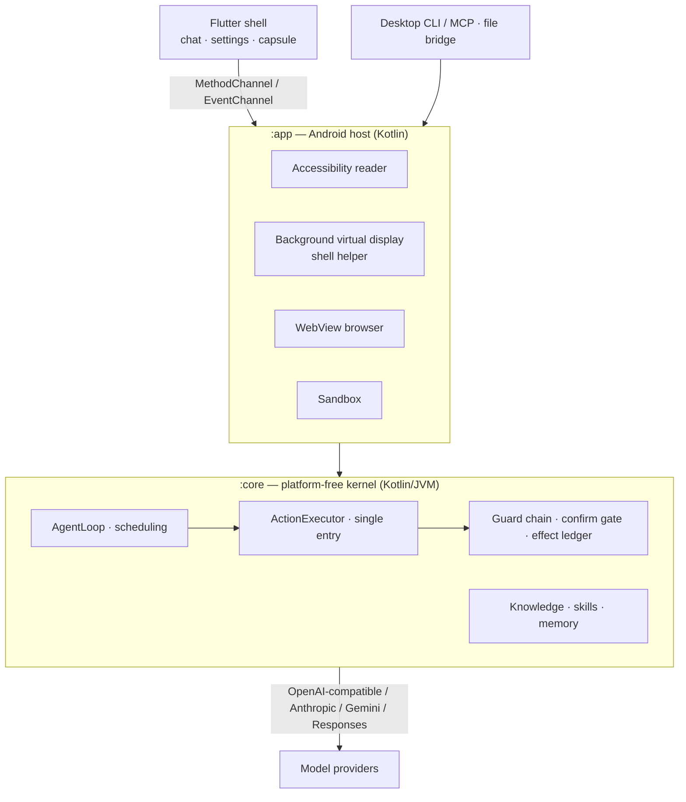

<!-- translated-from: README.md @ e77a4da7bf23 -->
<p align="center">
  <a href="README.md">简体中文</a> · <b>English</b>
</p>

<div align="center">


# Maeve

**She runs the loop. You keep your screen.**

An AI agent for Android: say what you need, and it works your apps and the web on a hidden background screen until the job is done. Your phone stays yours.

<a href="https://github.com/Daiyimo/Maeve"></a>
<a href="LICENSE"></a>
<a href="https://github.com/Daiyimo/Maeve/stargazers"></a>


<br/>


<sub>"Open the Delta Force mini-program in WeChat and read the special-ops daily codes and manufacturing picks": Maeve's chat on the left, each step on its background screen on the right (sped up; private info blurred)</sub>

</div>

> *"Surviving is just another loop."* — Maeve Millay, *Westworld* S1E7

Release codename **Dolores** · `v0.1.0` · [SPEC.md](SPEC.md). Maeve is an independently maintained Apache-2.0 project.

## Get things done with one sentence

<table>
<tr>
<td align="center" width="33%"><br/><b>"Delta Force mini-program: today's codes and manufacturing picks"</b><br/><sub>Opens the WeChat mini-program and reads the codes and profit ranking</sub></td>
<td align="center" width="33%"><br/><b>"What has this creator posted lately?"</b><br/><sub>Opens the app, reads post by post, then sums it up</sub></td>
<td align="center" width="33%"><br/><b>"What are the top ten trending topics?"</b><br/><sub>Opens the ranking in the background and reads it out</sub></td>
</tr>
</table>

<sub>The demos use apps popular in China, but Maeve isn't tied to them: any app or website on your phone, if it can see it, it can work it.</sub>

## Why Maeve

| | |
|---|---|
| 📱 **Leaves your screen alone** | Opens apps, taps, types and scrolls on a separate background virtual screen; keep using your phone, tap the live view whenever you want to watch |
| 🧩 **Works with any app** | Looks at the screen and finds buttons the way a person does: no app APIs, no per-app integration; self-drawn UIs via bundled OCR and a vision model |
| 🌐 **Ask right on the page** | The built-in browser opens any site; say what you want on the page you're reading and it works right there; touch the page and it stops |
| 🧠 **Gets better with use** | Remembers the preferences you tell it and turns finished tasks into skills, so next time is faster and steadier |
| 🔒 **Your data stays on your phone** | There is no Maeve server; use your own model key, or sign in with a ChatGPT / xAI / OpenRouter account |
| 🆓 **Open source and free** | Apache-2.0, all code public |

<br/>

<h3 align="center">Works in the background, your screen stays yours</h3>

<p align="center">Jobs run on a separate virtual screen. With several tasks at once, the "Background screens" page lists which app each task is using and how far it got; tap for the live view, tap again to go full screen.</p>

<p align="center"></p>

<br/>

<h3 align="center">A floating capsule; double-tap to send your screen</h3>

<p align="center">While you're in another app, a capsule at the screen edge shows progress, things needing you, and results. Double-tap it to send the screen you're looking at to Maeve: "how should I reply?" or "note this down".</p>

<p align="center"></p>

<br/>

<h3 align="center">Steer or stop anytime</h3>

<p align="center">Add a word or change the request mid-task; it reads it before the next step. After you stop, it reports what it did and what's left, so "continue" knows where to pick up.</p>

<p align="center"></p>

<br/>

<h3 align="center">It asks before spending money</h3>

<p align="center">Autonomous mode by default: ordinary reversible actions continue, while outward or irreversible actions such as sending, submitting, deleting or placing an order still stop for one-time approval, and payment is always completed by you. Switch to Ask to also confirm every WeChat write and blind taps on self-drawn screens. Login and captchas hand over to you in both modes.</p>

<p align="center"></p>

<br/>

<h3 align="center">Memory and skills, smoother with use</h3>

<p align="center">Remembers preferences and ways of doing things you explicitly stated; view, edit, delete them. Passwords, codes and card numbers are never stored; memory is encrypted on the phone. Finished flows become skills for next time.</p>

<p align="center"></p>

<br/>

<h3 align="center">Ask right on the page in the browser</h3>

<p align="center">Opens any site and keeps you signed in. Say what you want on the page you're reading and it works right there; paging is paced, and it recognizes anti-bot blocks and hands them to you rather than forcing through.</p>

<p align="center"></p>

## Get started in three steps

1. **Install**: build from source (below), or wait for a release package. Currently at M2, no public APK yet.
2. **Connect a model**: Settings › Model, pick a provider and enter a key, or sign in with an account ([models and sign-in](docs/models.en.md)).
3. **Authorize once**: follow the guide to authorize ADB / wireless debugging and accessibility so the background screen can start ([setup guide](docs/setup-guide.en.md)).

Then just say what you need. First time, see the [setup guide](docs/setup-guide.en.md) and [what it can do](docs/features.en.md).

## Two ways in

One execution kernel, two ways to receive a task, both through the same agent loop and guard chain — a remote task is not a weaker second implementation.

| Route | Entry | Typical use |
|---|---|---|
| **R1 · On-device** | Maeve's own chat UI | Ask directly on the phone; accessibility + background virtual display do the work |
| **R2 · Driven by another agent** | Inbound MCP over `/mcp`, or the on-device file bridge | Let a desktop assistant delegate a task to the phone, then read back the result ([computer](docs/computer.en.md) · [MCP](docs/mcp.en.md)) |

R1 needs no companion device. R2 is optional and off by default. The two remote transports are not interchangeable: MCP is a network service, while the file bridge exists for sandboxed runtimes that cannot reach the phone's loopback port.

## Architecture

<p align="center">
  
  
  
  
  
</p>

One execution kernel, two shells: a **platform-free Kotlin kernel** does the thinking and deciding, the **Android host** sees the screen and acts, and the **Flutter shell** provides the UI. The kernel has no Android dependency, so the whole loop runs in JVM unit tests with a fake model.



| Layer | Tech | Responsibility |
|---|---|---|
| `flutter` | Flutter / Dart | Liquid-glass UI: chat, settings, floating capsule; talks to the host over MethodChannel/EventChannel |
| `app` | Kotlin / Android | Accessibility reader, background virtual display (shell helper), WebView, sandbox, foreground service, permissions |
| `core` | Kotlin / JVM | Agent loop, tool engine, context compression, guard chain, confirm gate, effect ledger, knowledge/skills/memory |
| `tools/relay` | Go (optional) | Single-user single-device public remote CLI / MCP gateway, not bundled in the APK |

A few designs that hold up reliability:

- **Single execution entry**: every action that changes the outside world goes through `ActionExecutor`, in the same order: guards → gate → irreversible check → execute → verify → record.
- **Guard chain and effect ledger**: operation guards prevent stalls and repeats, the confirm gate blocks irreversible actions, and the effect ledger guarantees receipts are never replayed and stops for human review when an outcome is unknown.
- **Platform-free kernel**: `core` references no Android; capabilities are injected via interfaces, so unit tests run on a desktop with a fake model and fake screen.
- **Capabilities don't reference each other**: phone / web / sandbox each depend only on the kernel; the assembly layer wires them, so adding a capability doesn't touch old code.

Finer layering and dependency direction are in [docs/dev/architecture.md](docs/dev/architecture.md).

## What you need

- Android 11 (API 30) or newer; the background screen works best on Android 14+.
- **One-time ADB or wireless-debugging authorization**: the virtual display is created by a helper running as `shell`, screen access goes through accessibility; there is no zero-permission setup.
- **Your own model provider**: execution on device, planning in the cloud; configure the endpoint and key in Settings, no model weights bundled.
- Plaintext HTTP is currently permitted — use a trusted provider and a network you control; don't read the confirmation gate as a blanket privacy guarantee.

## Build from source

```bash
git clone https://github.com/Daiyimo/Maeve.git
cd Maeve
./gradlew :app:assembleDebug
```

| Path | What it is |
|---|---|
| `core` | Pure-JVM Kotlin: agent loop, tools, context, guards, knowledge and skills |
| `app` | Android host: accessibility, virtual display, shell helper, WebView, sandbox, permissions |
| `flutter` | The Flutter shell replacing Compose; `app` consumes the debug AAR it builds |

Build the Flutter module first, then assemble the app (the host won't compile without the AAR). Toolchain, cache and proxy traps are in [FLUTTER_MIGRATION.md](FLUTTER_MIGRATION.md) and [tooling/toolchain/README.md](tooling/toolchain/README.md).

<details>
<summary>Built-in app and website knowledge (unlisted apps still work)</summary>

<!-- generated:knowledge:start -->
<!-- Generated by ./gradlew updateReadme; do not edit by hand -->
| Category | Built in |
|---|---|
| **Apps** | Android 设置, 百家号, 哔哩哔哩, BOSS直聘, Chrome, 得到, 抖音, 飞书, Gmail, 即刻, 快手, 领英, QQ邮箱, Telegram, 今日头条, Uber, Uber Eats, 微信, 微博, WhatsApp, 闲鱼, 小红书, 知乎 |
| **Websites** | Amazon, 哔哩哔哩, Google Calendar, 豆瓣, 抖音, Instagram, Gmail, Google Maps, Telegram, 百度贴吧, 微博, 搜狗微信, WhatsApp, 小红书, 小宇宙, YouTube, 知乎, BOSS直聘 |
| **How-to skills** | 改 Maeve 自己的设置, 把内容整理成文字, 处理 PDF 文档, 查清一件事, 消息与邮件, 写技能 |
<!-- generated:knowledge:end -->

</details>

<details>
<summary>Model provider presets</summary>

<!-- generated:providers:start -->
<!-- Generated by ./gradlew updateReadme; do not edit by hand -->
Presets for DeepSeek, 通义千问, Kimi, 智谱, 智谱 Coding Plan, 硅基流动, 火山方舟, MiniMax, 阶跃星辰, 腾讯混元, 百度千帆, OpenRouter, Requesty, OpenCode Go, Anthropic, Gemini, OpenAI, xAI, Mistral, Groq, Ollama, LM Studio and more; for any other provider pick Custom (自定义), which takes any OpenAI-compatible, Anthropic, Gemini or OpenAI Responses endpoint.
<!-- generated:providers:end -->

You can also sign in without a key: ChatGPT (Plus / Pro), xAI / Grok and OpenRouter accounts. Provider-specific notes are in [models and sign-in](docs/models.en.md).

</details>

## Status

The repository is at **M2 (interaction layer)**, with the UI moving from Compose to a Flutter shell: Flutter starts directly, the chat bridge uses real Android conversation state, and the host registers MethodChannel/EventChannel handlers. The full M2 visual system, the connection hub and bridge v3 (M3), and release hardening (M4) are not finished; **nothing here is a released binary**. See [ATTRIBUTION.md](ATTRIBUTION.md) and [SPEC.md](SPEC.md).

---

<sub>Apache-2.0 · Maeve is a derivative work of Wang Zan's **Mika** (Apache-2.0); upstream attribution is retained in [NOTICE](NOTICE) and [ATTRIBUTION.md](ATTRIBUTION.md). Third-party components are listed in [licenses/THIRD_PARTY_NOTICES.md](licenses/THIRD_PARTY_NOTICES.md).</sub>

<sub>Maeve is an independent project, not affiliated with or endorsed by HBO, Warner Bros., or Westworld. The name is used as a common given name, referring to the show's setting.</sub>
