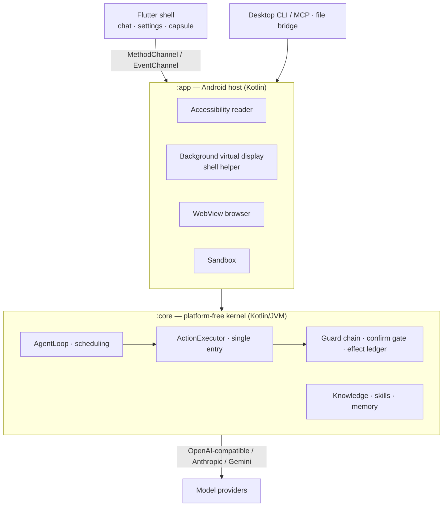

<p align="center">
  <b>简体中文</b> · <a href="README.en.md">English</a>
</p>

<div align="center">


# Maeve

**循环她来跑，主屏留给你。**

一个跑在安卓上的 AI Agent：你说一句话，它在一块你看不见的后台屏上操作 App 和网页，直到把事办完。你的手机照常用。

<a href="https://github.com/Daiyimo/Maeve"></a>
<a href="LICENSE"></a>
<a href="https://github.com/Daiyimo/Maeve/stargazers"></a>


<br/>


<sub>「进入微信打开三角洲小程序，看特勤处今日密码和制造推荐」：左边 Maeve 聊天，右边它在那块后台屏上一步步操作（加速播放；隐私信息已打码）</sub>

</div>

> *"Surviving is just another loop."* —— Maeve Millay，《西部世界》S1E7

版本代号 **Dolores** · `v0.1.0` · [SPEC.md](SPEC.md)。Maeve 是独立维护的 Apache-2.0 项目。

## 一句话，把事办完

<table>
<tr>
<td align="center" width="33%"><br/><b>「三角洲小程序，特勤处今日密码和制造推荐」</b><br/><sub>进微信小程序，逐屏读出密码与收益榜</sub></td>
<td align="center" width="33%"><br/><b>「这个博主最近发了什么？」</b><br/><sub>打开 App 逐条读，再给你总结</sub></td>
<td align="center" width="33%"><br/><b>「抖音热搜前十是什么？」</b><br/><sub>后台打开榜单，读给你听</sub></td>
</tr>
</table>

<sub>演示用的是国内常见 App，但 Maeve 不绑定它们：手机上任何 App、任何网站，看得到就能操作。</sub>

## 为什么选 Maeve

| | |
|---|---|
| 📱 **不占你的屏幕** | 在一块独立的后台虚拟屏上打开 App、点击、输入、滚动；你继续刷手机，想看时点开实时小窗 |
| 🧩 **任何 App 都能用** | 像人一样看屏幕、找按钮，不靠 App 接口、不用逐个适配；自绘界面靠自带 OCR 与看图模型 |
| 🌐 **浏览器里即问即做** | 内置浏览器打开任何网站，对着正在看的页面说要求就地办；你一碰页面它就停 |
| 🧠 **越用越懂你** | 记住你说过的偏好，把办成的事沉淀成技能，下次更快更稳 |
| 🔒 **数据留在手机** | 没有 Maeve 服务器；用你自己的模型 Key，或 ChatGPT / xAI / OpenRouter 账号登录 |
| 🆓 **开源免费** | Apache-2.0，代码全公开 |

<br/>

<h3 align="center">后台屏干活，主屏归你</h3>

<p align="center">活在一块单独的虚拟屏上跑。多个任务同时进行时，「后台屏」页列出每个任务在用哪个 App、做到哪了，点开看实时画面，再点放大整屏。</p>

<p align="center"></p>

<br/>

<h3 align="center">悬浮胶囊，双击把这一屏发给它</h3>

<p align="center">你在别的 App 里时，屏幕边上一颗胶囊显示进展、要你处理的事和结果。双击胶囊，把正在看的这一屏发给 Maeve：「这个怎么回」「帮我记下来」。</p>

<p align="center"></p>

<br/>

<h3 align="center">随时插话，随时停</h3>

<p align="center">任务跑着也能补一句、改要求，它在下一步之前读到。按停止后会交代做了什么、没做完什么，下次说「继续」它知道从哪接。</p>

<p align="center"></p>

<br/>

<h3 align="center">花钱的事，先问你</h3>

<p align="center">默认询问模式：下单、付款这一步停下来，卡片写清在哪、买什么、多少钱，只能同意这一次；付款本身由你亲手完成。也可以切到自主模式连付款也不问。登录、验证码这类要你亲手处理的，两种模式都会请你接管。</p>

<p align="center"></p>

<br/>

<h3 align="center">记忆与技能，越用越顺手</h3>

<p align="center">记住你明确说过的偏好和做事方式，可查看、修改、删除；密码、验证码、卡号这类不记，记忆加密存在手机上。办成的流程沉淀成技能，下次更快。</p>

<p align="center"></p>

<br/>

<h3 align="center">浏览器里，对着页面说</h3>

<p align="center">任何网站都能打开，登录态保留。对着正在读的页面说要求，它就在那一页上办；翻页有节奏，认得出风控拦截页，交给你而不是硬闯。</p>

<p align="center"></p>

## 三步上手

1. **装**：从源码构建（见下），或等发布包。当前处于 M2，暂无公开 APK。
2. **接模型**：设置 › 模型，选服务商填 Key，或用账号登录（[模型与登录](docs/models.md)）。
3. **授权一次**：按引导授权 ADB / 无线调试与无障碍，后台屏才起得来（[安装引导](docs/setup-guide.md)）。

然后直接说你要什么。第一次用可以看 [使用指南](docs/setup-guide.md) 和 [能做什么](docs/features.md)。

## 两种用法

一个执行内核，两种接任务的入口，走同一套 Agent 循环和守卫链——远程任务不是更弱的另一套实现。

| 路线 | 入口 | 典型场景 |
|---|---|---|
| **R1 · 本机** | Maeve 自己的聊天界面 | 在手机上直接说；无障碍 + 后台虚拟屏把活干完 |
| **R2 · 由另一个 Agent 驱动** | `/mcp` 上的入站 MCP，或本机文件桥 | 让电脑上的助手把任务派给手机，再读回结果（[电脑派单](docs/computer.md) · [MCP](docs/mcp.md)） |

R1 不需要配套设备。R2 可选、默认关闭。两种远程通道不能互相替代：MCP 是网络服务，文件桥是为连不到手机 loopback 端口的沙箱运行时准备的。

## 技术架构

<p align="center">
  
  
  
  
  
</p>

一个执行内核，两层外壳：**平台无关的 Kotlin 内核**负责想和决定，**安卓宿主**负责看屏幕、动手，**Flutter 外壳**负责界面。内核不依赖安卓，能在电脑上用假模型跑完整循环的单测。



| 层 | 技术 | 职责 |
|---|---|---|
| `flutter` | Flutter / Dart | 液态玻璃界面：聊天、设置、悬浮胶囊；经 MethodChannel/EventChannel 接宿主 |
| `app` | Kotlin / Android | 无障碍读屏、后台虚拟屏（shell 助手）、WebView、沙箱、前台服务、权限 |
| `core` | Kotlin / JVM | Agent 循环、工具引擎、上下文压缩、守卫链、确认门、副作用账本、知识/技能/记忆 |
| `tools/relay` | Go（可选） | 单用户单设备的公网远程 CLI / MCP 网关，不进 APK |

几条撑起可靠性的设计：

- **唯一执行入口**：所有改外部世界的动作都过 `ActionExecutor`，按同一顺序走守卫 → 关卡 → 不可逆判定 → 执行 → 核对 → 记录。
- **守卫链与副作用账本**：操作守卫防卡死、防重复，确认门拦不可逆动作，副作用账本保证执行回执不重放、结果未知就停下让人核对。
- **平台无关内核**：`core` 不引用安卓，能力经接口注入；电脑上用假模型和假屏幕就能跑单测。
- **能力互不引用**：phone / web / sandbox 各能力只依赖核心，装配层统一接线，加新能力不动旧代码。

更细的分层与依赖方向见 [docs/dev/architecture.md](docs/dev/architecture.md)。

## 使用条件

- 安卓 11（API 30）及以上，后台屏在安卓 14+ 上最稳。
- **一次性授权 ADB 或无线调试**：虚拟屏由 `shell` 身份的助手进程创建，读屏走无障碍服务，没有零权限方案。
- **你自己的模型服务商**：端侧执行、云端规划，地址和 Key 在设置里配，不内置模型权重。
- 网络配置目前允许明文 HTTP——请用可信服务商和你能控制的网络；别把确认门当成全面的隐私保证。

## 从源码构建

```bash
git clone https://github.com/Daiyimo/Maeve.git
cd Maeve
./gradlew :app:assembleDebug
```

| 路径 | 是什么 |
|---|---|
| `core` | 纯 JVM Kotlin：Agent 循环、工具、上下文、守卫、知识与技能 |
| `app` | 安卓宿主：无障碍、虚拟屏、shell 助手、WebView、沙箱、权限 |
| `flutter` | 正在替换 Compose 的 Flutter 外壳；`app` 消费它构建出的 debug AAR |

先构建 Flutter 模块再汇编 App（AAR 不存在时宿主编不过）。工具链与缓存、代理的坑见 [FLUTTER_MIGRATION.md](FLUTTER_MIGRATION.md) 与 [tooling/toolchain/README.md](tooling/toolchain/README.md)。

<details>
<summary>内置使用知识的 App 和网站（没写到的照样能用）</summary>

<!-- generated:knowledge:start -->
<!-- 这一段由 ./gradlew updateReadme 生成，不要手改 -->
| 类别 | 内置 |
|---|---|
| **App** | Android 设置、百家号、哔哩哔哩、BOSS直聘、Chrome、得到、抖音、飞书、Gmail、即刻、快手、领英、QQ邮箱、Telegram、今日头条、Uber、Uber Eats、微信、微博、WhatsApp、闲鱼、小红书、知乎 |
| **网站** | Amazon、哔哩哔哩、Google Calendar、豆瓣、抖音、Instagram、Gmail、Google Maps、Telegram、百度贴吧、微博、搜狗微信、WhatsApp、小红书、小宇宙、YouTube、知乎、BOSS直聘 |
| **通用做法**（技能） | 改 Maeve 自己的设置、把内容整理成文字、处理 PDF 文档、查清一件事、消息与邮件、写技能 |
<!-- generated:knowledge:end -->

</details>

<details>
<summary>模型服务商预设</summary>

<!-- generated:providers:start -->
<!-- 这一段由 ./gradlew updateReadme 生成，不要手改 -->
内置 DeepSeek、通义千问、Kimi、智谱、智谱 Coding Plan、硅基流动、火山方舟、MiniMax、阶跃星辰、腾讯混元、百度千帆、OpenRouter、Requesty、OpenCode Go、Anthropic、Gemini、OpenAI、xAI、Mistral、Groq、Ollama、LM Studio 等服务商预设；其他服务商选「自定义」，OpenAI 兼容、Anthropic、Gemini、OpenAI Responses 接口都能接。
<!-- generated:providers:end -->

也可以不填 Key：用 ChatGPT（Plus / Pro）、xAI / Grok、OpenRouter 账号登录。各家的注意事项见[模型与登录](docs/models.md)。

</details>

## 当前状态

仓库处于 **M2（交互层）**，界面正从 Compose 迁到 Flutter 外壳：Flutter 直接启动，聊天桥用真实安卓会话状态，宿主注册了 MethodChannel/EventChannel。完整的 M2 视觉系统、连接中枢与 bridge v3（M3）、发布加固（M4）尚未完成，**这里没有任何已发布的二进制**。来龙去脉见 [ATTRIBUTION.md](ATTRIBUTION.md) 与 [SPEC.md](SPEC.md)。

---

<sub>Apache-2.0 · Maeve 是 Wang Zan 的 **Mika**（Apache-2.0）的衍生作品，上游署名保留在 [NOTICE](NOTICE) 与 [ATTRIBUTION.md](ATTRIBUTION.md)；第三方组件见 [licenses/THIRD_PARTY_NOTICES.md](licenses/THIRD_PARTY_NOTICES.md)。</sub>

<sub>Maeve is an independent project, not affiliated with or endorsed by HBO, Warner Bros., or Westworld. The name is used as a common given name, referring to the show's setting.</sub>
