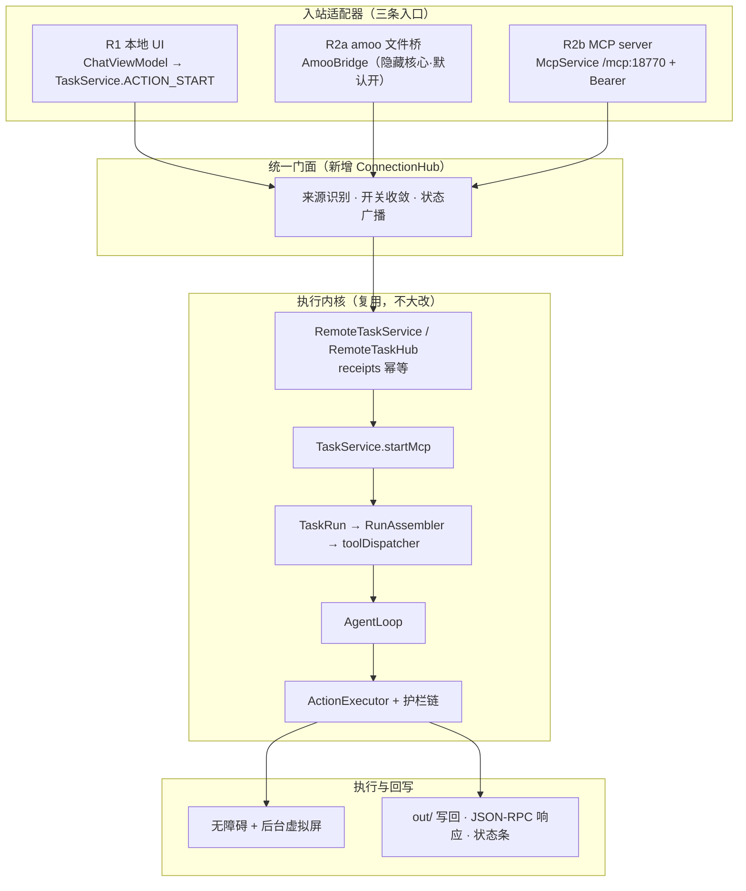
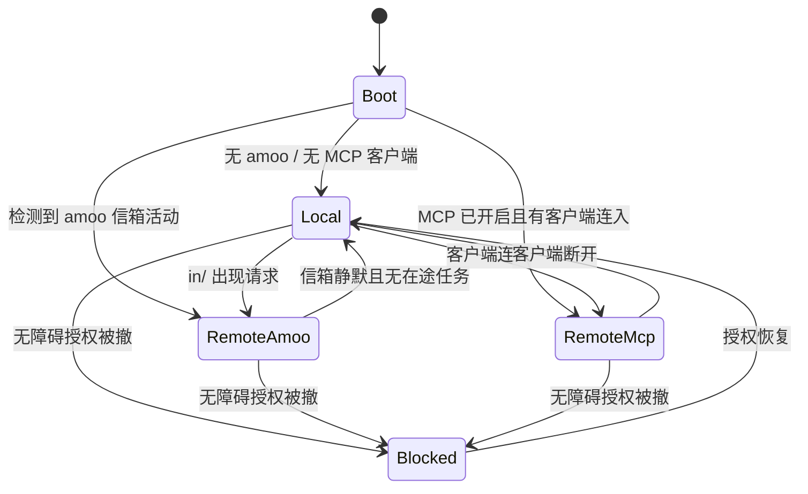

# Maeve Spec v0.3 — M0 已确认 / M1 完成 / M2 交互层完成 / 源码已发布

> **状态**：**M0 已于 2026-11-06 15:43 确认**（用户「按默认走 开始吧」，Q1/Q4/Q6/Q8 采用 §13.11 默认值）。M1 骨架、M2 第一刀（可见品牌）与 M2 交互层（`HapticEngine` 五级触感、`HoldToConfirm`、连续曲率、动效分档、设置开关）均已构建装机验证。**Q6 已于 2026-11-06 18:08 经用户「提交commit并push吧」单独授权并执行**：`main` 与 tag `amoo-bridge-v1` 已推送到 `Daiyimo/Maeve`，`origin/main` 已设为 upstream。本文件定义的产品与架构约束持续有效。
> **实现进度**：见 [`docs/spec/migration.md`](docs/spec/migration.md)（M1 完成清单、M2 第一刀、M2 交互层、Q6 发布记录、延后项与验收命令）；决策记录见 `docs/adr/`。
> **日期**：2026-11-06（v0.2 真机实证与资料校正 → v0.3 一致性修订 + 资料补纳 + 可执行契约）
> **v0.2 修订摘要**：① 双路线拆成 R1 / R2a(amoo 文件桥) / R2b(电脑 MCP)，两者不可互兜底；② 「隐藏核心」由「零配置」改为「能力隐藏 + 一次性握手」；③ `:18770` 实测仅回环，WorkBuddy 需显式开局域网或 USB forward；④ 「纯本地/内置模型」改为「端侧执行 + 外部 Provider 决策」；⑤ 新增文件桥协议缺陷、StepOS 平台约束、改包名致技能失效的迁移项。详见 §12。
> **v0.3 修订摘要**：① 修掉 v0.1 正文与 §12 的 6 处直接矛盾（技能版本、`request_id` 生成、alias 生命周期、超时终态等）；② 补纳 `step-gui-edge-资料.md` / `mobile-agent-GUI实现分析.md` / `豆包手机实现调研.md` / `gelab-zero` 本地仓库；③ 新增端侧决策后端接缝、机械后验、敏感应用清单、`SelfCheck` 验收复用 4 条 ADR；④ 把文件桥 v3 从「缺陷描述」写成可实现的 wire contract；⑤ 给出决策阻塞表，明确哪些问题不回答也能开工。详见 §13。
> **目标仓库**：`E:\project\daiyimo\Maeve` → `https://github.com/Daiyimo/Maeve.git`（**公开历史从单基线快照 `7cf7ff3` 开始，后面是 Maeve 提交；当前分支 `master`，单一贡献者；见 `ATTRIBUTION.md`**）
> **许可**：Apache-2.0，Copyright 2026 Daiyimo
> **设计参考**：`E:\project\daiyimo\dsh-go`（dsh-Go，AGPL-3.0）
> **本 spec 的范围**：只定义「要做什么、为什么、做成什么样、怎么验收」。**不写代码、不搬源码、不改上游**；实现与发布动作记录见 `docs/spec/migration.md`。

---

## 0. 文档控制与本次纠偏

| 项 | 内容 |
|---|---|
| Spec 版本 | **v0.3**（本文件）；v0.1 首版 → v0.2 真机修订 → v0.3 一致性修订 |
| 产品名 | **Maeve**（梅芙），仓库名 `maeve-agent`（GitHub remote 已是 `Daiyimo/Maeve`） |
| 首发版本代号 | **Dolores** → `versionCode = 1` / `versionName = "0.1.0-dolores"` |
| slogan | *"She runs the loop. You keep your screen."* /「循环她来跑，主屏留给你。」 |
| 彩蛋 | *"Surviving is just another loop."* — Maeve Millay, *Westworld* S1E7（IMDb 逐字可查） |

> **版本编号消歧（v0.3 新增，避免再读错）**：本文里 **`v0.1 / v0.2 / v0.3` 一律指 Spec 版本**；产品发版一律写成 **`v0.1.0 (Dolores)` / `v0.2.0`**。v0.1 正文里出现的「v0.1 同时注册 alias、v0.2 移除」等说法已按此规则在 §6.8 统一改写为产品版本号。

### 0.1 对前期结论的两处纠偏（重要）

1. **产品不是单主线 A。** 前文为收敛命名，曾把产品简化为「主线 A：不打扰的后台屏操作」。用户明确纠正：**这个 app 是两条路线**——
   - **R1 安卓通用路线**：原 Maeve 的本地路线，用户在 App 内下指令，Maeve 用无障碍 + 后台虚拟屏把活干完。
   - **R2 Agent 接入路线**：连接 amoo，或通过 MCP 连接其他 agent（例：WorkBuddy），由外部大脑下指令、Maeve 提供手机执行能力。
   
   「不打扰的后台屏」仍然是两条路线**共用的执行特征**，但不再是产品的全部定义。本 spec 以双路线模型为准。

2. **amoo 不是「可选外挂」，是隐藏核心。** 用户表述：「如果用户有 amoo 就可以直接连上 amoo 用；如果没有就走安卓无障碍 + MCP 的，amoo 作为隐藏核心」。本 spec 的解读与落地方案见 §1.3、§6.9。

### 0.2 参考项目的许可证红线（最高优先级）

dsh-Go 的 `LICENSE` 是 **AGPL-3.0**（`ASSETS.md` 另声明名称、Logo、Deepy/鲸娘形象不在开源授权内；`sdk/`、`examples/` 为 MIT）。Maeve 是 Apache-2.0 衍生作品，两者许可证不兼容。

> **硬性约束**：只借鉴 dsh-Go 的**设计决策、数值、枚举、交互语义**，用 Kotlin/Compose 独立重新实现。**禁止复制** `app/lib/**`、`app/android/**` 下任何源码，`res/` 图标资源，字体，品牌素材，或任何整段实现。逐文件头部的「Portions derived from PiPilot (MIT)」不构成整文件可照搬的依据。

---

## 1. 产品定义

### 1.1 一句话

**Maeve 是 Android 上的 AI Agent：它在一块你看不见的后台虚拟屏上替你操作 App 和网页，主屏始终归你。它能自己跑，也能被 amoo 或任意 MCP 客户端驱动。**

### 1.2 双路线模型（v0.2 按真机实证细化）

用户说的「两条路线」，v0.2 拆成**一条本地路线 + 两条互不相通的远程子通道**。原因见 §12.2：amoo 沙箱与手机不在同一网络命名空间，**MCP 对 amoo 是死路**，不能把两者笼统写成一条「MCP 路线」。

| | **R1 · 安卓通用路线（Local）** | **R2a · amoo 路线（本机文件桥）** | **R2b · 电脑 / 外部 agent 路线（MCP）** |
|---|---|---|---|
| 谁下指令 | 用户在 Maeve App 内输入 | amoo（StepOS 内置助手，真 Agent 在端侧 OpenClaw 微 VM） | WorkBuddy / 任意 MCP 客户端 |
| 谁思考 | **端侧编排 + 外部模型 Provider 决策**（非「内置模型全离线闭环」，见 §12.2④） | amoo / OpenClaw 侧大模型 | 外部 agent 的大模型 |
| 传输 | 进程内 `ChatViewModel → TaskService(ACTION_START)` | **目录信箱** `/sdcard/Android/media/<pkg>/amoo/{in,out}`（唯一可行） | `McpService` `/mcp` :18770 + Bearer token；**默认仅 loopback**，需开局域网或 USB forward |
| 执行 | 无障碍读屏 + 后台虚拟屏 + `ActionExecutor` | **同一套执行器** | **同一套执行器** |
| 结果 | 完整聊天 UI、可插话、可接管 | 原子写 `out/<id>.json` | JSON-RPC 同步响应 + 调用方轮询 `maeve_task_status` |
| 典型场景 | 手机上直接说「把这周订单导出来」 | amoo 里说「帮我看看抖音热榜」 | WorkBuddy 在电脑上派一个手机任务 |
| 主屏 | 不被占用 | 不被占用 | 不被占用 |

**关键设计决策**：三条入口**不是三个产品、不是三套执行器**，而是「一个执行内核 + 多个入站适配器」（Maeve 进程内已成立，见 §6.2；**不要外推**到 GAgent / StepBridge 等独立 App）。改造重点是**把分散的开关收敛成一个可发现的门面**，而不是复制链路。

### 1.3 「amoo 作为隐藏核心」的落地解读（v0.2 修正）

v0.1 写成「零配置自动接管」，**与真机不符**。实证（`Maeve/docs/dev/amoo-bridge.md:51-55,59,69-77` + §12.1 设备快照）：

- 现状 `bridge_amoo` **默认关**，要点「开始接入」才开；关着时 Maeve 不碰这个目录。
- 文件桥只是**手机侧的一半**。amoo 侧还必须装 `maeve-bridge` 技能（真机 `skill.json` = `{"skill":"maeve-bridge","version":2}`）；**技能在会话启动时加载，装完要开新会话**；注入靠无障碍把说明打进 amoo 聊天页，需用户切到该页。
- 技能里写死了信箱路径与包名。`SKILL.md` 位于 OpenClaw 微 VM 内（`~/.openclaw/workspace/skills/maeve-bridge/`），**adb 从 Android 侧扫不到**（本次 `find /sdcard -iname SKILL.md` 无结果）。

因此 v0.2 把「隐藏核心」重新定义为：**能力层隐藏，接入只需一次性握手**。

1. Maeve 侧：`bridge_amoo` 默认 true、设置页不暴露开关、首启引导不提 amoo（这部分可控）。
2. 首次握手：检测到 `com.stepos.ailauncher` 时后台准备好 skill 说明；用户首次与 amoo 对话时经 `AmooSetup` 注入一次，之后不再打扰。技能改名 `maeve-bridge`，`SKILL_VERSION` 升到 **3**。
3. 握手状态只在诊断页只读展示（最近收/发、技能版本），不作为用户需要理解的「连接模式」。
4. 有 amoo → R2a 可用；无 amoo → R1 正常，R2b 保持可被发现。**不因有 amoo 而禁用本地路线**，靠 `RunProvenance` 区分来源。

> 备选解读（若用户本意不同）：把 amoo 的意图理解能力内置成 Maeve 的隐藏推理层。这会显著改变架构，需 Q1 确认。

### 1.4 能力发现与自动降级矩阵（v0.2）

| 检测到的环境 | 默认激活 | 用户可见 | 说明 |
|---|---|---|---|
| 无 amoo、无 MCP 客户端 | R1 | 完整 App UI | **端侧执行闭环 + 外部模型 Provider 决策**；端侧小模型仅离线降级（§12.5） |
| 有 amoo 且技能版本匹配 | R1 + R2a | 状态条标注「由 amoo 驱动」 | 隐藏核心自动消费，无需再配置 |
| 有 amoo 但技能缺失/版本旧 | R1 + 一次性握手提示 | 诊断页只读 + 一条轻提示 | 不能静默假装已连通 |
| MCP 已开启且有客户端连入 | R1 + R2b | 状态条标注 agent 名 | 需先开局域网监听或 USB forward |
| 两者都在 | R1 + R2a + R2b，按来源排队 | 多来源标识 | receipts 幂等，不并发抢屏 |
| 无障碍授权被撤 | 全部执行降级为「仅可读 / 暂停」 | 明确阻断提示 + 引导 | 不静默失败 |
| 非 StepOS 普通 Android | 仅 R1 + R2b | amoo 相关能力整体隐藏 | amoo 依赖厂商 system app 与平台签名（§12.4） |

### 1.5 非目标（v0.1 明确不做）

- 不做浏览器 CDP、PRoot 沙箱/root、语音输入、微信、远程 Relay 网关的**新增功能**（沿用或按 §8.4 裁剪，不扩范围）。
- 不做 iOS / 桌面端。
- 不做云端服务、账号体系、多用户。
- 不承诺「端侧推理 / 100% 本地 / 数据不出手机」——实际需用户配置云端 LLM Provider。
- **产品 `v0.1.0` 不内置任何端侧 GUI 模型权重**（GELab-Zero / Qwen3-VL 等），但保留 `DecisionBackend` 接缝，见 §13.4；「不实现」不等于「架构上堵死」。
- 不从 dsh-Go 移植任何代码或素材。

---

## 2. 参考项目 dsh-Go：借鉴清单与边界

### 2.1 dsh-Go 是什么

DeepSeek Harness 的 Android 客户端（Flutter UI + Android Kotlin 平台层），可本机跑 Ubuntu/Node/DSH 引擎，也可 SSH 远程连电脑；有聊天、工具审批、手机操控、主题/图标/桌宠。AGPL-3.0。它值得参考的不是功能，而是**外观与触感的系统化程度**。

### 2.2 可借鉴的设计决策与数值（照此重新实现，不复制代码）

| # | 决策 | 具体数值 / 做法 | 出处（dsh-Go 本地路径） |
|---|---|---|---|
| D1 | 低饱和配色，恒明度换色相 | OKLCH 推导；彩度封顶 `0.13`，明度限 `0.30–0.60`，深色 `+0.234`；只换色相/彩度、不动明度 ⇒ 各套配色文字对比度一致 | `app/lib/ui/theme/accent.dart:275-344`、`oklch.dart:100-109` |
| D2 | 对比度守卫 | 二分 24 步保证非文本 `3:1`(WCAG 1.4.11)、文本 `4.5:1`(1.4.3) | `accent.dart:359-376` |
| D3 | 70/25/5 用色比例 | 中性 70 / 文字 25 / 强调 5；`surfaceTint = transparent`，`elevation = 0` | `palette.dart:22-25`、`app_theme.dart:140-159` |
| D4 | 六套预设 + 自定义 + 壁纸取色 | `AccentSource = preset / custom / wallpaper`；壁纸取色只取 hue/chroma 自建安静色板（不依赖 Material You） | `appearance_state.dart:12-21`、`DynamicColorPlugin.kt:37-48` |
| D5 | 四层玻璃材质 | chrome 白 α0.70 blur18 sat1.3 / sheet α0.82 blur24 sat1.4 / card α0.62 无模糊 / pill α0.55 无模糊；只画形状外部阴影；同屏真模糊 ≤3 | `surfaces.dart:159-259`、`glass.dart:11-38` |
| D6 | 发丝描边与顶边高光 | 0.5px hairline（浅色冷墨 8% / 深色白 9%）；顶边白 α0.85–0.90 向下 45% 渐隐 | `surfaces.dart:43-45,176`、`glass.dart:229-239` |
| D7 | 连续曲率圆角 | `xs6 / sm10 / md14 / lg20 / xl28`，squircle 连续曲率 | `shapes.dart:7-55` |
| D8 | 4 倍数间距阶梯 | `2/4/8/12/16/20/24/32`，gutter16、readingWidth720 | `shapes.dart:57-89` |
| D9 | 动效时长分档 | press90 / quick160 / standard240 / collapse280 / emphasized340 / sheetIn380 / glassIn120 / breath2400 ms；`pressScale 0.97`；跟随系统「移除动画」 | `motion.dart:16-137` |
| D10 | 触感语义分级 | `selectionClick`(普通点按) → `lightImpact`(确认/发送) → `mediumImpact`(停止/长按/菜单) → `heavyImpact`(危险确认)；危险操作长按 1500ms | `pressable.dart:151-154`、`composer.dart:153,159`、`hold_to_confirm.dart:41,81` |
| D11 | 连续手势防抖 | 滑杆「值真的变了才发」、Dock「翻到下一张才发」 | `segmented_pill.dart:94`、`dock_stack.dart:158` |
| D12 | 桌面图标切换 | `activity-alias` + `setComponentEnabledSetting`；**先启新再关旧**；关闭用 `STATE_DEFAULT(0)` 不用 `DISABLED(2)`，避免清掉 task | `LauncherIcons.kt:9-17,107-123` |
| D13 | 首屏共用背景不闪 | 全屏渐变 + 两团极淡光晕；切 tab 背景不动；弹层运动中(`settled=0`)不采样背景 | `backdrop.dart:11-25,100-110`、`glass.dart:77-80` |
| D14 | 性能降级 | 低端机/高对比度时关 `BackdropFilter`，改用近乎不透明 fallbackFill | `glass.dart:31-33,110-118` |
| D15 | 危险操作独立摩擦 | 手机操控默认限制付款/密码/验证码/系统设置；「解除限制」必须单独按住确认 | `hold_to_confirm.dart`、`docs/guide/zh/04-phone-control.md` |

### 2.3 明确不借鉴

- **任何源码 / 资源 / 字体 / 品牌素材**（AGPL-3.0，见 §0.2）。
- 桌宠、社区、Bot、终端、分享图等与 Maeve 无关的功能与页面。
- Flutter 技术栈：Maeve 是**原生 Android + Jetpack Compose**，D10/D12 需按 §4.2 与 §3.6 做技术转译，不能照搬 API。
- dsh-Go 的「把引擎装进手机」产品叙事。

### 2.4 与 Maeve 主题的差异化

dsh-Go 是「把电脑装进口袋」，视觉是安静的雾蓝玻璃；Maeve 是「**它在另一块屏上替你过完第二人生**」，视觉母题应当是**双层、错位、半透、后台感**：

- 主视觉从「一层玻璃」改为「**两层错位的面**」：后层是主屏（用户），前层偏移一点是后台虚拟屏（Maeve），中间一道细光缝。
- 强调色带一点**雾紫 / 灰蓝**（呼应 reveries / 白日梦），比 dsh-Go 的蓝更冷、更退后，符合「不打扰」。
- 状态色（成功/警告/危险）**不随主题色变化**，色相即语义（借鉴 D1 的语义色独立思路）。
- 危险确认的「摩擦感」在 Maeve 里更重要——它直接对应源码的 `ConfirmDecision` / `IrreversibleDetector`，是有代码支撑的真实语义，不是装饰。

---

## 3. 视觉规格

### 3.1 视觉母题与图标概念

- **双层错位圆环 + 一个偏出的光点**：外环=主屏，内环=后台屏，光点=正在执行的那一步。
- 浅色下用雾紫灰，深色下用低饱和靛；避免高饱和、避免发光特效。
- 自适应图标 108dp 网格，可见区 72dp；提供单色（monochrome）层以适配 Android 13+ 主题图标。

### 3.2 主题色系统

**方法**：按 D1/D2 自建 OKLCH 推导（**Kotlin 独立实现，不引入 dsh-Go 代码**）。不用 `ColorScheme.fromSeed`、不用 `dynamicColorScheme`；中性色保持明度不动，只换色相/彩度；自定义色与壁纸取色走同一 `derive()` + `guard()`。

**六套预设（Maeve 命名，全部为设定词）**：

| id | 名称 | 浅色 seed | 深色 seed | 意象 |
|---|---|---|---|---|
| `reverie` | 雾紫（**默认**） | `#6E6296` | `#B3A8D6` | reveries / 白日梦 |
| `dolores` | 晨金 | `#8A6A3E` | `#D8BC93` | 园区晨光 / 首发代号 |
| `maze` | 沙褐 | `#7A6248` | `#C9AE93` | 迷宫 / 荒漠 |
| `pearl` | 珠白 | `#4F6472` | `#AFC3CE` | 记忆珍珠 |
| `sublime` | 深靛 | `#3A4A7A` | `#9BAEDD` | 升华之境 |
| `graphite` | 石墨 | `#2C2E32` | `#E5E8ED` | 中性/无彩 |

派生约束：彩度 ≤ `0.13`、明度 `0.30–0.60`（深色 `+0.234`）、非文本对比 ≥`3:1`、文本 ≥`4.5:1`、用色比例 70/25/5。

**三态来源**：`AccentSource = Preset | Custom | Wallpaper`。壁纸取色在 Kotlin 侧读 `system_accent1_500/600/200` + `system_neutral1_500`（API 31+），只回传 hue/chroma，低版本隐藏该选项。自定义色轮拖动按 ~100ms 节流（D9/D11）。

### 3.3 材质、形状、动效 token

沿用 §2.2 的 D3、D5–D9、D13、D14 数值作为**目标值**，以 Compose `ColorScheme` + 自定义 `ThemeExtension` 等价物（CompositionLocal）落地：

- 四层表面 `MaeveSurfaces { chrome, sheet, card, pill }`，每档含 fill / blurSigma / saturation / hairline / rim / outerShadow。
- 全屏背景一页一张，`BackdropVeil` 只在 band 内淡出；切页背景不动。
- 圆角 `xs6 sm10 md14 lg20 xl28`；间距 `2/4/8/12/16/20/24/32`；发丝线 0.5px；无 elevation tint。
- 动效 `press90 quick160 standard240 collapse280 emphasized340 sheetIn380 glassIn120 breath2400`，跟随系统减少动画归零。
- 降级：`blurEnabled=false` 时用不透明 fallback，不建模糊层。

### 3.4 桌面图标

四款 = `activity-alias` + 各自 `mipmap/ic_launcher_*`，运行时用 `PackageManager.setComponentEnabledSetting` 切换（D12）：

| variant | 背景意象 | 对应主题 |
|---|---|---|
| `reverie`（默认） | 雾紫渐变 + 双层错位圆环 | 雾紫 |
| `pearl` | 珠白 + 单圆环 | 珠白 |
| `night` | 深靛 + 光点 | 深靛 |
| `mono` | 石墨 + 单色字形 | 主题图标 |

必须遵守：manifest 中除默认 alias 外全部 `enabled="false"`；切换时**先 enable 新的、再关旧的**；关闭用 `STATE_DEFAULT(0)` 而非 `STATE_DISABLED(2)`；原 alias 延迟到其 task 不可见时再关，否则系统会清掉已打开的 task。

**功能图标风格**（对齐 dsh-Go 的 `TileStyle` 思路，Maeve 自定三档）：`duotone`（默认，扁平双色）/ `geometric`（极简几何）/ `glass`（玻璃渐变），持久化在设置里，只影响首页功能磁贴与工具卡，不影响桌面图标。

### 3.5 交付物清单（视觉阶段）

`ui/theme/` 下：`MaeveColors`(OKLCH + 六预设 + derive/guard)、`MaevePalette`(中性)、`MaeveSurfaces`、`MaeveShapes`、`MaeveMotion`、`MaeveSemanticColors`、`MaeveTheme`；`res/mipmap-anydpi-v26/` 四套 adaptive icon + monochrome；`icons/LauncherIconController.kt`；`docs/design/tokens.md`（本表外置，供设计/开发对齐）。

---

## 4. 触感交互规格

### 4.1 原则

1. **语义分级，不是随手震动**：强度映射动作的重要程度，同一动作在两条路线下反馈一致。
2. **危险操作有摩擦**：不可逆动作（付款/删除/发送/解除限制）用长按 + 最重反馈，不能一键通过。
3. **连续手势防抖**：滑杆、翻页、拖动只在「值/项真的变了」时发，避免连发。
4. **可关、可降级**：系统关闭触感或设备不支持预置效果时静默降级为无反馈，不报错。

### 4.2 技术转译（重要）

dsh-Go 用 Flutter 的 `selectionClick / lightImpact / mediumImpact / heavyImpact`；**Maeve 是 Compose，不能照搬**。Compose 的 `LocalHapticFeedback` 仅提供 `LongPress` / `TextHandleMove` 两种，不足以表达四级语义。因此自建统一封装 `HapticEngine`（Kotlin），基于 `VibratorManager` + `VibrationEffect`（API 30+），旧版本回退 `HapticFeedbackConstants`：

| 语义级 | dsh-Go 对应 | Android 实现 | 降级 |
|---|---|---|---|
| `Tick` 选择/点按 | selectionClick | `VibrationEffect.EFFECT_TICK` | `CLOCK_TICK` / `VIRTUAL_KEY` |
| `Light` 确认/发送/任务完成 | lightImpact | `EFFECT_CLICK` | `CONTEXT_CLICK` |
| `Medium` 停止/长按/接管/远程任务到达 | mediumImpact | `EFFECT_HEAVY_CLICK` | `LONG_PRESS` |
| `Heavy` 危险确认完成 | heavyImpact | `EFFECT_DOUBLE_CLICK` 或自定义 waveform | `LONG_PRESS` ×2 |
| `Reject` 被护栏拦下（**Maeve 新增**） | — | `EFFECT_REJECT` | `REJECT` / 无 |

约束：先查 `Vibrator.areEffectsSupported`；集中一个入口，禁止散落的 `performHapticFeedback`；需 `android.permission.VIBRATE`；提供设置开关「触感反馈」（dsh-Go 没有，Maeve 补上）。**收敛 Maeve 现存零散用法**：`MessageMenu.kt`、`ChatDrawer.kt`、`VoiceHold.kt`、`OverlayHost.kt` 四处 `LongPress` 全部改为走 `HapticEngine`。

### 4.3 反馈矩阵

| 动作 | 级别 | 备注 |
|---|---|---|
| 任意可点组件点按 | `Tick` | 统一 `Pressable` 包装；滚动中延迟 90ms 显现避免误触 |
| 发送消息 / 下指令（R1） | `Light` | |
| 复制、展开工具卡、切换分段、滑杆吸附 | `Light` / `Tick` | 值变化才发 |
| 确认闸门弹出（付款/删除/发送） | `Light` | 同时前屏浮层，主屏可继续用 |
| **确认闸门通过（不可逆动作执行前）** | `Heavy` | 需长按 1500ms，松开取消 |
| **被护栏拦下 / 需要用户接管** | `Reject` | 与「通过」严格区分 |
| 停止任务 / 长按消息出菜单 | `Medium` | |
| **用户接管成功（抢回控制）** | `Medium` ×2 短促双段 | Maeve 特有，标志控制权移交 |
| **远程任务到达（R2，amoo / MCP）** | `Medium` 一次 | 用户不在 App 内也要能感知 |
| 后台虚拟屏开始执行一帧动作 | 无 | 禁止逐步震动，避免持续嗡鸣 |
| 任务完成 | `Light` | |
| 任务失败 / 被取消 | `Medium` | 与完成区分 |
| amoo 连接建立 / MCP 客户端连入 | `Tick` | 只首次，不重复 |
| 无障碍授权被撤、执行降级 | `Reject` | 配合可见阻断提示 |

### 4.4 危险确认组件

`HoldToConfirm`：按住 1500ms 环形进度 + down 一次 `Tick`、完成一次 `Heavy`；用原始指针监听（不走手势识别器，避免无障碍/误触触发）；一次按住最多两次反馈；取消不补发。用于：解除执行限制、放行付款类动作、允许无人值守模式。

---

## 5. 信息架构

### 5.1 页面清单

| 页面 | 状态 | 说明 |
|---|---|---|
| 首页 / 对话 | 改造 | 沿用 Maeve 单 Activity Compose `NavStack`；换成 Maeve 主题、双层母题、新反馈矩阵 |
| **连接中枢**（新增） | **新增** | R2 的统一门面，见 §5.3；替代 Maeve 里分散的 `AmooScreen` / `McpScreen` / `McpServersScreen` / `RelaySection` |
| 任务详情 / 运行记录 | 改造 | 增加「来源」标识（本地 / amoo / MCP:xxx）与 `RunProvenance` 可视化 |
| 设置 · 外观 | 新增 | 六主题色 + 自定义 + 壁纸取色 + 四款桌面图标 + 三档功能图标风格 + 触感开关 |
| 设置 · 模型与能力 | 改造 | Provider 配置、能力裁剪（按 §8.4） |
| 设置 · 关于 | 改造 | 归属、许可、免责、版本代号 Dolores |
| 权限引导 | 改造 | 渐进式：无障碍 → 后台虚拟屏授权 → 通知 |
| 首启引导 | 新增 | 3 步；**不出现 amoo 配置**（隐藏核心） |

### 5.2 双路线状态可视化

顶部常驻一条细状态条，格式：`[来源] · [主屏状态] · [后台屏状态]`。例：

- `本地 · 主屏空闲 · 后台屏执行中`
- `amoo · 主屏归你 · 后台屏执行中（第 4 步）`
- `WorkBuddy (MCP) · 主屏归你 · 等待确认`

来源标签颜色取自 `MaeveSemanticColors` 的固定 identity 槽（按来源名做 FNV-1a 稳定哈希，保证跨进程配色一致），不随主题色变。

### 5.3 连接中枢页（R2 核心 UI，v0.2 拆分）

一张卡说明当前状态，下面**把 amoo 与电脑 MCP 分成两个区块**（v0.1 混在一起，与真机网络拓扑冲突）：

1. **本机执行**：无障碍 / 虚拟屏授权状态、暂停开关。
2. **amoo（本机文件桥）**：只读状态——技能名与版本（`maeve-bridge` v3）、最近一次收/发时间、在途任务数；握手未完成时给一条轻提示（「在 amoo 里开个新会话即可自动接上」）。**不提供开关、不解释 amoo 是什么**。
3. **电脑 / 外部 agent（MCP）**：已连接客户端列表（名称、来源、最近任务、可断开）；端点 `http://<ip>:18770/mcp`、Bearer token（可复制/重新生成）、二维码、一键复制 WorkBuddy 配置片段。**必须显式提示**：默认只监听 `127.0.0.1`，电脑要连需开「局域网监听」或用 USB adb forward（真机 `ss` 实测 `[::ffff:127.0.0.1]:18770`）。
4. **高级（默认折叠）**：端口、监听范围、USB forward、出站 Relay、外部 MCP server 列表、amoo 诊断明细（只读）。

> 设计意图：用户日常只看第 1–3 区块；amoo 不是需要理解或开启的「模式」，而电脑 MCP 是**需要显式开一次**的连接。两者不可互相兜底。

### 5.4 首启与权限渐进

三步：欢迎（说明「另一块屏」）→ 无障碍授权 → 后台虚拟屏授权。每步给「为什么需要」与「跳过会怎样」。不索要无关权限，不一次性弹全。

---

## 6. 架构规格

### 6.1 分层



### 6.2 一个执行内核（沿用，不重造）

源码现状已确认：amoo 三条链路（`AmooSetup` / `AmooBridge` / `AmooIntercept`）与 MCP 侧 `RemoteEndpoints` **都落到** `RemoteTaskService.start → RemoteTaskHub.launch → TaskService.startMcp → TaskRun / AgentLoop`。`request_id`(小写 UUID，幂等) 与 `conversation`(`mcp-<uuid>`，上下文续接) 契约定义在纯 JVM 的 `RemoteTaskService`，与传输无关。

**决策**：保留 `RemoteTaskService`、`RemoteTaskReceipts`(SQLite)、`TaskService`、`TaskRun`、`AgentLoop`、`ActionExecutor` 全部不改语义；改造只发生在**传输适配层**与**新增门面**。

### 6.3 三个入站适配器

| 适配器 | 现状 | 真机 / 资料约束 | 改造 |
|---|---|---|---|
| R1 本地 UI | `ChatViewModel → TaskService(ACTION_START)` | 非 StepOS 普通 Android 也必须完整可用 | 保留；接入状态条与反馈矩阵 |
| R2a amoo 文件桥 | `AmooBridge`：1.5s 轮询 `in/`、`.claimed` 认领、原子写回 `out/`；`AmooSetup` 一键接入（真机 `skill.json` v2）；`AmooIntercept` 无障碍截获（默认关） | 沙箱 `127.0.0.1:18770` **exit 7**、局域网 **exit 28**；技能在会话启动时加载；SKILL.md 在微 VM 内 adb 不可见 | **默认开且 UI 不暴露**（能力隐藏）+ **一次性握手**（技能 v3 重注入）；`AmooIntercept` 维持默认关并从 UI 移除；协议缺陷修复见 §12.3 |
| R2b MCP server | `McpService` + `McpRuntime` + `MiniHttpServer`（`:18770`，`/mcp`，无 TLS）+ `McpRpc` + `RemoteAccess`（Bearer token 常量时间比较、Origin 403、失败 5 次 429、私有地址过滤） | 真机 `[::ffff:127.0.0.1]:18770` **仅回环 LISTEN**，手机侧 `curl` 返回 401；**对 amoo 沙箱不可达，对电脑需显式开局域网/USB** | 保留三传输；tool 改名 `maeve_*`；接入连接中枢并标注「默认仅本机」；补发现广播与状态回调 |

### 6.4 Outbound MCP 客户端（区分清楚）

`core/cap/mcp/` 下 7 个类（`HttpMcpEndpoint` / `LegacySseMcpEndpoint` / `StdioMcpEndpoint` / `McpHandshake` / `McpProtocol` / `McpOAuth` / `McpClient`）是 **Maeve 作为客户端去调别人的 MCP server**，与 §6.3 的 inbound server 是两套独立代码。命名陷阱必须在代码注释与文档中写明。v0.1 保留但默认不启用任何外部 server（按 §8.4 裁剪）。

### 6.5 新增 ConnectionHub（解决开关分散）

现状问题：`FeatureFlags` 管 amoo（`bridge_amoo` / `intercept_amoo`），`McpSettings` / `McpUsbSettings` / `RelaySettings` 管电脑连接，**没有统一门面**。

`ConnectionHub` 职责：
- 唯一的「当前有哪些来源在驱动这台设备」真值源，暴露 `StateFlow<ConnectionState>`；
- 汇总 `enabled` 状态、按 `RunOrigin` 打标、把 `Attendance` 传给 `RunProvenance`；
- 把 `amoo` 的固定开关从用户可配置项中移除（内部恒为 true），把 MCP 开关收敛到一处；
- 向 UI 状态条与触感引擎广播「远程任务到达」事件；
- 不碰执行链，只做注册、状态、事件分发。

> 具体的 `StateFlow<ConnectionState>` 字段与 `HubEvent` 契约见 §13.9。

### 6.6 策略分叉：`RunProvenance` 与工具裁剪

`RunProvenance(RunOrigin.Mcp | Local, Attendance)` 是策略分叉点。`RunAssembler` 在 `Unattended` 时移除 `AskUser / RequestConfirmation / HandToUser / ScheduleTask / ProfileEdit / SkillSave`；远程来源一律按「询问」处理、付款确认拒绝。

**决策**：R2 默认 `Attendance.Reachable`（保留可插话/接管），**不默认 Unattended**；无人值守必须用户在连接中枢显式开启且经 `HoldToConfirm`。这是 Maeve 对 dsh-Go「随时停止」理念的对应实现。

### 6.7 自动降级状态机



`Blocked` 状态下所有入站请求返回明确错误（`UNAVAILABLE` + 原因），不静默丢弃、不排队执行。

### 6.8 对外 MCP tool 契约

| Maeve 原名 | Maeve 名 | 语义 |
|---|---|---|
| `maeve_run_task` | `maeve_run_task` | 起任务，返回 `request_id` |
| `maeve_steer_task` | `maeve_steer_task` | 中途插话 |
| `maeve_task_status` | `maeve_task_status` | 查状态（幂等） |
| `maeve_wait_task` | `maeve_wait_task` | 阻塞等待 |
| `maeve_answer` | `maeve_answer` | 回答确认闸门 |
| `maeve_cancel_task` | `maeve_cancel_task` | 取消 |
| `maeve_list_tasks` | `maeve_list_tasks` | 列出在途/近期任务 |
| `maeve_device_state` / `maeve_wake_device` / `maeve_unlock_device` | `maeve_*` | 设备类工具，按请求决定是否暴露（网关默认不给） |

**兼容策略**：**产品 `v0.1.0 (Dolores)`** 同时注册旧名作为 deprecated alias，保证现有 amoo skill 与已有 WorkBuddy 配置平滑迁移；`server/discover` 响应里标注 `deprecated_aliases`；**产品 `v0.2.0`** 移除 alias。`request_id` 与 `conversation` 契约不变。（v0.1 此处原写「v0.2 移除」，与 §10 M3 验收「旧 alias 仍可用」冲突，v0.3 统一为产品版本号。）

**结果回写**：MCP 侧无主动推送，维持调用方轮询 `maeve_task_status` / `maeve_wait_task`；amoo 侧维持原子写 `out/<id>.json`（v2 字段 `status/answer/note`，v3 增补字段见 §13.8）。产品 `v0.1.0` 不新增推送通道。

### 6.9 amoo 隐藏核心的具体规则

- 目录：`/sdcard/Android/media/<applicationId>/amoo/{in,out}`（`<applicationId>` 跟随包名自动变化，源码里 `$pkg` 与 `${applicationId}` 已是运行时/占位，不要写死）。
- 默认：`bridge_amoo = true` 且**不出现在任何设置页**；诊断页只读展示「最近一次收/发时间、在途数」。
- 认领（**v0.3 按 `AmooBridge.kt:105-132` 逐行订正**）：`in/<id>.json` → `renameTo(.claimed)` → 解析 → `RemoteTaskService.start(goal, null, requestId)`；**`requestId` 由 Maeve 侧 `UUID.randomUUID()` 生成，不是文件桥的 `id`**（v0.1 此处误写成传 `id`）。产品 `v0.1.0` 起改为 `id` 的稳定 UUIDv5 映射以获得幂等能力，见 §13.8。写回 `out/<id>.json` 用临时文件 + 原子 rename。
- 并发：`MAX_IN_FLIGHT` 上限保持；两条路线同时在途时按 `request_id` 在 receipts 排队，不并发抢后台屏。
- 安全：**信箱是明文的，等价于把「动手机」的能力交给任何能写该目录的应用**。产品 `v0.1.0` 至少补：请求体大小上限、`goal` 长度上限、来源目录权限检查、异常请求隔离（单个坏 JSON 不影响轮询）。更严格的签名校验列入后续版本。
- **技能必须升级（v0.3 订正）**：v0.1 此处原写「不改 `AmooSetup` 注入的 skill 说明（SKILL_VERSION=2）」，与 §12.2⑦ 和 §12.6 直接矛盾。改包名后旧技能里的 `/sdcard/Android/media/<旧包名>/amoo/` 永久失效，因此**必须**改名 `maeve-bridge`、`SKILL_VERSION` 升 **3**、首次启动自动重注入，并把 `AMOO_PKG` / `ID_INPUT` / `ID_SEND` 改为运行时探测。MCP 侧 `maeve_*` alias 只兜住电脑客户端，**兜不住文件桥**。

### 6.10 安全与隐私边界

沿用源码既有 `RemoteAccess`（Bearer token 32 字节 SecureRandom、加密存 `mcp-token.bin`、常量时间比较、Origin 403、失败冷却 429）。**已知欠债、v0.1 必须显式处理或记录**：

- `network_security_config.xml` 全局允许明文 HTTP → 收窄为仅调试/局域网所需，或至少在文档中明确风险。
- MCP server 自身**无 nonce 挑战 / 设备密钥配对**（配对只存在于出站 Relay 网关）→ 连接中枢首次连入需用户确认。
- 无障碍服务全放行、`shell(uid 2000)` 可驱动 → 保持 `ActionExecutor` 单一写入口与护栏链，不在本次改造中放宽。
- `Unattended` 不得默认开启（§6.6）。
- 生产包 WebView debugging 关闭。

---

## 7. 数据与状态

- 两条路线共用 `RemoteTaskReceipts`(SQLite) 与 `conversation` 命名空间；`Local` 来源也写入 receipts，便于统一「最近任务」视图，但用 `RunOrigin` 区分。
- 新增 `ConnectionConfig`（accentSource / preset / customColor / iconVariant / tileStyle / hapticsEnabled / mcpEnabled / listenScope / unattendedAllowed），与 Maeve 现有 `ThemeMode` / `McpSettings` / `FeatureFlags` 做一次迁移合并，避免继续分散。
- 数据重置：新 `applicationId` ⇒ 新 UID、新 AndroidKeyStore 空间、新私有目录；API Key、ADB 配对私钥、无障碍授权、对话、记忆、技能、amoo 信箱全部不迁移，`allowBackup=false` 封死系统迁移。**首启引导需明确告知「旧版数据不会带过来」**。
- 文案红线（来自前期 review）：禁止宣称 `on-device` / `100% local` / `offline` / 「数据不出手机」/「无需权限」/「安全隐私优先」。

---

## 8. 源码迁移与工程

### 8.1 目标目录与仓库

`E:\project\daiyimo\Maeve` 的 remote = `https://github.com/Daiyimo/Maeve.git`。**公开历史是重写后的单基线快照**（根提交 `7cf7ff3`，见 `ATTRIBUTION.md`），不要 `git init` 或再压平；上游血缘靠 `NOTICE` 和 `ATTRIBUTION.md` 保留。

**2026-11-06 实测校正**：工作副本的 `origin` 已经指向本地镜像仓库（不是上游仓库），工作副本干净（**523 个提交、tag `amoo-bridge-v1`、0 处未提交改动**），所以 v0.1 写的「`git remote rename origin upstream-fork`」不符合现状，也不需要。

M1 已按下面方式在本地完成历史镜像（只读 Maeve、不 push、完全可逆）：

```bash
cd /e/project/daiyimo/Maeve
git remote add maeve-local "E:/project/daiyimo/Maeve"   # 本地路径，仅用于灌历史
git fetch maeve-local --tags                           # M0 时的做法;该 remote 已于历史重写时移除
git reset --hard maeve-local/main                      # 空仓库首次检出，不会覆盖未跟踪的 SPEC.md
```

**Q6 待授权后才执行**（公开、不可逆）：确认目标仓库为空 → `git remote remove maeve-local` → `git push -u origin --all` → `git push origin --tags`。若目标仓库被 GitHub 自动初始化了 README/LICENSE，`--all` 会因历史无关被拒，需先清空远端。完整前置检查见 `docs/spec/migration.md`。

### 8.2 包名与版本

- `applicationId` / `namespace`：`com.daiyimo.maeve`（**Q4 已确认，M1 已执行**：9,230 处替换 / 1,442 文件 / 8 个源码目录，脚本已移除，见 git 历史）。数据可重置，这次连 `namespace` 一起改干净。
- 影响面：约 1419 个文件的 package/import/AIDL/组件相对名，外加 `tools/maeve-cli/scripts/maeve_cli.py` 的 `PHONE_FILES` 与若干 docs/adb 脚本里的写死路径。`AmooSetup` 的 `$pkg` 与 FileProvider 的 `${applicationId}` 自动跟随，无需手改。
- `MaeveLinks.kt` 五个上游 URL 与 `ApkIntegrity.kt` 的官方更新 URL 白名单必须同步改，否则自更新包全被拒。
- `versionCode = 1`、`versionName = "0.1.0-dolores"`、`GIT_HASH` / `BETA` 保留但重设。

### 8.3 目录约定（文档与源码同仓）

```
Maeve/
├── SPEC.md                 本文件
├── README.md               （后续阶段产出，见附录 E 模板）
├── ATTRIBUTION.md / NOTICE / LICENSE / THIRD_PARTY_NOTICES.md
├── docs/
│   ├── spec/               分册（架构 / 视觉 token / 触感矩阵 / 迁移清单，按需拆分）
│   ├── reference/          前期四份分析报告（已归档）
│   └── dev/                amoo-bridge / amoo-intercept / remote-mcp 等开发文档
├── app/  core/  gradle/  tools/   （后续从 Maeve 迁移）
└── .github/                CI / issue 模板
```

### 8.4 能力裁剪（按双路线）

保留：`PhoneCapability`（无障碍 + 虚拟屏）、`WebCapability`（视 Q3）、inbound MCP server、amoo 文件桥、inbound/outbound 任务链、护栏链、memory/knowledge/skill、run record/recovery。

v0.1 默认不启用：`SandboxCapability`、`RootCapability`、出站 Relay、外部 MCP server 列表、语音、微信、`AmooIntercept`（无障碍截获）。

裁剪点在 `TaskTools.toolDispatcher()` 的 provider 列表与 `RunAssembler` 的 `spec.capabilities`，**不要在 UI 层做分支**；`ToolGroups.layout` 顺序保持「常驻通用 → screens → 手机 → 网页」。

### 8.5 从 code review 继承的必修项

| 优先级 | 问题 | 位置 |
|---|---|---|
| P0 | `runBlocking` + 错用 `scope.isActive` 导致录音协程可能永久挂死 | `voice/PcmRecorder.kt` |
| P0 | 删除对话/工作区失败被空 catch 吞掉 | `ui/ChatViewModel.kt`、`chat/ConversationDeleter.kt` |
| P1 | `MemoryRuntime.items()` 每次泄漏无限 `collect` | `memory/MemoryRuntime.kt` |
| P1 | `PdfDoc.close()` / `NetworkTracker.close()` 裸 `CoroutineScope` | `ui/viewer/FileViewerScreen.kt`、`cap/web/cdp/NetworkTracker.kt` |
| P1 | `ProviderStore.configOf` 的 `!!` 导致配置静默丢失 | `settings/ProviderStore.kt` |
| P1 | MCP SSE 半包 / 坏消息静默丢弃，请求卡到 timeout | `core/cap/mcp/HttpMcpClient.kt`、`LegacySseMcpClient.kt` |
| P1 | 69 处 `collectAsState()` 无 lifecycle-aware collect | 全 UI |
| P2 | 全局明文 HTTP、生产 WebView debugging | `res/xml/network_security_config.xml` 等 |

> **与 §8.4 裁剪的关系（v0.3 补）**：语音在 `v0.1.0` 默认不启用，因此 `PcmRecorder.kt` 的 P0 **若整个模块被删干净则自动销项**；只要代码仍在（哪怕 UI 不暴露），该缺陷仍属必修，不能因为「功能没开」而跳过。CDP 相关项（`NetworkTracker.close()`）同理。P0/P1 修复与包名无关，可在 Q4 未定时先行。

### 8.6 工程化补齐

release 目前无 `signingConfigs` / 无 minify / 无 shrinkResources，CI 只构建 debug、CD 手工。v0.1 补齐：release 签名配置、R8（先只开 `minifyEnabled` 并跑通 keep 规则）、CI 构建 debug + release、版本代号写入 release notes、APK 完整性校验沿用 `ApkIntegrity` + `HelperHandoff` uid/pid/签名指纹/nonce 核对。

---

## 9. 合规

| 项 | 要求 |
|---|---|
| Apache-2.0 §4(a) | 保留 `LICENSE` 全文 |
| §4(b) | 修改过的文件加显著变更声明（建议统一文件头 + `ATTRIBUTION.md` 列改动范围） |
| §4(c) | 保留版权/专利/商标/归属声明 |
| §4(d) | **`NOTICE` 里的上游署名原样保留**，只能追加自己的 addendum；换 Logo/名字不能删原作者署名 |
| §6 | 不授予产品名/商标使用权 ⇒ 不用 Maeve 名称与 Logo |
| 衍生关系 | 重构 + 换名 + 换仓库**仍是衍生作品**，§4 义务不因重写而消失；README 首屏坦率注明 fork 来源是加分项 |
| GPL/LGPL | `libproot.so` / `libmaeverun.so` / rootfs 作为独立子进程运行 = mere aggregation，不传染主体；但 APK 需附 GPL/LGPL 全文、NOTICE 逐字副本、≥3 年源码要约。当前 `assets/licenses/` 只有 `Apache-2.0.txt` 与 `Protocol-Buffers.txt` |
| **ML Kit** | `com.google.mlkit:text-recognition:16.0.1` **完全未披露**（THIRD_PARTY_NOTICES / LicensesScreen / assets/licenses 均无），发布前必须核查条款并补齐 |
| AGPL-3.0 参考 | 见 §0.2：只取设计决策，不复制代码与素材；归档分析中不得放入 dsh-Go 源码 |
| IP 免责 | README 与关于页写明 `Not affiliated with or endorsed by HBO, Warner Bros., or Westworld` |
| 版本代号 | `Sublime` 仅作内部 release 代号（是知名编辑器名），不得作产品名或公开商标 |

---

## 10. 里程碑与验收

| 阶段 | 产出 | 验收标准（可测） |
|---|---|---|
| **M0 Spec** | 本文件 + §13.11 决策表 | ✅ **2026-11-06 15:43 已确认**：Q1/Q4/Q6/Q8 走默认，其余按默认继续。注意 Q6 的默认值为「否（不 push）」 |
| **M1 骨架** | 新仓库、包名、`README/FORK/NOTICE/LICENSE`、CI 全绿 | ✅ **已完成并已推送**：`com.daiyimo.maeve`、根合规文档、`NOTICE` 原署名、compliance CI job；`:core:compileKotlin :app:compileDebugKotlin` **BUILD SUCCESSFUL**；Windows 单元测试 59 例失败与上游基线一致（非回归，见 `docs/spec/migration.md`）；历史已重写为单快照，见 `ATTRIBUTION.md` |
| **M2 视觉** | 主题系统、四款图标、玻璃材质、触感引擎、连接中枢 UI | 六套主题在浅/深下文本对比度 ≥4.5:1、非文本 ≥3:1；四款图标切换不清除已开 task；`HapticEngine` 单一入口、无散落调用；关闭触感后零反馈 |
| **M3 双路线** | ConnectionHub + amoo 隐藏核心 + MCP `maeve_*` + 状态机 | ① 无 amoo 时本地路线完整可用 ② 写入 `in/` 能自动被消费并写回 `out/` ③ WorkBuddy 通过 `/mcp` 起任务并查到状态 ④ 两来源同时到达按 `request_id` 排队、不并发抢屏 ⑤ 撤无障碍授权后所有入站返回明确错误 ⑥ 产品 `v0.1.0` 内旧 `maeve_*` alias 仍可用 ⑦ `SelfCheck` 扩展版报告全绿（§13.7） |
| **M4 发布** | 合规补齐、release 签名、P0/P1 修复、v0.1.0 "Dolores" | release 包可安装可自更新；ML Kit 已披露；GPL/LGPL 全文与源码要约就位；P0 全清、P1 有结论 |

---

## 11. 待确认问题（已被 §12.8 取代；当前以 §13.11 为准）

> v0.1 的 Q1–Q6 已按真机实证重问，**请以文末 §12.8 的表为准**（新增 Q7 / Q8）。保留本节标题只为维持章节编号连续性。

| 变化 | 说明 |
|---|---|
| Q1 | 从「文件桥默认开即零配置」改为「能力隐藏 + 一次性握手」 |
| Q3 | 从「内置模型闭环」改为「端侧执行 + 外部 Provider 决策，L1 仅离线降级」 |
| Q6 | 仍未授权 `git push --all --tags` |
| 新增 | Q7 非 StepOS 普通 Android 兼容性、Q8 是否接受首次握手需切到 amoo 聊天页 |

> **阅读顺序**：§0–§11 为 v0.1 正文（§1.2–1.4 / §5.3 / §6.3 / §6.8 / §6.9 已按后续修订同步） → 附录 A/B 通用参考 → **§12 v0.2 真机修订** → **§13 v0.3 一致性修订与可执行契约（当前结论）** → 附录 C 资料索引 → 附录 D 决策记录。

---

## 附录 A · 参考源

| 来源 | 路径 / 链接 | 用途 | 许可证 |
|---|---|---|---|
| Maeve 上游 | `E:\project\daiyimo\Maeve` | 源码与架构基础 | Apache-2.0 |
| dsh-Go | `E:\project\daiyimo\dsh-go` · https://github.com/ccch1mneyyy/dsh-Go | 主题/触感/图标设计参考 | **AGPL-3.0**（只取设计决策） |
| 前期分析（已归档） | `Maeve-源码深度分析与Code-Review.md`、`Maeve-amoo链路实现流程图解.md`、`Maeve-自有产品改造与深度优化路线图.md`、`新开源项目-建仓构思与命名方案.md` | 缺陷清单、amoo 链路、合规、命名与简介 | 本项目产出 |
| IMDb Quotes | https://www.imdb.com/title/tt0475784/quotes/ | 彩蛋台词逐字核对 | 引用 |

## 附录 B · 术语

| 术语 | 含义 |
|---|---|
| 后台虚拟屏 | `ShellService` 以 `shell(uid 2000)` 助手进程创建的 `VirtualDisplay`，Android 14+ 用 `FLAG_OWN_FOCUS` 保持主屏焦点 |
| 隐藏核心 | 默认启用、UI 不暴露、无需用户理解的 amoo 文件桥接入层 |
| ConnectionHub | 新增统一门面：来源识别、开关收敛、状态广播 |
| `RunProvenance` | `RunOrigin`(Local/Mcp) + `Attendance`(Present/Reachable/Unattended)，决定工具裁剪与确认策略 |
| `request_id` | 小写 UUID，同时是 `task_id`，用于幂等与「回复丢失后按同 ID 查状态」 |
| inbound / outbound MCP | inbound = 外部 agent 调 Maeve（server，`/mcp`）；outbound = Maeve 调别人的 MCP server（`core/cap/mcp/`） |

---

## 12. v0.2 修订：真机实证与 `E:\project\daiyimo` 资料校正

> 本章基于 2026-11-06 对已连接 ADB 真机的**只读**观测，以及对 `E:\project\daiyimo` 下 amoo 相关资料的梳理。**本章结论优先于 v0.1 正文中的冲突表述**；§1.2–1.4、§5.3、§6.3 已同步改写。全程未修改设备状态、未改上游源码、未 commit / push。**v0.3 对本章的技术订正见 §13.1（C4 / C5）与 §13.8。**

### 12.1 真机实证基线（2026-11-06）

设备：`adb devices -l` → `ZYPZ261A01M68700159  product:pandora model:PZ261A transport_id:3`

| 项 | 实测值 | 取法 |
|---|---|---|
| 机型 / 厂商 | **PZ261A / StepX**（STEPX Neo） | `getprop ro.product.model` / `ro.product.manufacturer` |
| 系统 | **Android 16 / API 36** / `BQ2A.260122.002-BP2A.250705.008 release-keys` | `getprop ro.build.version.*` |
| amoo | `com.stepos.ailauncher` **1.0.1_20261024_001806**（versionCode 100010，targetSdk 36） | `dumpsys package` |
| Maeve（旧包名） | **0.1.37 / versionCode 38**，2026-11-05 23:13 更新 | `dumpsys package` |
| 关键系统包 | `com.stepos.stepclaw` / `ability` / `agentbus` / `aiengine` / `secureinput`、`io.github.shenhaostu.gagent` | `pm list packages` |
| 运行时进程 | `openclaw_env`(root)、`ubuntu_zygote`(root)、`openclaw-gateway`(system)、`com.stepos.stepclaw`(system)、`com.stepos.ailauncher`(u0_a136) | `ps -A` |
| 文件信箱 | `/sdcard/Android/media/<旧包名>/amoo/` 存在；`in/` 空、`out/` **10 个结果 JSON**、`skill.json` = `{"skill":"maeve-bridge","version":2}` | `ls -laR` |
| MCP 端口 | `[::ffff:127.0.0.1]:18770` **LISTEN（仅回环）**；手机侧 `curl 127.0.0.1:18770/api/v1` → **HTTP 401** | `ss -lntp` / `curl` |
| 其它监听 | 8765、18789、18790、18791、18800、8900（均回环）；13636 / 13687 / 9114 / 58800 等 | `ss -lntp` |
| 前台 | `com.android.launcher3/QuickstepLauncher`（**amoo 不在前台**） | `dumpsys activity activities` |
| 沙箱内技能 | `find /sdcard -iname SKILL.md` **无结果** ⇒ SKILL.md 在 OpenClaw 微 VM 内，adb 侧不可见 | `find` |

**十条真实结果**（`out/*.json`，2026-11-05 20:42 → 11-06 10:00）：`done` **4**（「只回答三个字：你好呀」握手测试、三角洲行动小程序「制作推荐」、微博/抖音热搜、抖音热榜）、`cancelled` **5**、`failed` **1**（`note: "模型拒绝处理该内容,请调整任务描述或换一个模型。"`）。

→ 结论：**文件桥在这台设备上确实跑通过，最近一次成功就在当日 10:00**；但 50% 取消率说明远程任务生命周期与调用方耐心不匹配（见 §12.3）。

### 12.2 对 v0.1 的八条事实修正

| # | v0.1 表述 | 实证 / 出处 | v0.2 结论 |
|---|---|---|---|
| ① | 隐藏核心「零配置自动接管」 | `amoo-bridge.md:59` 默认关需点「开始接入」；`:51-55,69-77` 技能会话启动时加载、需新会话、需切到 amoo 聊天页注入；真机 `skill.json` v2 已装 | **能力隐藏 + 一次性握手**，不能写零配置 |
| ② | R2 笼统称「MCP 路线」 | `amoo-bridge.md:12-17` 沙箱 `curl 127.0.0.1:18770` **exit 7**、`10.73.194.51:18770` **exit 28**、「那条路对 amoo 是死的」 | R2a(文件桥) / R2b(电脑 MCP) **必须分开**，互不可兜底 |
| ③ | `:18770` 对外可连 | 真机 `ss` 显示仅 `[::ffff:127.0.0.1]:18770`；`amoo-connect.md:26`「需先打开电脑连接，否则 18770 没有监听」 | 默认仅回环；WorkBuddy 需**显式开局域网监听或 USB adb forward** |
| ④ | 「纯本地 / 内置模型闭环」 | `Amoo-端侧GUI方案.md:19,219` 全离线 4B LLM / 2B VLM 决策质量不够、复杂任务失败率高；`GUI-Agent成熟实现调研.md:44-46` 模型推理先放 PC 或局域网 | **端侧执行闭环 + 外部 Provider 决策**；端侧小模型仅离线降级 |
| ⑤ | 两路线共用一个执行内核 | Maeve 进程内成立（`amoo-intercept.md:21` 同一 `RemoteTaskService.start`）；但 GAgent / StepBridge / capability-kit 是三套独立实现 | 表述**收窄到 Maeve 进程内**，不外推 |
| ⑥ | amoo 是「沙箱里的 agent」 | `Amoo/README.md:28-33,305` 实为 system app 前端（uid 10136/10136 段，预装 vendor），真编排在 pKVM 微 VM 的 Ubuntu + OpenClaw | 修正平台模型；厂商能力受平台签名门禁约束 |
| ⑦ | `SKILL_VERSION=2` 可沿用 | 技能写死 `/sdcard/Android/media/<旧包名>/amoo/`；改包名 = 新目录 = 技能失效；真机 amoo 已从 `1.0.0_20261002` 升到 `1.0.1_20261024`，`et_input_bar`/`btn_text_send` 写死有跨版本风险 | 升 **v3** + 自动重注入 + view id 运行时探测（§12.6） |
| ⑧ | 无 amoo 时「MCP 兜底」 | `core/cap/mcp/` 是 **outbound 客户端**，`/mcp` 是 **inbound 服务端**，两者方向相反 | Q2/Q3 必须明确方向，不能含糊写成「MCP」 |

### 12.3 文件桥协议实证与四个协议缺陷

真机结果原文（字段与 `amooResultJson` 一致）：

```json
{"id":"20261105204211","task_id":"23aa7f16-2baa-4042-a714-2d9737801412","status":"done","answer":"你好呀","note":null}
```

**ID 契约**（`AmooBridge.kt:105-116, 135-180` 逐行确认）：

| 字段 | 生成方 | 真机值 | 语义 |
|---|---|---|---|
| `id` | **amoo** | 14 位时间戳 `20261105204211` | 匹配 in/out 文件；`ID = Regex("[A-Za-z0-9_-]{1,64}")` |
| `task_id` / `request_id` | **Maeve 自己** `UUID.randomUUID()` | UUID | 内部任务 id；`tasks.start(goal, null, requestId)` |
| MCP `request_id` | 调用方 | 小写 UUID | 兼 task_id，可按同 ID 幂等重查 |

⇒ **文件桥 `id` 与内部 UUID 是两套，且文件桥没有幂等能力**（每个 `in/` 文件都生成新 UUID）。建议用 `UUIDv5(NAMESPACE_URL, "maeve:amoo:" + id)` 把 `id` 映射为稳定 UUID 作 `requestId`，让文件桥也能去重 / 重查。**v0.3 技术订正**：`RemoteTaskService.kt:39,128` 的 `isUuid` 只要求「canonical lowercase UUID」，UUIDv5 天然满足，**无需放宽校验**；只有采用 `amoo-<id>` 这类带前缀的形式才需要改校验，故不采用前缀方案。

**四个协议缺陷（本次新发现，v0.1 未覆盖）**：

1. **无进度心跳**：`handle()` 只在启动后写一次 `running`，直到终态 / 超时都不再更新（`AmooBridge.kt:116-132`）。技能虽写「每 2 秒读、最多 15 分钟」，但读到的永远是同一份 running；真机 5 个 `cancelled` 与文档记载「第一次 4 分钟就放弃、Maeve 跑了 6 分钟」吻合。→ **每轮 1.5s 原子刷新 running，加 `step` / `updated_at` / `progress_note`**。
2. **超时不进终态**：15 分钟到点写的仍是 `status:"running"` + note `"still running after 900s..."`，而技能只把 `done/failed/cancelled` 当终态 ⇒ amoo 会一直空转。→ 超时改 **`status:"failed"` + `code:"TIMEOUT"`**（**不新增 `timeout` 状态**，终态集合保持不变；v0.2 的 §12.7 曾写「终态集合含 timeout」，v0.3 已订正）。
3. **`note` 无结构化错误码**：真机 failed 只有中文自由文本。→ 加 `code`（`MODEL_REFUSED` / `GUARD_BLOCKED` / `TIMEOUT` / `UNAVAILABLE`），`note` 保留给人看。
4. **明文 + 无来源校验**：`amoo-bridge.md:63-65` 已明确「等于把动手机的权限给了 amoo」；`parseAmooRequest` 手写扫描只取 `goal`。→ 保留 `goal.take(4000)`，补 body 长度上限、单请求隔离、目录属主校验。

### 12.4 StepOS 平台约束（R2a 设计必须接受的前提）

| 约束 | 证据 | 对 spec 的影响 |
|---|---|---|
| 网络命名空间隔离 | `amoo-bridge.md:12-17`；8765/18789/18791 是**单向前向代理**，无反向通道；网关 `[ConfigGuard]` 强制 `bind=loopback` + Ed25519/nonce 配对 | 文件桥是 R2a 唯一可行传输，不是权宜之计 |
| 平台签名门禁 | `Amoo/README.md:107-111,222-239`：`ACCESS_MCP_SERVICES`、`mdi_*` 均 `signature`；24 个 TOOLS_SERVICE 中无门禁仅 3 个 | 第三方 bind 不上厂商 MCP，只能走 AppFunctions / 无障碍 |
| `gui_agent` 不可用 | `综合版-amoo-StepX-StepClaw整理.md:1579` 实机「GUI自动化功能暂未开放」，未出现 `submitGuiTask` | 不能假设 amoo 能自己连续点按界面 → 互补而非竞争 |
| 明确不存在的能力 | `综合版...:1583`：任意 Shell、任意文件读写、消息发送接口、通用 GUI 自动化 | amoo **需要 Maeve 提供执行能力**，这是 R2a 存在的前提 |
| StepOSFreeze 每 ~20s 断开重绑无障碍 | `amoo-intercept.md:55-57` | 事件会丢；`AmooIntercept` 维持默认关且不进 UI |
| 60s 自动息屏、18s+ 截图全黑 | capability-kit reports、`Amoo-ADB-GUI方案.md:69` | 长任务需持唤醒；ADB UI 桥要求 amoo 前台，而本次实测 amoo 不在前台 |
| FLAG_SECURE 页面截图空白 | `Amoo-端侧GUI方案.md:78,135`；`com.stepos.secureinput` 密码框 | 降级「只走 a11y + 问用户」，对应 `ConfirmDecision` |
| view id / ROM 绑定 | 真机 amoo 已跨版本；`amoo-bridge.md:91-92` 写死 `et_input_bar` / `btn_text_send` | `AmooSetup` 注入改运行时探测 + 失败降级到「手动复制说明」 |
| SKILL.md 在微 VM 内 | 本次 `find /sdcard -iname SKILL.md` 无结果 | 无法用 adb/文件方式升级技能，必须走无障碍注入 |

### 12.5 从 `E:\project\daiyimo` 纳入的设计输入

| 资料 | 纳入结论 |
|---|---|
| `Amoo-端侧GUI方案.md:19,139-156,184-186` | **L0 规则快轨 / L1 端侧小模型（离线降级、默认关）/ L2 云端 VLM（主力）** 分级路由；「两条都留，**共用同一套决策/结算/防循环内核**」直接支撑「一内核多入口」；全离线决策质量不够 |
| `GUI-Agent成熟实现调研.md:44-46` | 务实形态：手机负责感知/动作/编排/规则，模型推理放 PC 或局域网；端侧 NPU 是 P2 优化 |
| `Droidance/README.md:9-11,59-61` | 纯视觉 + 独立虚拟显示屏 Sidecar（内置 ADB 自连），与 Maeve `ShellService` 虚拟屏思路互证 |
| `GAgent/app/src/main/assets/amoo/SKILL.md:26-30` | 技能写法值得借鉴思路：「只派单，不自称执行」「已有原生原子能力能办的不要走本工具」「支付/密码/删除不要派」——正是护栏的产品化措辞 |
| `stepx-claw整理/综合版...:1577-1620` | 「登记 ≠ 启用 ≠ 调用成功」「404 ≠ 可用」；未验证清单不得写成已打通 |
| `Stepx-NEO-amoo-capability-kit/reports/*`（16 份） | 18791 `/chat/completions` 恒 **403 / code10014**；空搜索不等于无能力；`partial/action_dispatched` 不等于业务成功 |

> ⚠️ **四套同名/近名实现互不相干**：Maeve 的**文件桥**、`amoobridge/` 的 **StepBridge**（本地 HTTP + 44 工具，端口写入 `status.json`）、capability-kit 的 **Mac UI 桥**（UiAutomation JAR + `127.0.0.1:18799`）、GAgent 的 **AppFunctions / ACTION_SEND 派单**。spec 只沿用 Maeve 文件桥，其余仅作对照。另：`E:\project\daiyimo\amoo实机log\` 实际为空，实测证据在 `Stepx-NEO-amoo-capability-kit/reports/` 与 `Maeve/docs/dev/`。

### 12.6 迁移新增项（补 §8.2）

1. **改 `applicationId` 会让 amoo 侧技能整体失效**：技能里写死 `/sdcard/Android/media/<旧包名>/amoo/`，新包名 = 新目录 = 旧的 `in/` 永远没人读。v0.1 必须：技能改名 `maeve-bridge`、`SKILL_VERSION` 升 **3**、首次启动检测到 amoo 时自动重注入、旧目录只读清理（不删用户数据）。
2. `AmooSetup` 的 `AMOO_PKG` / `ID_INPUT` / `ID_SEND` 改为**运行时探测 + 失败降级**；真机 amoo 已跨版本，不能假定 id 稳定。
3. `MaeveLinks` / `ApkIntegrity` / `tools/maeve-cli/scripts/maeve_cli.py` 的 `PHONE_FILES` 同步改（见 §8.2）。
4. 迁移后**必须在真机重跑一次握手验证**：新会话 → 注入 v3 → 写 `in/` → 收到 `out/` 的 `done`。这是 M3 的硬验收项。

### 12.7 M3 验收新增项（补 §10）

- 在 PZ261A / Android 16 真机上，amoo **新会话**能加载 `maeve-bridge` v3 并成功写入 `in/`；
- 一个 **≥6 分钟**的长任务，amoo 侧不提前放弃（依赖 §12.3 的进度心跳）；
- `status` 终态集合保持 `done / failed / cancelled` 不变；超时以 `status:"failed"` + `code:"TIMEOUT"` 表达，且 `code` 能被 amoo 正确理解；
- `127.0.0.1:18770` 手机侧 401（服务活）、沙箱内 exit 7（不误以为通）、开 `PrivateNetworks` 后电脑侧可连；
- 撤掉无障碍授权后，三条入口都返回明确错误而非静默排队。

### 12.8 待确认问题更新（覆盖 §11；v0.3 追加 Q9/Q10 与阻塞判定见 §13.11）

> 下表是 v0.2 时的快照，保留作决策留痕。**当前以 §13.11 的 Q1–Q10 合并表为准。**

| # | 问题 | v0.2 暂定 |
|---|---|---|
| Q1 | 隐藏核心 = 「能力隐藏 + 一次性握手」（§12.2①），还是内置 amoo 推理层？ | 前者 |
| Q2 | R2b 的 MCP 方向：Maeve 作 **server** 被 WorkBuddy 调，还是同时主动连外部 MCP？ | server 为主；outbound 不默认启用 |
| Q3 | 无 amoo 时模型来源优先级：外部 Provider / 局域网 PC / 端侧 L1 降级？ | L0 规则 + 外部 Provider 主力，L1 仅离线降级 |
| Q4 | 包名 `com.daiyimo.maeve`？ | 是（会触发 §12.6 技能重注入） |
| Q5 | 视觉是否全量（四层玻璃 + 六主题 + 四图标 + 三风格）？ | 全量 |
| Q6 | 是否授权 `git push --all --tags`（把 Maeve 全部历史推到新仓库）？ | **否，未执行** |
| **Q7**（新） | R1 是否要在**非 StepOS 普通 Android**上完整可用？amoo 相关能力是整体隐藏还是灰显？ | 完整可用，amoo 能力整体隐藏 |
| **Q8**（新） | 接受「一次性握手需用户切到 amoo 聊天页」吗？若要求完全无感，只能改用 AppFunctions / 分享派单（GAgent 路线），需另评估 | 暂时接受 |

---

## 附录 C · `E:\project\daiyimo` 资料索引（v0.2 + v0.3 纳入思考）

| 路径 | 主题 | 本 spec 引用 |
|---|---|---|
| `Amoo/README.md` | amoo 定位、包名/版本、平台签名门禁、pKVM 微 VM 架构 | §12.2⑥、§12.4 |
| `Amoo-端侧GUI方案.md` | L0/L1/L2 分级路由、全离线质量、一内核多入口、`DeviceRuntimeProtocol` | §12.2④、§12.5 |
| `Amoo-ADB-GUI方案.md` | ADB 直控、中文注入 NPE、息屏、GAgent 无障碍总线 18765 | §12.4 |
| `GAgent赋能Spec.md` / `GAgent/` | Shizuku 通道、self-ADB 不可用、技能「只派单不自称执行」 | §12.5 |
| `GUI-Agent成熟实现调研.md` | 端侧 GUI Agent 模型、务实形态（推理放 PC/局域网） | §12.2④ |
| `StepX_StepClaw厂商AI能力分析报告.docx` + `stepx-claw整理/` | 厂商能力清单、组件版本、端口、证据分级、未验证清单 | §12.4、§12.5 |
| `Stepx-NEO-amoo-capability-kit/reports/`（16 份） | 真机实测报告、403/code10014、能力探测踩坑 | §12.4、§12.5 |
| `Stepx-NEO-amoo-capability-kit/amoo-bridge/` | Mac UI 桥（非文件桥，仅对照） | §12.5 |
| `amoobridge/` | StepBridge 本地 HTTP 桥（仅对照） | §12.5 |
| `Droidance/` | 纯视觉 + 独立虚拟屏 Sidecar | §12.5 |
| `Maeve/docs/dev/amoo-bridge.md` / `amoo-connect.md` / `amoo-intercept.md` / `remote-mcp.md` | 文件桥协议、被推翻的旧直连文档、截获四层闸门、Relay | §12.2、§12.3、§12.4 |
| `Maeve/app/.../intercept/AmooBridge.kt` / `AmooSetup.kt` | 协议实现与技能注入 | §12.3、§12.6 |
| **`Amoo/step-gui-edge-资料.md`**（v0.3 补） | `stepos-gui-agent` = Step-GUI Edge / GELab-Zero-4B 的厂商固化版；开源权重与六道墙、GUI-MCP 分层双栈、state compression | §13.3、§13.4、附录 D |
| **`gelab-zero/` 本地仓库**（v0.3 补） | MIT 工程源码 + `Notice.txt` 许可清单、10 步一压真实配置、`simple_gelab_mcp_server.py` 的两个 MCP tool、`yadb` 二进制 | §13.3、§13.4 |
| **`mobile-agent-GUI实现分析.md` / `mobile-gui拆解/`**（v0.3 补） | 动作结算三层账、三档防循环、欧氏距离 40、字节 diff 退化陷阱、同机真机验证数据 | §13.5、§13.10 |
| **`豆包手机实现调研.md`**（v0.3 补） | 155 款 App 风控、拒绝操作应用清单、金融类限制、FLAG_SECURE 能力差距、虚拟屏崩溃历史结论 | §13.6、§13.7 |
| **`Maeve/core/selfcheck/` + `docs/dev/architecture.md:383`**（v0.3 补） | 现成「兼容性自检」：虚拟屏 / 无障碍 / 读屏 / 点按 / 持续运行 / 主屏不受打扰等 12 项，带脱敏报告 | §13.7、§13.10 |


---

## 13. v0.3 修订：一致性校正、资料补纳与可执行契约

> 本章基于对 `E:\project\daiyimo\Maeve` 源码的逐行回读、对 `E:\project\daiyimo` 下 4 份此前未纳入资料的梳理，以及对真机 `ZYPZ261A01M68700159`（PZ261A / Android 16）连接状态的复查。**本章结论优先于前面所有章节的冲突表述**。全程只读，未改设备状态、未改上游源码、未 commit / push。

### 13.1 六处一致性缺陷（本版已修）

v0.2 采用「正文留痕 + 末尾追加修订章」的写法，导致 v0.1 正文与 §12 直接打架。逐条核对后修复：

| # | 位置 | 冲突 | v0.3 订正 |
|---|---|---|---|
| C1 | §6.9 末条 vs §12.2⑦ / §12.6 | 一处写「不改 skill 说明、`SKILL_VERSION=2`」，一处写「必须升 v3 重注入」 | **统一为 v3 重注入**；见 §6.9 订正版。改包名后旧技能目录不可访问，alias 兜不住文件桥（§13.8） |
| C2 | §6.9 认领条 vs `AmooBridge.kt:105-108` | 正文写 `RemoteTaskService.start(goal, null, id)` | 实际是 `start(goal, null, requestId)`，`requestId = UUID.randomUUID()`；**文件桥 `id` 从未作为 request_id 传入** |
| C3 | §6.8 vs §10 M3 | 「v0.2 移除 alias」与「M3 验收旧 alias 仍可用」冲突；且 `v0.1/v0.2` 被同时用作 Spec 版本与产品版本 | 引入版本消歧（§0）：alias 在**产品 `v0.1.0`** 保留、**产品 `v0.2.0`** 移除 |
| C4 | §12.3② vs §12.7 | 一处「超时改 `failed` + `code: TIMEOUT`」，一处「终态集合含 `timeout`」 | 统一为 `status:"failed"` + `code:"TIMEOUT"`，**终态枚举不变**（amoo 技能只认 `done/failed/cancelled`） |
| C5 | §12.3 ID 契约段 | 写「`RemoteTaskService` 的 `isUuid` 校验需同步放宽」 | 实测 `RemoteTaskService.kt:39,128` 只要求 canonical lowercase UUID，**UUIDv5 天然满足，无需放宽**；不采用带前缀 ID |
| C6 | §0 版本行 / §11 阅读顺序 | 版本行仍写「v0.1（首版）」；阅读顺序停在 §12 | 版本行改 v0.3；阅读顺序延伸到 §13 与附录 D |

另补两处说明性缺口：§8.5 注明「语音被裁剪 ≠ 缺陷自动销项」（只有模块删干净才销项）；§1.5 明确「不内置端侧模型」指不打包权重，**不等于架构上堵死**（§13.4）。

### 13.2 本版核对范围与边界

- 回读源码：`AmooBridge.kt`（1-190 行全量）、`AmooSetup.kt` 常量与 `setupInstruction`、`RemoteTaskService.kt:35-40,122-129`、`RemoteTaskHub.kt:48-57`、`OperationGuards.kt:70-245`、`ShellService.kt:1627-1645`、`core/selfcheck/` 三个文件、`docs/dev/architecture.md:148-149,383`。
- **§12.5 的「四套同名实现互不相干」结论继续成立**，本版再收窄一处：连「虚拟屏崩溃」这种看似通用的结论也不能跨实现外推（§13.7）。
- 本版仍**不**纳入：`ClawX.apk` 二进制、`agent-demo/` 等非本项目产物、`_dshgo_*` 构建临时目录。

### 13.3 补纳资料与许可证事实校正

| 资料 | 新增关键事实 | 对 Spec 的影响 |
|---|---|---|
| `Amoo/step-gui-edge-资料.md` | 设备侧 `stepos-gui-agent` = Step-GUI Edge / **GELab-Zero-4B-preview** 的厂商 QNN 固化版；六道墙拿不到，但**开源权重可下**；GUI-MCP 分层双栈；「截图留端侧、只上传语义摘要」的高隐私执行模式 | §13.4 决策后端接缝；**不**改变 §1.5 不内置模型的结论 |
| `gelab-zero/`（本地已 clone） | 仓库代码 **MIT**（`LICENSE:1-3`）；权重 **Apache-2.0**（`Notice.txt:1` + HF 元数据）；**`yadb` 二进制为 LGPL v3**（`Notice.txt:5`）；`Notice.txt` 53 KB 第三方清单；state compression 真实配置 `interval=10 / recent_window=10 / max_field_items=8`（`local_state_compress_server.py:110-148`）；`simple_gelab_mcp_server.py:30,43-49` 暴露 `list_connected_devices` / `ask_agent(device_id, task, max_steps=20)` 两个 MCP 工具 | 许可事实校正 + §13.4；`ask_agent` 是 R2b「把 GUI 能力包成 MCP tool」的现成范式 |
| `mobile-agent-GUI实现分析.md` + `mobile-gui拆解/` | 动作结算三层账、三档防循环、坐标等价欧氏距离 ≤40（0-1000 域）、字节精确 diff 的退化陷阱；**同一台真机**的 12 项验证数据 | §13.5、§13.10 |
| `豆包手机实现调研.md` | 155 款 App 风控抵制、官方加「拒绝操作应用清单」与金融类限制；系统签名能力（GPU buffer 直读 / INJECT_EVENTS）自研不可得 | §13.6、§13.7 |
| `Maeve/core/selfcheck/` | 现成 12 项兼容性自检 + 90s 总限 + 脱敏报告，已覆盖虚拟屏 / 无障碍 / 读屏 / 点按 / 持续运行 / 主屏不受打扰 | §13.7、§13.10 |

> **许可证事实纠偏（重要）**：`step-gui-edge-资料.md §1.1` 里 `license: apache-2.0` 指的是 **HF 模型权重**，不是 `gelab-zero` 仓库代码（MIT）。两者不能混写。若 Maeve 未来分发 `yadb` 二进制，会触发 **LGPL v3** 义务——而 Maeve 走 a11y `SET_TEXT`，本来就不必引入它（§13.5）。`Qwen3-VL-4B-Instruct` 基座许可需单独核，不得默认按 Apache-2.0 处理。
>
> **§12.2④ 的引用需要补一层说明**：该条引的是 `Amoo-端侧GUI方案.md:19,219`（修订前正文「全离线 4B LLM / 2B VLM 质量不够」），而文档顶部 `:9` 有 2026-10-26 修订，把 L2 主力改为**本地/局域网 GELab-Zero-4B**。两者不矛盾：`:19` 说的是**手机端侧文本 4B**，`:9` 说的是 **PC/局域网 VLM 4B**。§12.2④「端侧执行 + 外部 Provider 决策」的结论不变，但 Q3 的候选后端应显式包含「局域网 PC 推理」。

### 13.4 ADR-01 · 端侧决策后端接缝（`DecisionBackend`）

**决策**：在 `:core` 新增纯 JVM 接口 `DecisionBackend`，产品 `v0.1.0` 只实现 `RemoteProviderBackend`（复用现有 `ProviderStore` / 模型调用链），**不打包任何权重、不引入 llama.cpp / QNN / ExecuTorch**；预留 `LanPcBackend` 与 `LocalVlmBackend` 两个未实现分支。

- 输入契约：屏幕观测（a11y 树 / 截图 / pseudo-tree）+ 最近 N 步机械后验 → 动作；输出仍经 `ActionExecutor`，**不绕过护栏链**。
- 借鉴 GUI-MCP 的分层双栈：低层原子操作（Maeve 已有）/ 高层任务委派（对应 `maeve_run_task`）。「截图留端、只传语义摘要」列为**可选隐私档**，实现前不得写进 README 或文案（§7 文案红线仍禁「数据不出手机」）。
- 长任务上下文：`AgentLoop.UNLIMITED_STEPS` + `MemoryContext` 预算是已知张力点。预留 `RollingSummary` 接缝，参数参考 GELab 实测的 10 步一压 / 10 步滑窗 / 单字段 8 项上限；**`v0.1.0` 不实现**，仅在 `ContextBuilder` 留出插桩点。
- 与 §1.5 的关系：非目标写的是「不内置模型权重」，不是「不允许第三方在局域网提供推理」。

### 13.5 ADR-02 · 机械后验与防循环（对照 mobile-agent）

Maeve 已有 `OperationGuards` / `GuardRules` 阶梯，不必推倒重来；mobile-agent 的价值是**把「事实」与「结论」分开**这件事做得更干净。

| mobile-agent 机制 | Maeve 现状 | `v0.1.0` 建议 |
|---|---|---|
| `DISPATCHED → SETTLED / REJECTED / FAILED / RECOVERED` 状态账 | `ActionExecutor` 有运行记录与 `RunProvenance`，但无显式 outcome 枚举 | 补 `ActionOutcome`；明确「截图未变 ≠ 任务语义失败」 |
| `screenshot_exactly_same`（base64 全等） | `OperationGuards.unchangedFrames`：`NO_EFFECT`→++，warn@2、stop@≥3，另有 `treeBlind` 标记 | **保留 Maeve 阶梯，不照搬字节全等**；理由见下方真机反证 |
| `foreground_identity_changed`（package, activity 二元组） | `AndroidScreen.foregroundApps` 已能读顶层任务 | 把二元组变化作为 `progressVersion` 递增信号，减少误判停滞 |
| 三档防循环：软提示 → 改写动作 → 拒绝下发 | `GuardRules.NO_EFFECT_LADDER` + `StopRules` 已有「提示 / 停止」两档 | 补中间的「改写动作」档（WAIT / BACK / 重聚焦），每档有界、以 ABORT 收尾 |
| 动作等价：欧氏距离 ≤40（0-1000 坐标域） | 未见等价判定 | 可选；先统一坐标域再引入，避免网格量化边界误判 |

> **同机真机反证（`mobile-agent-GUI实现分析.md:269-287`，设备序列号与本次一致）**：静止屏两次截图 MD5 一致，但游戏 / 动画页**每帧都不同** ⇒ 字节精确 diff 在动画页静默退化，整条「强无效果证据」链失效。另有：游戏内截图 `2670x1200` 而 `wm size` 报 `1200x2670`（坐标换算必须用**截图实际尺寸**）；Android 16 中文 `input text` 触发 `InputShellCommand.sendText` NPE，需 yadb 或 a11y `SET_TEXT`。Maeve 走无障碍 `SET_TEXT`，**天然规避中文 NPE，也不必引入 LGPL 的 yadb**（§13.3）。

### 13.6 ADR-03 · 敏感应用清单（`SensitiveAppPolicy`）

豆包手机 2026 年被 155 款 App 风控抵制后，官方主动加了「拒绝操作应用清单」并限制金融类操作。这是**行业已经替我们验证过的产品约束**，不是可选优化。

**决策**：新增 `SensitiveAppPolicy`，内置一份可更新的敏感应用包名清单（金融 / 支付 / 身份 / 健康 / 凭据）：

1. 清单内 App 命中 `IrreversibleDetector` 的动作一律降为 `ASK_USER`（`ConfirmDecision`），与 §4.4 `HoldToConfirm` 一致；
2. 清单内 App **禁止 `Unattended`**，即使用户在连接中枢显式开启（§6.6）；
3. 设置页提供可见的「受限应用」列表与导入 / 导出，不静默拦截；拦截原因写进运行记录；
4. 策略是**产品风控自律**，文案里不得升格为「安全 / 隐私优先」承诺（§7 红线）。

FLAG_SECURE 页面（银行 / 密码框）在自研 App 里读不到——豆包靠系统签名直读 GPU buffer，Maeve 没有这条权限。维持 §12.4 的 `ASK_USER` 兜底，**不破解安全输入**。

### 13.7 ADR-04 · 虚拟屏结论边界 + 复用 `SelfCheck`

**边界澄清（避免把别的实现的结论套到 Maeve 上）**：`豆包手机实现调研.md:63` 与 `GAgent赋能Spec.md:34`、`stepx-claw整理/04-...:381,464` 记有「StepOS 往虚拟屏放 Activity 必崩 system_server（Transition NPE，5/5 复现）」。这条结论属于 **GAgent 的 `vd_*`（self-ADB / 无线调试）路线**，当时与「self-ADB 无法自连」并列，用来解释 GAgent 为什么只走 a11y 前台路线。**它不是 Maeve `ShellService` 的结论**：

- 本次真机 `out/` 有 4 个 `done`（含抖音热榜、微博热搜、小程序「制作推荐」），证明 Maeve 的后台虚拟屏路径在这台 StepOS 设备上跑通过；
- `Maeve/docs/dev/architecture.md:148-149` 与 `ShellService.kt:1627-1645` 描述的是 `FLAG_OWN_FOCUS | FLAG_STEAL_TOP_FOCUS_DISABLED` 建屏 + shell(uid 2000) 助手进程，与 GAgent 不是同一条路。

**但换 `applicationId` + 新签名后必须在真机复验**：平台签名门禁、SELinux 标签、shell 助手进程绑定都可能变（§12.4、§12.6）。已列入 §13.10 的 M3 硬验收。

**复用自检作为验收载体**：`core/selfcheck/{SelfCheck,SelfCheckRunner,SelfCheckReport}.kt` 已有 12 项、每项 5–25s、总限 90s、报告经 `Diagnostics.sanitize` 脱敏（不写账号 / App 列表 / 序列号），且 `AndroidSelfCheck` 用的是**与真实任务同一套** `SharedShell` / `AgentDisplay` / `AndroidScreen` 路径。扩展 3 个探针即可作为 Q7「非 StepOS 普通 Android 完整可用」的官方验收：

| 新增探针 | 判据 |
|---|---|
| amoo 信箱 | 目录可读写、`skill.json` = `maeve-bridge` v3、写一条测试请求能收到 `out/` 终态 |
| MCP 端点 | 回环 `curl` 返回 401（服务活）；开局域网后电脑侧 `/mcp` 能 `initialize` |
| 长任务驻留 | 后台屏跑 ≥60s 不掉线、不息屏、主屏焦点未被抢 |

### 13.8 文件桥 v3 wire contract（从缺陷描述落成可实现协议）

§12.3 只列了缺陷，本节给出 `maeve-bridge` v3 的具体字段；产品 `v0.1.0` 按此实现。

**请求** `in/<id>.json`（`ID = [A-Za-z0-9_-]{1,64}`，body ≤ 8 KiB）：

```json
{"goal":"帮我看看抖音热榜","version":3,"conversation":null}
```

- `goal` 必填，`trim()` 后 `take(4000)`；`version` 可选（缺省按 2 兼容解析）；`conversation` 可选，须通过 `RemoteTaskService.isConversation`（`mcp-<uuid>`）校验，用于多轮续接。
- `parseAmooRequest` 是手写扫描器、只取 `goal`，**未知字段自动忽略** ⇒ v3 字段是纯增量，不会破坏旧技能。
- 标记文件 `skill.json`：`{"skill":"maeve-bridge","version":3}`，`AmooSetup.skillVersion()` 现有解析可直接复用。

**响应** `out/<id>.json`（临时文件 + 原子 rename，字段全部恒定存在，缺省 `null`）：

| 字段 | 类型 | 说明 |
|---|---|---|
| `id` | string | 与请求文件名一致，amoo 用它配对 |
| `task_id` | string / null | 内部任务 ID；失败启动时为 null |
| `status` | enum | **`running` / `done` / `failed` / `cancelled`**；终态仅后三者 |
| `answer` | string / null | 终态答案 |
| `note` | string / null | 给人看的自由文本 |
| `code` | string / null | **结构化错误码**，见下表 |
| `step` | int / null | 当前步数，心跳时递增 |
| `updated_at` | long | epoch ms，**每次写入必更新**（心跳的活性依据） |
| `progress_note` | string / null | ≤200 字符、经 `Redactor` 脱敏的一行进度 |

`code` 枚举：`BAD_REQUEST` / `START_REFUSED` / `MODEL_REFUSED` / `GUARD_BLOCKED` / `TIMEOUT` / `UNAVAILABLE` / `INTERRUPTED` / `CANCELLED`。

```json
{"id":"20261106150001","task_id":"8f3c…","status":"running","answer":null,"note":null,"code":null,"step":4,"updated_at":1762412400000,"progress_note":"已打开抖音"}
{"id":"20261106150001","task_id":"8f3c…","status":"failed","answer":null,"note":"任务超过 15 分钟未完成","code":"TIMEOUT","step":61,"updated_at":1762413300000,"progress_note":null}
```

**四条运行规则**：

1. **进度心跳**：`running` 每 5s 或「状态 / `step` 变化」时原子刷新一次（不必每 1.5s 轮询都落盘，减少外部存储写入）；amoo 侧以 `now - updated_at > 30s` 判失联，等待上限 16min；Maeve 15min 到点写 `failed` + `TIMEOUT`。
2. **幂等**：`requestId = UUIDv5(NAMESPACE_URL, "maeve:amoo:" + id)`，同一个 `in/` 文件重放得到同一任务 ID，receipts 可直接去重 / 按 ID 重查。⚠️ JVM 的 `UUID.nameUUIDFromBytes()` 是 **v3/MD5 不是 v5**，需自行实现 SHA-1 版（约 20 行）；结果仍是 canonical lowercase UUID，**`RemoteTaskService.isUuid` 不用改**（C5）。
3. **崩溃恢复**：启动时扫描 `in/*.claimed`，超过 60s 未产生结果的写 `failed` + `code: INTERRUPTED` 并清理占位文件；不自动重跑（进程已重启，旧任务上下文已丢）。
4. **来源与越界**：目录来自 `getExternalMediaDirs()`（属主为本 App）；校验 canonical path 仍在 root 下；单个坏 JSON / 超长 body 隔离处理，不影响本轮其余请求。

> **不兼容声明**：换 `applicationId` 后，Maeve **无法读写** `/sdcard/Android/media/<旧包名>/amoo/`（外部存储按包隔离），因此 `maeve-bridge` v2 技能**没有运行时兼容方案**，只能靠 §1.3 的一次性握手重注入 v3。这从传输层再次证明 C1 必须修：§6.8 的 `maeve_*` MCP alias 只对电脑客户端有效。

### 13.9 `ConnectionHub` 数据契约（补 §6.5）

```kotlin
enum class RunOrigin { Local, Amoo, Mcp }
enum class HubMode { Local, RemoteAmoo, RemoteMcp, Blocked }

data class ConnectionState(
    val mode: HubMode,
    val a11yGranted: Boolean,
    val amoo: AmooState,   // skillName, skillVersion, lastInAt, lastOutAt, inFlight, handshaken
    val mcp: McpState,     // listenScope, clients: List<Client>, tokenRotatedAt
    val activeOrigin: RunOrigin?,
)
sealed interface HubEvent {
    data class TaskArrived(val origin: RunOrigin, val requestId: String) : HubEvent
    data object GuardBlocked : HubEvent
    data object AuthorizationLost : HubEvent
}
```

`StateFlow<ConnectionState>` 是唯一真值源；`HubEvent` 同时驱动 §5.2 状态条与 §4.3 触感矩阵（远程任务到达 `Medium`、护栏拦下 `Reject`、授权被撤 `Reject`）。`Attendance` 由 `ConnectionHub` 按来源注入 `RunProvenance`，默认 `Reachable`（§6.6）。

### 13.10 M3 / M4 验收增补与真机命令

在 §10 / §12.7 之外追加：

- **虚拟屏换身份复验**：新 `applicationId` + 新签名后，在 PZ261A 上跑一次「打开 App → 后台屏操作 → 主屏焦点不被抢 → 接管 → 收尾放屏」全链；若复现 `system_server` Transition NPE，按 §13.7 回退到 a11y 前台路线并记为已知限制（**不得静默**）。
- **`SelfCheck` 扩展版报告全绿**：12 项原有 + 3 项新增探针，报告沿用脱敏，可贴 GitHub issue。
- **动画页停滞判定**：在一个持续动画的页面上跑 ≥20 步，确认 `OperationGuards` 不误判 `no_progress` 停任务（§13.5 真机反证）。
- **敏感应用清单**：金融类 App 上触发一次付款动作，确认强制 `ASK_USER` 且 `Unattended` 被拒。
- **文件桥 v3 全字段**：`running` 心跳 `updated_at` 递增、≥6min 长任务不被 amoo 提前放弃、超时写 `failed/TIMEOUT`、重复投放同一 `id` 不产生第二个任务、进程重启后 `.claimed` 有 `INTERRUPTED` 终态。

只读复查命令（Git Bash 下路径含 `/sdcard` 须加 `MSYS_NO_PATHCONV=1`，否则被 MSYS 转换坏）：

```bash
adb devices -l
adb shell dumpsys package com.stepos.ailauncher | grep versionName
MSYS_NO_PATHCONV=1 adb shell ls -la /sdcard/Android/media/com.daiyimo.maeve/amoo/out/
MSYS_NO_PATHCONV=1 adb shell cat /sdcard/Android/media/com.daiyimo.maeve/amoo/skill.json
adb shell ss -lntp | grep 18770
adb shell curl -s -o /dev/null -w '%{http_code}' http://127.0.0.1:18770/api/v1
```

> 本轮复查（v0.3 时点）：真机仍在线，序列号 `ZYPZ261A01M68700159`，`PZ261A` / Android 16；`E:\project\daiyimo\Maeve` 仍为 `?? SPEC.md` / `?? docs/` 未提交状态，remote 仍指向 `https://github.com/Daiyimo/Maeve.git`。

### 13.11 决策阻塞表（当前以本表为准，覆盖 §11 / §12.8）

> **2026-11-06 15:43 决议**：用户「按默认走 开始吧」⇒ 下表**全部默认值生效**，M0 关闭，M1 开工。
> 其中 **Q6 的默认值为「否（未授权、未执行）」**，因此「按默认走」**不等于**授权公开推送；推送必须再单独确认一次。
> M1 实际落地范围见 `docs/spec/migration.md`：本地历史镜像、包名迁移、根合规文档、设计分册、ADR 与 CI 模板；**未 push、未改上游、未动设备**。

| # | 问题 | 默认值 | M0 阻塞 | 说明 |
|---|---|---|---|---|
| Q1 | 隐藏核心 = 「能力隐藏 + 一次性握手」还是内置 amoo 推理层？ | 前者 | **是** | 决定 §1.3 / §6.9 全部设计 |
| Q2 | R2b 方向：Maeve 作 server 被调，还是同时主动连外部 MCP？ | server 为主，outbound 不默认启用 | 否 | §6.4 已写清方向 |
| Q3 | 无 amoo 时模型来源优先级？ | L0 规则 + 外部 Provider 主力；L1 端侧 / 局域网 PC 仅降级或可选后端 | 否 | §13.3 补充「局域网 PC」；§13.4 预留接缝 |
| Q4 | 包名 `com.daiyimo.maeve`？ | 是 | **是** | 触发 §12.6 技能重注入 + §13.8 v3 协议 |
| Q5 | 视觉是否全量（四层玻璃 + 六主题 + 四图标 + 三风格）？ | 全量 | 否 | 可先做默认 `reverie` 一套，不阻塞 |
| Q6 | 授权 `git push --all --tags`（把 Maeve 全部历史推到新仓库）？ | **否，未执行** | **是** | M1 建仓必需；本轮仍未授权、未执行 |
| Q7 | R1 是否要在非 StepOS 普通 Android 完整可用？ | 是，amoo 能力整体隐藏 | 否 | 用 §13.7 扩展版 `SelfCheck` 验收 |
| Q8 | 接受「一次性握手需切到 amoo 聊天页」吗？ | 暂时接受 | **是** | 若要完全无感，只能改走 AppFunctions / 分享派单，架构另评估 |
| **Q9**（新） | `v0.1.0` 是否预留 `DecisionBackend` 接缝（不实现端侧模型）？ | 预留，不打包权重 | 否 | §13.4 / ADR-01 |
| **Q10**（新） | 是否把 `SelfCheck` 扩展为 M3/M4 官方验收 harness？ | 是 | 否 | §13.7 / ADR-04 |

**无需等待即可开工的事项**（与上述阻塞项无耦合）：`docs/design/tokens.md` 与视觉 token、合规补齐（ML Kit 披露、GPL/LGPL 全文与源码要约、`NOTICE` addendum）、README / ATTRIBUTION.md 文案（附录 E 模板）、P0/P1 缺陷修复、`HapticEngine` 单入口改造、文件桥 v3 协议实现（用 `<applicationId>` 运行时取值，不依赖 Q4 的具体包名）、`SensitiveAppPolicy` 数据结构。

---

## 附录 D · v0.3 新增架构决策记录（ADR）

| 编号 | 决策 | 章节 | 影响面 | 状态 |
|---|---|---|---|---|
| ADR-01 | 预留 `DecisionBackend` 接缝，`v0.1.0` 不内置端侧 GUI 模型权重 | §13.4 | `:core` 新增接口；`ContextBuilder` 插桩 | 建议采纳 |
| ADR-02 | 保留 `OperationGuards` 阶梯，补 `ActionOutcome` 与「改写动作」中间档；**不照搬字节全等 diff** | §13.5 | `core/guard/`、`ActionExecutor` | 建议采纳 |
| ADR-03 | 新增 `SensitiveAppPolicy`，清单内强制 `ASK_USER` 且禁止 `Unattended` | §13.6 | `ConfirmDecision` / `RunAssembler` / 设置页 | 建议采纳 |
| ADR-04 | 澄清虚拟屏崩溃结论的适用边界；复用并扩展 `SelfCheck` 作为验收 harness | §13.7 | `core/selfcheck/`、M3/M4 验收 | 建议采纳 |
| ADR-05 | 文件桥升级 `maeve-bridge` v3：心跳 + 结构化 `code` + UUIDv5 幂等 + `.claimed` 崩溃恢复 | §13.8、§12.6 | `AmooBridge` / `AmooSetup` / amoo 侧技能 | 建议采纳 |

---

*本 spec 为工程与设计梳理，不是法律意见。占用数、台词出处、许可证结论、真机观测均已标注来源与取法；商用或注册商标前请另行检索。本版全程只读核对，未修改设备状态、未改上游源码、未 commit / push。*
