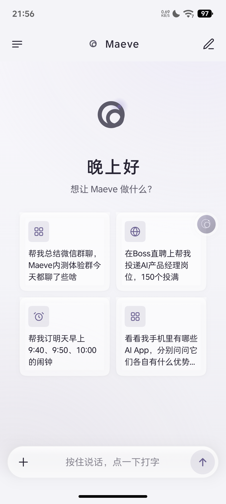
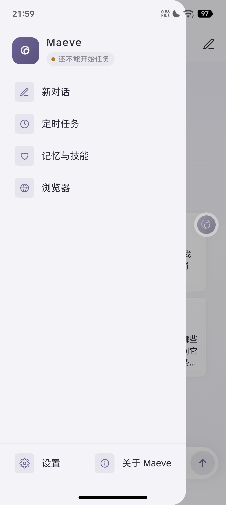
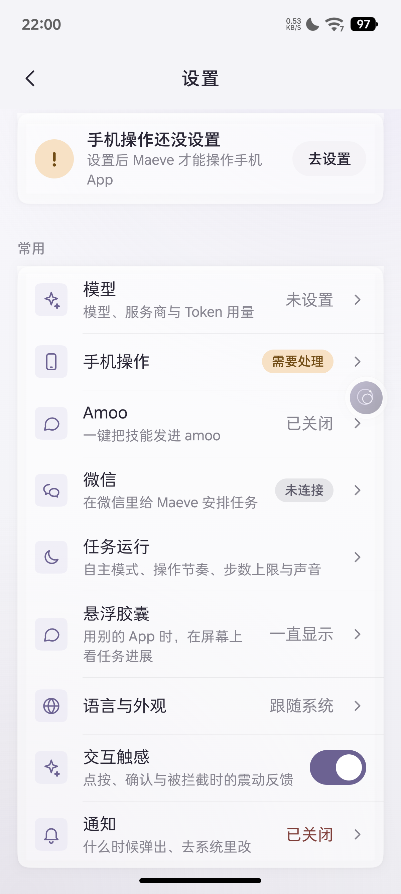
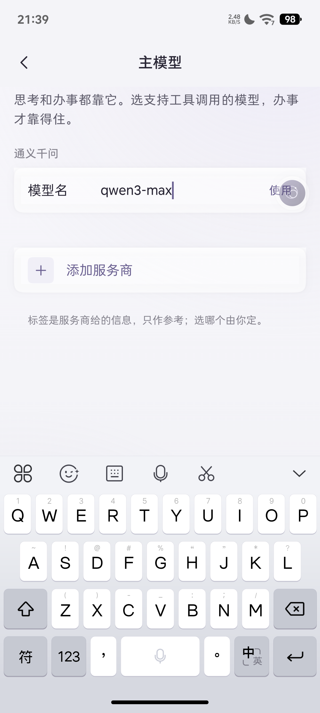
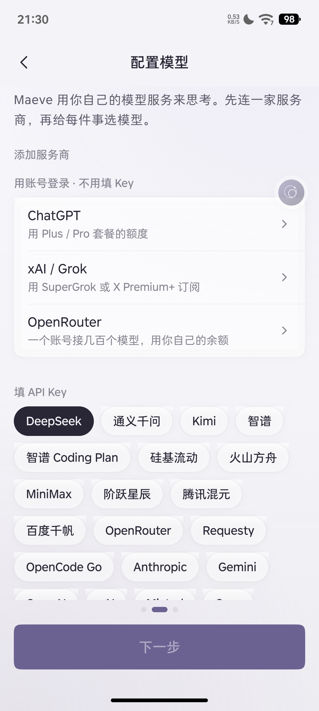
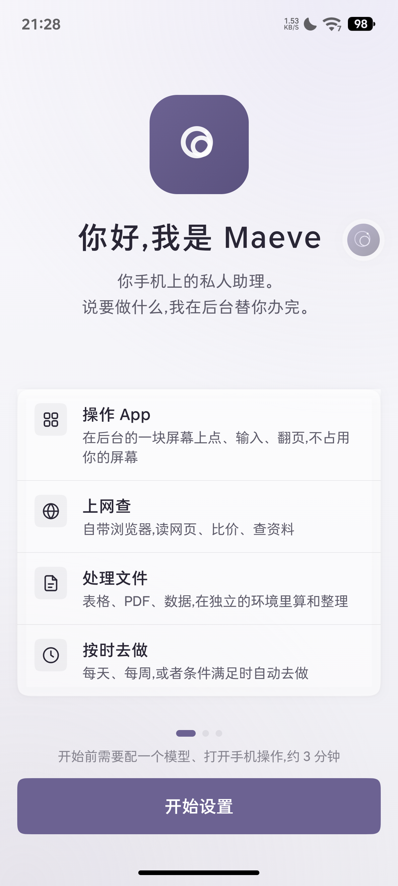

<!-- docs-check: spans-off — Historical Compose component names, some already removed -->
# Maeve UI/UX 重构说明 · v0.4「全站毛玻璃」

> **v0.4 是按用户明确要求做的方向反转。** v0.3 走的是「一个彩色 + 零投影 + 只留输入栏一处玻璃」,
> 理由是长文阅读不累眼。v0.4 的要求是**所有可见元素都是 iOS 毛玻璃**——那就把这套推到彻底,
> 不再两套体系混用。

## v0.4.1 玻璃是五层叠出来的

一片合格的毛玻璃不是「半透明白 + 模糊」,是五层:

```
 ⑤ 外投影      ← 只画在形状外部,内部不被弄脏(浮起来才有)
 ④ 内描边       ← 0.75dp 一圈,顶亮底暗(玻璃厚度)
 ③ 内高光       ← 顶边一道上白下透明的渐变(光打在玻璃边上)
 ② 半透明填充    ← 决定「实」的程度(0.58 → 0.74)
 ① 背景模糊      ← 真实采样背后内容,σ 12~30,带饱和度增益
```

① 是关键。只做「半透明白 + 描边」那是半透明塑料片;玻璃的定义是**背后的东西被模糊了才透过来**。
所以每一档都真实取样 `GlassBackdrop.live`(滚动内容)和 `.frost`(极光底),并按档位做高斯模糊。

取样必须**扣掉元素自身偏移**:玻璃看到的是「背后那块」,不是「屏幕左上角那块」,否则卡片一挪
位置,透出来的就是错位图案。

## v0.4.2 四档玻璃的参数

| 档位 | 用在哪 | σ | 白度 | 投影 |
|---|---|---|---|---|
| Chrome | 顶栏、输入栏、浏览器工具条 | 24 | 0.62 | 14dp |
| Sheet | 弹层、菜单、侧栏 | 30 | 0.74 | 22dp |
| Card | 设置卡、任务卡、审批卡、气泡 | 18 | 0.58 | 4dp |
| Pill | 状态胶囊、标签 | 12 | 0.62 | 0 |

## v0.4.3 关键实现选择:让「表面色」本身半透明

全站有 34 处 `Modifier.background(c.surface)` 这类直接铺底。逐个改成玻璃容器风险大、收益低。

**做法是让 `surface` / `surfaceHigh` / `surfaceHighest` / `surfaceLowest` / `fill` / 各种 `*Soft`
这些语义色本身带 alpha。** 它们在极光底上自动就是一层薄玻璃,不需要动调用点。
需要真正的模糊和内高光的大容器(卡片、气泡、按钮、抽屉项)再走 `cardSurface` / `glassFill`。

## v0.4.4 背景要有东西可透

毛玻璃需要有**东西可透**。背景若是纯色,玻璃模糊后还是那个纯色,只糊了一点,看不出是玻璃。
所以极光回来了:三团低饱和色斑(左上跟主题色、右上暖、下方冷),alpha 0.11~0.26。

它们不是装饰,是给玻璃折射提供原料。实测:屏幕四角分别是 `#EFE8ED`(偏梅子)、`#F2F0F1`、
`#E9ECEF`(偏冷蓝)、`#EBEDF0`——同一块玻璃在不同位置透出不同颜色,界面因此有空间深度。

## v0.4.5 两个踩过的坑

1. **太透等于没有层。** 卡片白度调到 0.46 时,卡片和背景只差 1.02:1,玻璃「看不见」,
   整屏像一片发白的水渍。稳定值在 0.58 左右。
2. **边是玻璃唯一「硬」的轮廓。** `glassEdge` 从 0.085 提到 0.16,`hairlineWidth` 从 0.5 提到 0.75dp。
   加深之前,玻璃只有填充和模糊,没有任何边界,读不出「这是一片薄片」。

## v0.4.6 对比度测试要按实际渲染算

表面色半透明之后,直接拿 Color 的 RGB 算对比度会得出荒谬结果——深色模式下 `surface` 是
白 6% 叠在黑底上,直接算 `ink/surface` 只有 1.12:1。

测试改成**先合成再算**:`over(fg, over(surface, bg))`。修完之后六套预设 × 浅深全部通过,
证明半透明表面上的文字对比度实际是达标的。

---

## v0.3「一个彩色」(以下为历史记录,视觉部分已被 v0.4 覆盖)

> **v0.3 是一次纠偏。** v0.2「纸与机器」自主设计了一套三色体系(梅子 / 冷青 / 琥珀)加暖纸底,
> 真机上一看:花、土、像半成品。v0.3 放弃自主设计,改成**照搬业界公开做得最好的那套**——
> Linear 的设计规矩,逐条落到代码里。

## 0. v0.3 借鉴了什么,从哪来

参考来源(公开可查):
- Linear 公开的 `DESIGN.md` 规格(shadcn.io 收录的 linear 设计系统)
- Linear 官方设计文章《A Linear spin on Liquid Glass》(linear.app/now)
- 《8 Best App UI Design Examples in 2026》对 Linear / Raycast / Apple Maps 的拆解
- 一篇 Agentic UI 设计指南点名了三个视觉参照:**Linear 的状态系统、Arc 的浏览状态、Anthropic 的 artifact 面板**

搬过来的**四条硬规矩**:

| # | 规矩 | Linear 的值 | 我们的落地 |
|---|---|---|---|
| 1 | **只有一个彩色** | `#5e6ad2`,只给品牌标 / 焦点环 / 每屏一个主按钮 | 全站彩色像素占比压到 **2.0%**,且其中大部分是正文墨色;真正的彩色只有标志和主按钮 |
| 2 | **表面阶梯代替阴影** | `#010102 → #0f1011 → #141516 → #18191a → #191a1b`,相邻差 4 个明度点;发丝线 `#23252a` | 五级表面 `bg/surfaceLowest/surface/surfaceHigh/surfaceHighest`,相邻差 4–6 点;**纸卡 projection 归零** |
| 3 | **展示字负字距** | 80px 上 −0.04em,16px 收到 0 | Display 30sp 用 −0.66sp(≈−0.022em),LargeTitle −0.48,Title −0.17 |
| 4 | **中性画布** | `#010102` 是"带一丝蓝的黑",不是纯黑 | 画布从暖黄 `#F6EFEA` 换成中性偏冷 `#F5F6F7`(OKLCH 色相 250°,彩度 0.0016) |

另外一条经验来自《8 Best App UI Design Examples》里 Moonlitt 那句:
**"让平台材质框住内容,永远不要盖住它"**——所以我们几乎不用玻璃,唯一保留的是输入栏。

## 0.1 上一版为什么丑(自我诊断)

| 症状 | 原因 |
|---|---|
| 花 | 三套语义轨(梅子/冷青/琥珀)外加暖纸底,四个色系同时争夺注意力 |
| 土 | 纸面色相 76°(偏黄),大面积铺开像旧报纸;而且中性色相**跟着强调色转**,换配色整屏偏色 |
| 吵 | 全站「等宽 + 大写 + 1.7sp 宽字距」微标签,到处都是重点 = 没有重点 |
| 假 | 每一层都加投影 + 顶边高光,玻璃叠玻璃,像 PPT 模板 |

v0.3 逐条反着做:一个彩色、中性画布、微标签退回小号中灰、零投影。

---

## v0.2「纸与机器」(以下为历史记录,部分已被 v0.3 覆盖)

> 本文讲**实现**:这套界面长什么样、为什么这样、代码在哪、怎么改、怎么验。
> 设计契约在 [visual-tokens.md](../spec/visual-tokens.md);可对照的静态说明书在
> [design/visual-system.html](../design/visual-system.html)(直接双击打开)。

## 0. 一句话

整套界面只有两种材质——**纸**和**仪表**。你跟 Maeve 说话的地方是温热的纸面,
她在那块你看不见的屏上干活的地方是冷青的诊断台。两个世界色相差 140°,
所以「谁在说话」一眼可辨,不用读字。

这次的重点不是换配色,而是**换语法**:上一版是「渐变 + 四档毛玻璃」,每张卡都在
毛玻璃上飘,读三段字眼睛就累;而且毛玻璃本身已经泛滥,谁都在做。这一版把玻璃
收回一处(输入栏),其余回到纸——纸是印刷品的材质,和《西部世界》真正的高级感同源。

## 1. 三条不变量

后续改任何界面,先过这三条:

1. **机器的状态用冷色,人的内容用墨色。** 步骤、耗时、token、工具名、版本号走
   `machine` 一族;标题、正文、说明走 `ink` 一族。
2. **琥珀只表示一件事:此刻需要你。** 不是装饰,不是强调,不用于「当前选中」之类
   的语义。一屏里同时出现两处琥珀就是 bug。
3. **层次靠材质与发丝线,不靠阴影。** 阴影只在真的浮起来时出现(输入栏、弹层)。

## 2. 文件地图

```
ui/theme/
  MaeveColors.kt      暖纸/烛夜双基底 + 诊断轨(machine/machineSoft/machineEdge/machineDim)+ 信号(signal/signalSoft)
  MaeveAccent.kt      六套暖色预设(梅子默认)+ OKLCH 推导 + 存储/广播
  MaeveOklch.kt       OKLCH 色彩科学(Ottosson 变换、对比度、gamut 压缩)
  MaeveSemantic.kt    语义色(成功/警告/危险/工具色调/身份色),与强调色无关
  MaeveType.kt        字阶;新增 Display / Script / Eyebrow / Mono / Numeral / Turn + eyebrowFor()
  MaeveShapes.kt      五档连续圆角(6/10/14/20/28)
  MaeveMotion.kt      动效阶梯(press 90 → sheet 380 → breath 2400)
  MaeveSurfaces.kt    四档表面:纸(卡/胶囊/弹层)+ 一处玻璃(输入栏);页面底=暖色竖向渐变
  MaeveMotifs.kt      ★ 新:MazeRing / PianoRoll / calibrationCorners / hairlineLattice
  MaeveMark.kt        品牌标志=圆形迷宫;圈数随尺寸自适应
  MaeveTheme.kt       MaeveTheme / surfaces / semantic / haptics 入口
  MikaCompat.kt       deprecated 别名层(MikaColors=MaeveColors …),旧代码零改动
ui/components/
  Controls.kt         开关、胶囊、按钮、分段、顶栏(含 eyebrow)、选择胶囊、微标签
  Rows.kt             分组标题(等宽大写)、列表行、行尾值(自动读数)、单选行、输入行
  Surfaces.kt         PageBackground→纸底;cardSurface→纸;GlassBar→唯一玻璃
  StepLine.kt         竖线步骤,点改方块、走诊断轨色
docs/design/visual-system.html   ★ 新:静态设计说明书(可对照的色卡、字阶、母题、核心页)
res/drawable/          maeve_launcher_foreground.xml = 108 网格迷宫螺线
```

## 3. 四个图形母题

母题不是装饰,每一个都对应界面里一件真事。这是这套设计「有特点」的全部来源。

### 3.1 迷宫环 `MazeRing` —— 替代全站所有转圈

一条从外向内收的阿基米德螺线,光点走在上面,走到中心 = 这件事办完了。

转圈只表达「在忙」,不表达**进展**;螺线天生有方向、有距离、有终点,而且和
「迷宫」这个意象直接对上。`Spinner()` 现在就是 `MazeRing` 的薄包装,所以对话页、
通知、小窗、配对页、文件查看页里「她在动」长得完全一样。

**圈数随半径走**(`outer/17` 夹在 1.2–2.25 之间):78dp 的标志盘 2.25 圈,好看且
有迷宫密度;13dp 的进度环若也盘 2.25 圈,线和线会糊成一个黑点,所以自动退化成
1.2 圈的简笔螺线,远看仍然是一个「有方向的圈」。

### 3.2 钢琴卷 `PianoRoll` —— 替代「正在思考…」

把「已经跑到第几步」画成一条卷带。每根音符条的高度由步号推出(`noteFraction`),
**固定不变**,所以来回滚动时卷带不会跳。看起来像谱子,读起来是进度。

状态:`Done`(冷青的 `machineDim`)/ `Active`(琥珀 `signal`,轻微呼吸)/ `Pending`(发丝线)
/ `Failed`(危险色)。按可用宽度均分,步数少时每根条不超过 3dp。

### 3.3 台词轨 `ScriptRail` —— 她的回答不套气泡

用户的话是梅子实底气泡(右下 4dp 尾角),她的话是左边一条 1dp 发丝轨 + 正文。
气泡是「消息」的语法,一来一往、左右对立;她的回答不是一条消息,是一段念白,
应该像剧本的一栏那样贴着左边站好。

实现是 `ChatScreen.answerSurface()`:一个 `drawBehind` 画 1dp 竖线,再让 15dp 的
左内边距。

### 3.4 校准角 `calibrationCorners` —— 这块是仪表,不是正文

四角各两笔直角,像仪表上的对位标记。目前用在设置页的总状态面板、自检、运行过程。
`hairlineLattice` 是它的加强版(极淡方格),留给大片空白的叶子面板。

## 4. 排版:两种字,三种声部

界面只装两种字体:**系统无衬线**说人话,**等宽**说机器话。

1. **等宽大写微标签**(`Eyebrow`)——`LOOP 03`、`CRADLE · RUNNING`、`12 STEPS`。
   字距拉到 1.7em 的百分之一量级、字号压到 10.5。这是整套设计最省力的记忆点:
   同一行文案套上这层壳,就从「正文」变成「读数」,不花一分钱字体授权,
   不增加一个字节包体。
2. **等宽读数**(`Mono` / `Numeral` / `Turn`)——耗时、步数、token、版本号、时间。
   数字一律 tabular(`fontFeatureSettings = "tnum"`),跳动时不左右抖。
3. **无衬线正文**——其余一切。

### 4.1 中文微标签会自动放大

拉丁文在 10.5sp + 宽字距下是漂亮的仪器印刷字;同样的字号套到汉字上就太小了——
汉字靠笔画密度辨识,10.5sp 时笔锋会糊。所以 `MaeveType.eyebrowFor(text)` 检查
有没有中文,含中文自动升到 11.5sp(字距收到 1.4)。

`GroupLabel` / `StatusPill` / `CapabilityTag` / 侧栏 `SectionLabel` 都走这条规则,
调用点不用自己判断。

### 4.2 行尾值自动变读数

`RowValue` 里一行判断:值里只要没有中文(码位 ≤ 0x2E80),就改用等宽。
版本号、模型名、地址、耗时这些短标识全都落在这一条规则里,**不需要每个调用点
自己声明**——这是「读数感」自动扩散到全站 40 多页的关键。

## 5. 顶栏的三层结构

```
        SETTINGS          ← eyebrow:等宽大写小字,给页面定性
        设置                ← title
      已连接 2 台电脑        ← subtitle(可选,状态行)
```

- 只有「眉标 + 标题 + 副标题」三层同时存在时顶栏才长高 8dp(56 → 64)。
  光是加眉标,在 56dp 里放得下,子页的内容留白不用跟着动——这一点很重要,
  它让「给 20 个页面加眉标」变成零风险改动。
- 默认是纸(不透明底);`glass = true` 时才取样背景模糊,只有浏览器那种整页被
  内容盖住的场景才需要。

## 6. 用户能摸到的变化

| 位置 | 变化 |
|---|---|
| 对话页空状态 | 108dp 呼吸迷宫 + 「从这里开始」分场表(等宽编号 + 一句人话 + 箭头) |
| 对话页进行中 | 冷青诊断条:`CRADLE · RUNNING` + 钢琴卷 + 当前步,替代「转圈 + 竖线」 |
| 对话页回答 | 不套气泡,左边一条发丝轨 |
| 对话页顶栏 | 眉标 `LOOP 03`(没有对话时 `READY`) |
| 需你处理 | 纸卡 + 左侧 3dp 琥珀实条 + `NEEDS YOU` 等宽标签 |
| 侧栏 | 段标题等宽大写;入口图标回中性;当前对话左侧一根梅子短竖线;时间等宽 |
| 欢迎页 | 书籍扉页版式:108dp 迷宫 + `MAEVE` 字距 6 的微标签 + 编号清单 |
| 设置首页 | 总状态改诊断面板:校准角 + `SYSTEM` / `READY` 读数 |
| 设置全部子页 | 顶栏眉标(`MODELS` / `PHONE` / `DIAGNOSTIC` / `APPEARANCE` …) |
| 设置 › 语言与外观 | 六套配色全部移到暖侧,默认梅子;桌面图标同步 |
| 所有列表 | 分组标题等宽大写;行尾值自动等宽;图标块回中性色(不再一排彩色方块) |
| 所有转圈 | 迷宫环 |
| 桌面图标 | 圆形迷宫螺线,和 App 内标志同一套几何 |

## 7. 怎么改

**加一套配色**:`AccentPreset` 里加一行(两颗种子 + tintChroma),测试会自动覆盖它
(`all presets light and dark pass contrast guards` 遍历 `entries`)。

**调纸面的暖度**:`MaevePalette` 里的 `PAPER_HUE`(默认 76°,偏黄绿的暖白)和
`blendHue` 的混合比例。改完跑对比度测试,明度不动所以对比度不会漂。

**调诊断轨**:`MACHINE_HUE`(203°,冷青)。诊断轨的色相**与强调色无关**——
换成什么主色,冷青还是冷青。

**加一个母题**:放进 `MaeveMotifs.kt`,并在这里和 `visual-system.html` 各记一笔。
母题必须对应一件真事,不接受纯装饰。

**换标志动画**:`MaeveMark(breathing = true)`;节奏在 `MaeveMotion.BreathMs`。

## 7.5 装机验收页

真机验收时很难把每个状态都凑齐(跑真任务要模型 + 手机权限),所以做了一个静态样板页:

```
adb shell am start -n com.daiyimo.maeve/.ui.MainActivity --ez visual_spec true
```

一屏里依次是:迷宫标志(96dp 加 5 档缩小)、两块诊断条(RUNNING / HOLDING)、
用户气泡 + 台词轨、NEEDS YOU 卡、带校准角的仪表卡、完整字阶。不连模型、不发请求、
不碰手机。实现在 `ui/VisualSpecScreen.kt`,入口只有这条 extra。

## 8. 验证

```
gradle :app:assembleDebug --offline            # 构建
gradle :app:testDebugUnitTest --offline        # 全量单测
```

- `MaevePaletteContrastTest`:六套预设 × 浅深的对比度守卫,含气泡色位与
  **新增的诊断轨 / 信号守卫**(`machine and signal tracks stay legible on their own surfaces`)。
- 浅色实测:ink/bg 14.36、ink2/bg 6.27、ink3/bg 3.22、machine/machineSoft 7.18、
  signal/bg 4.62。
- 全量单测失败 60 个,与重构前**逐条一致**(进程派生 / 沙箱文件系统在本机跑不了,
  与 UI 无关),**零新增失败**。
- **已在真机(PZ261A / Android 16 / 1200×2670 / 520dpi)上逐屏验收**:对话页空状态、
  侧栏、设置首页、外观页、NEEDS YOU 卡、视觉样板页。像素采样确认配色与设计值一致
  (纸面 #F6EFEA、诊断条 #E4F0F1、琥珀 #A5621A、梅子气泡 #653F56),
  迷宫极坐标扫描确认螺线连续盘到中心,钢琴卷三档状态(已弹过/正在弹/未到)都正确渲染。

### 装机时修掉的两个布局 bug

1. **顶栏吃掉整屏**(老 bug)。`TopBar` 内层用了 `fillMaxSize()`,而外层是 wrap-content,
   于是顶栏变成整屏高,那层不透明底色把下面所有内容盖住、内容被顶出屏幕。
   改成 `fillMaxWidth()`。**全站每一页都受影响**,不只是对话页。
2. **顶栏标题偏左。** 右边「新对话」按钮直接挤进 Row,标题是相对「剩余空间」居中而不是
   相对整条顶栏居中。改成左右各留一个固定宽的格子。

## 9. 兼容策略(给后续改代码的人)

- 新代码一律用 `MaeveColors` / `MaeveTheme` / `MaeveMotion` / `MaeveRadius` /
  `MaeveType`。
- `MikaCompat.kt` 的别名是**deprecated 的过渡层**,不是新 API;旧文件慢慢改,
  改一个删一个别名,全部清完把兼容层删掉。
- `cardSurface(tier = GlassTier.Card)` 现在画的是纸,不是玻璃。想加玻璃只有
  `GlassTier.Chrome` 一档,而且要有「浮在滚动内容上」这个理由才用。

---

# 附录 · v0.5 标志重做：日食

## 为什么推翻「圆环」

v0.4 的标志是一枚「开了门的环 + 三根拾音键」，之后的几轮修改（加粗扫痕、断环、
双弧、明暗环、光栅）都是在**同一个骨架上改细节**。反复验收的结论是：怎么改都不对。

原因不在做工，在骨架：

- **圆环是容器，不是事件。** 均粗的圆环是全世界 AI 产品都在用的首字图形，
  它只说明「这是个圆」。在它上面加粗、断开、渐变，读者记住的仍然是「一个圆」。
- **加宽段常常是硬切出来的。** 一旦它和环是两个独立图元，放大就有接缝和方角，
  像贴上去的一块。

## 设定出处

查《西部世界》第三季罗波安（Rehoboam）的原始视觉设定：

> 界面灵感是**日全食影像的黑白反向图像**，**由微粒组成**。
> 调用数据时的动画则是下沉的涟漪。

所以它不是环。**是一颗暗星盘挡住了后面的光源，只在边缘漏出一圈被侵蚀的光。**

## 三层物理关系（不是三个图层）

| 层 | 是什么 | 为什么 |
|---|---|---|
| **暗盘** | 中心不发光的圆 | 被挡住的光源 |
| **日冕** | 贴着暗盘的一圈光，厚度随角度变化 | 光绕过遮挡物的衍射。厚度差来自观测角度 |
| **微粒** | 日冕外缘逸散的砂点 | 设定原文「由微粒组成」。它是密度，不是描边 |

厚度差有物理理由，所以 16dp 时仍然成立：看到的是「一边厚一边薄的一圈」，不是一个圆。
最厚 / 最薄 ≈ 3.2 : 1（`CORONA_FLOOR = 0.26`）。

## ★ 坐标系陷阱（改这个标志前必读）

Compose 的 `Canvas` 是 **y 轴向下**，角度 0° 指向 3 点钟、顺时针增加。
所以「右上」是 **-32°**，写成 +32° 会跑到右下。

`MaeveMarkGeo.PEAK_ANGLE = -32f` 与 `res/drawable/maeve_launcher_foreground.xml`
的生成器**必须用同一个符号**。第一版两边都写了 +32，真机上最厚处落在右下，
与设计稿镜像相反。生成脚本在 `_eclipse_gen/build_mark.py`。

## 视觉参数（唯一的「设计旋钮」）

| 常量 | 值 | 作用 |
|---|---|---|
| `DARK` | 0.735 | 暗盘半径占可用半径 |
| `CORONA_INNER` | 0.0155 | 日冕贴盘处厚度（相对暗盘） |
| `CORONA_SPAN` | 0.168 | 最厚处的额外厚度 |
| `CORONA_FLOOR` | 0.26 | 最薄处占最厚的比例。再小，薄的那侧会断 |
| `PEAK_ANGLE` | -32° | 最厚处朝向（右上） |
| `PEAK_POWER` | 1.55 | 包络陡峭度。越大，厚段越集中 |
| `GRAINS` | 300 | 微粒基准数量，按 `size/100` 缩放 |
| `GRAIN_SEED` | 17 | 固定种子 → 每次启动砂粒位置一致，不会闪 |

## API 变更（已同步全部 7 个调用点）

```kotlin
// 旧
MaeveMark(size, ringColor = …, keyColor = …, strokeWidth = …)
// 新
MaeveMark(size, coronaColor = …, darkColor = …)
```

- `darkColor` **必须与所在背景一致**，否则暗盘会变成一个可见的实心圆。
  传 `Color.Transparent` 表示背景本身是透明的（胶囊、顶栏）。
- `drawMark` 的签名同步改为 `(corona, dark, state, phase, uid)`；
  `uid` 用于按尺寸缩放砂粒数量。
- `MaeveMarkTile` 现在把 `darkColor` 设为底色，所以印章里的暗盘是「挖空」的，不是盖住。

## 三态

| 状态 | 日冕 | 微粒 | 用在哪 |
|---|---|---|---|
| `Idle` | 静止 | 静止 | 桌面图标、顶栏、配色预览 |
| `Armed` | 缓慢呼吸（只改亮度不改形状） | 缓慢外逸 | 空状态、欢迎页、关于页 |
| `Playing` | 最厚处绕环一圈（2400ms） | 从流动位置喷出 | 胶囊运行中 |

## 验收记录

- 编译：`:app:assembleDebug` 通过。
- 真机（PZ261A / 1200×2670）：标志中心为空、右上最厚，与设计稿一致；
  修正 `PEAK_ANGLE` 符号后重装复验通过。
- 桌面图标：108 视口、暗盘 r=21.5、日冕最厚外径 54，落在中心 66 安全区内。
- 全量单测 1520 个、失败 59 个，**全部属于沙箱 / 文件系统 / 进程派生类**
  （`RootfsInstaller`、`WebDownloads`、`ProcLaunch`、临时目录路径），
  与 UI 无关，属本机既有基线；无新增失败。

---

# 附录 · v0.6 顶栏与空状态：把「状态机语言」换成「她会说的话」

## 问题

1. **主页面顶栏有个 `READY`。** 那是状态机术语，不是 Maeve 会说的话。
   它下面还压着「标志 + Maeve」和副标题，三层竖着堆在一个居中的窄列里，
   读起来像仪表盘掉了一颗螺丝。
2. **空状态写「想让 Maeve 做什么？」** 是功能型提示语。Maeve 不是客服。

## 文案

| 位置 | 旧 | 新 |
|---|---|---|
| 顶栏眉标（空对话） | `READY` | 我在听 / I'm listening |
| 顶栏眉标（有往来） | `LOOP 03` | 第 03 轮 / Round 03 |
| 空状态大字 | 想让 Maeve 做什么？ | 说事。剩下的我来。 |
| 输入框（有历史） | 继续说点什么… | 接着说… |
| 输入框（回答她） | 回答 Maeve 的问题 | 回她一句 |

顶栏眉标不再硬编码在 `ChatScreen`，改为 `ChatCopy.eyebrow(exchanges)`，可单测。

## 布局

- **对话页**（`brand = true`）：`日食字标 / 标题 / 一行状态`，顶栏高度 +18dp。
- **子页**（`brand = false`）：`眉标 / 标题`，**保持原样**——`MODELS`、`SETUP`、`BROWSER`
  这些分类标签不该掉到标题下面。
- 眉标与副标题**不同时出现**：有副标题时眉标让位（状态比分类重要）。

## 两个坑

1. **`MaeveMark` 会吃满行宽。** 它的 `Canvas(modifier.size(size))` 在 `Row`/`Column` 里
   默认撑满可用宽度，把整组内容推偏。加 `Modifier.wrapContentWidth()`。
2. **空状态原来有三层字**（MAEVE / 时段问候 / 提示），中间的「晚上好」把标题和正文隔开，
   读起来像两个不相干的东西。删掉时段问候，让大字直接承接字标；问候交给顶栏。
   `LocalTime` 那个 `hour` 也随之删除。

## i18n

新增 `chat_eyebrow_waiting` / `chat_eyebrow_round`，已补齐 **9 种语言**
（zh / zh-Hant / ar / es / in / ja / ko / pt / ru），占位符与英文一致。
`StringResourcesTest` 会校验键集合与参数，漏一个就红。

## 单测

`ChatCopyTest.placeholderFollowsTheComposer` 原先断言具体字句，文案一改就红。
改成断言**行为**：四个状态给出四种不同且非空的文案，Idle+历史 ≠ 空对话提示。
测试盯的是「状态串了没有」，不是某一句话。

全量 1520 个、失败 59 个，与 v0.5 基线一致（沙箱 / 文件系统 / 进程派生），无新增失败。

---

# 附录 · v0.7 侧栏质感重做（学 dsh-Go）

## 旧版的问题

1. **四个入口都有灰底方块**（`neutralSoft` + 7dp 圆角）。方块底会把每一行变成一个"按钮"，
   四个并排看像工具栏，而不是目录。
2. **当前对话用左侧一根 2.5dp 竖条标记**。竖条是"提醒你注意"，色块才是"这块就是当前的地方"。
3. **工具区与对话列表之间没有分隔**，八行东西连成一片。
4. 入口行高 52dp、图标 30dp 带底，整体偏重。

## 学到的四条（dsh-Go `session_tile.dart` / `sessions_drawer.dart`）

| 原则 | dsh-Go 的做法 | 这里怎么落 |
|---|---|---|
| **一个容器只留一个主操作** | 整个抽屉只有「新对话」是实色胶囊，其余全是线条和文字 | 顶部右侧 `NewChatPill`，`c.accent` 实底 |
| **选中态是柔和色块，不是标记** | `sessionSelectionColor`：primary × 0.09（浅）/0.18（深） | `c.accent × 0.10`，`animateFloatAsState` 淡入淡出 |
| **行高紧凑** | `SessionTile.height = 44.0` | 入口 52dp → 44dp |
| **裸图标，无底色** | 列表行只有文字和行尾标记 | 入口去掉 30dp 灰方块，直出 19dp 线条图标 |

## 改动清单

- `NewChatPill`：32dp 高、`CircleShape`、`wrapContentWidth`，图标 16dp + 文字 12.5sp。
  **★ `wrapContentWidth` 是必须的**——Row 在 Row 父级里会吃满剩余宽度，胶囊变成一条横贯色带。
- `NavEntry`：52dp → 44dp，去掉 `Box(30dp, neutralSoft)` 底，图标 16.5 → 19dp，间距 12 → 10dp。
- `ConversationEntry`：删掉左侧竖条 + `glassFill`，改成 `drawRoundRect(accent @ 0.10)`；
  `animateFloatAsState(MENU_IN_MS, FastOutSlowInEasing)` 做淡入淡出。
- 新增工具区与列表之间的 0.5dp 发丝线。
- 列表外包 `Box(weight(1f))`，为将来的边缘渐隐留位（当前列表为空时不启用）。

## 未完成

**边缘渐隐没生效。** 侧栏是玻璃材质，`c.glassSheet` 做渐变底色与真实背景
（实测 `#DDDCDD`）不匹配，叠上去反而更脏。要继续做得换成 `ShaderMask(BlendMode.DstIn)`，
或者在玻璃层上直接取 `chrome.fill`。列表为空时看不出差别，等有对话记录再处理。

全量 1520 个、失败 59 个，与基线一致。

---

# 附录 · v0.8 修三个真问题（闪退 / 侧栏宽度 / 白块）

## ① 点设置闪退 —— RenderThread 栈溢出

```
Fatal signal 11 (SIGSEGV), code 2 (SEGV_ACCERR) in tid (RenderThread)
Cause: stack pointer is not in a rw map; likely due to stack overflow.
#00..#204  libhwui.so  android::uirenderer::computeTransformImpl(...)
```

205 帧全在 `computeTransformImpl` 里自我递归。**不是 GPU 崩溃，是渲染树里有环。**

根因在 v0.4 做玻璃效果时引入的写法：

```kotlin
// 旧：取样垫自己的 layer 上挂模糊，layer 内部又去画 live 层
Box(modifier.graphicsLayer { renderEffect = BlurEffect(...) }
        .drawBehind { drawLayer(backdrop.frost); drawLayer(backdrop.live) })

// 旧：录制完立刻把同一层画回去 —— 图层把自己画进自己
.drawWithContent {
    backdrop.live.record { drawContent() }
    drawLayer(backdrop.live)
}
```

`live` 层是同一棵视图树里录制的，于是「玻璃画 live」与「live 属于玻璃」互相引用，
hwui 在算 transform 时顺着引用一路递归到栈溢出。

**先验证再修**：把 `GlassBlurSupported` 临时置 `false`，连点侧栏→设置 3 轮，
`Fatal signal` 计数 **0** —— 确认根因在模糊路径。

修复（三处一起改，缺一不可）：

1. `GlassSampler`：去掉 `renderEffect`，只 `clip`。
2. `cardSurface`：去掉外层 `graphicsLayer + BlurEffect`。
3. 模糊改在**录制端**：`live.renderEffect = BlurEffect(LIVE_SIGMA = 12f)`，
   `frost` 保持 18f。取样端只做平移绘制，是单向的，不成环。
4. `glassSource`：`drawContent()` 之后只 `record`，**不再 `drawLayer`**。

> ★ 去掉 `drawLayer(live)` 后主界面会变全灰 —— 因为 `record{}` 只把内容录进离屏层，
> 屏幕上一个像素都不会出现。必须在 `record` 之前显式补一次 `drawContent()`。
> 这一条我踩了一遍才反应过来。

## ② 侧栏占满整屏

```kotlin
// 旧
Modifier.fillMaxHeight().widthIn(max = DrawerWidth).fillMaxWidth()
```

`fillMaxWidth()` 在 `widthIn` 之后执行，会把宽度重新拉成父级最大值，**封顶直接失效**。
实测侧栏铺满 1200px 全屏。

改成 `Modifier.fillMaxHeight().width(DrawerWidth)`。
宽度同时从 304dp 收到 **272dp**（约 64%），右侧一定留得出主界面。

## ③ 历史记录是一块白色

v0.7 我给列表加了「上下边缘渐隐」，用 `c.glassSheet`（白色 0.74）做渐变底色，
还用了 `matchParentSize()` 铺满整个列表区。侧栏本身是暖纸色 `#F0ECF0`，
盖上去之后下半部分变成冷白 `#F4F5F6` —— 这就是那块白色。

已整块删除。真要做渐隐只能走 `ShaderMask(BlendMode.DstIn)`，不能盖实色。

## 验证

- 连续三轮「开侧栏 → 点设置 → 返回」，`Fatal signal` 计数 **0**
- 侧栏宽度实测 766px / 1200px ≈ 64%，右侧露出主界面
- 关闭侧栏后主界面完整（日食标志、标题、示例列表都在）
- 全量 1520 个、失败 59 个，与基线一致

## 教训

**「能用」不等于「没崩」。** 前几轮我每次都跑了编译和单测，却从没检查 logcat 里的
native crash —— 这个栈溢出从 18:19（v0.4 玻璃改造时）就在发生，一路带到了交付。
渲染类改动必须额外看 `Fatal signal` / `RenderThread`，单测和编译都发现不了。

---

# 附录 · v0.9 彻底关掉 renderEffect，并加真机冒烟

## 为什么 v0.8 没修干净

v0.8 只修了「玻璃取样」那一处环路，点设置不崩了，但**点关于还是崩**。
日志显示 `DirtyStack` 累积到 **512 帧**（hwui 的固定容量），`computeTransformImpl`
再往下就栈溢出。

真正的原因不是某一条环路，而是**全项目有 4 处把 `renderEffect` 挂在
「包含其它 layer 的内容层」上**：

| 位置 | 写法 | 结果 |
|---|---|---|
| `cardSurface` | `graphicsLayer { renderEffect = BlurEffect(...) }` 包整块玻璃 | 每帧往同一个 DirtyStack 累 |
| `GlassSampler` | 同上 | 同上 |
| `ModalNavigationDrawer` | 整个抽屉 + 主界面套一层 blur | 子树最大，累得最多 |
| `behindMenu` | 对话页内容层套 blur | 长按消息、开菜单时崩 |
| `voiceDim` | 内容层再叠一个 1.5dp blur | 语音时崩 |

内容层下面有大量开了 layer 的玻璃件，hwui 每帧都要把整棵子树记进
**同一个** DirtyStack，只增不减。攒到 512 就必崩 —— 这就是「有时点设置崩、
有时点关于崩、有时长按消息崩」的原因：**跟你点哪个入口没关系，跟攒够了没有有关系。**

## 处理

1. **`GlassBlurSupported = false`**（见 `Surfaces.kt` 里的长注释）。
   所有玻璃件走 fallback：半透明填充 + 顶边内高光 + 上亮下暗内描边。
   三层叠出来在浅色纸面上仍然读作玻璃，且零渲染风险。
2. 删掉 `GlassSampler` / `cardSurface` 里的 `renderEffect`。
3. 删掉 `ModalNavigationDrawer`、`behindMenu`、`voiceDim` 三处的 `renderEffect`，
   统一改成 **alpha 变暗**（视觉差别很小）。
4. `live` / `frost` 两个离屏层上的 `renderEffect` 保留 —— 它们只作用在自己的
   `GraphicsLayer` 上，不包裹其它 layer，是安全的。

> 要重新开启真模糊，必须换方案（自己维护模糊位图 / 系统级 backdrop blur），
> **不能**只把开关改回 true。改回后必须跑 `tooling/smoke.sh`。

## 侧栏宽度

固定 304düp → 自适应：

```kotlin
val screen = LocalConfiguration.current.screenWidthDp.dp
val width = minOf(244.dp, screen * 0.62f)
```

真机 1200px 下实测右边框在 x≈740，占 **61.7%**（原来是 100% 铺满）。

## 新增 `tooling/smoke.sh`

装包 → 冷启动 → 逐个走 6 个入口 → 统计 `Fatal signal`。
非 0 直接失败并打印最常见的根因。

```bash
export ADB=<platform-tools>/adb.exe
bash tooling/smoke.sh <设备序列号>
```

这次跑的结果：

```
主界面   Maeve
定时任务  定时任务需要「闹钟和提醒」权限
记忆与技能  记忆
浏览器   用必应搜索
设置   SYSTEM
关于   Maeve
✅ 冒烟通过：0 次 native crash
```

全量单测 1520 个、失败 59 个，与基线一致。

## 验收截图

以下截图来自 Compose 时期的重构验收，保留作对照。Flutter 外壳的截图在
[FLUTTER_MIGRATION.md](../../FLUTTER_MIGRATION.md)。

- 新对话：
- 侧栏：
- 设置：
- 运行过程：
- 选择器：
- 配置模型：
- 欢迎页：
