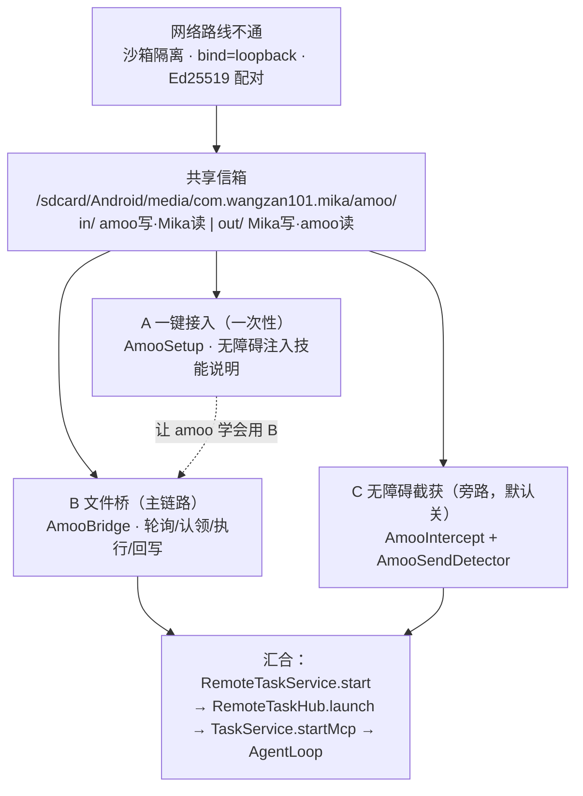
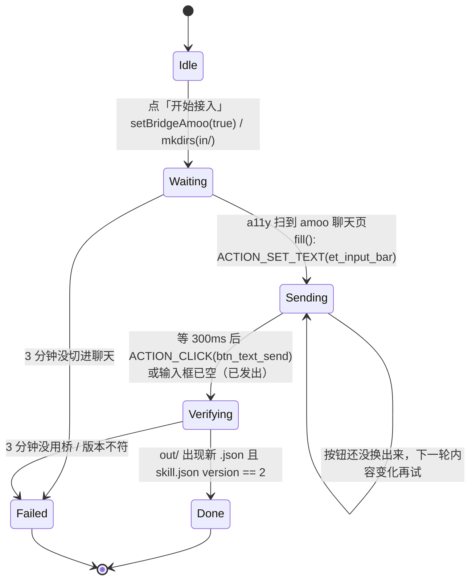
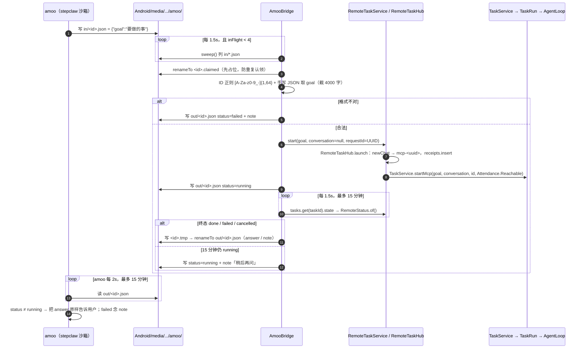
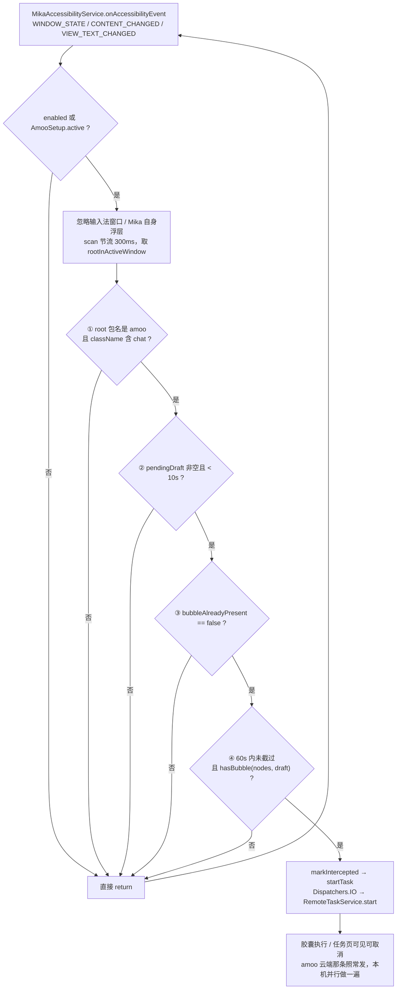
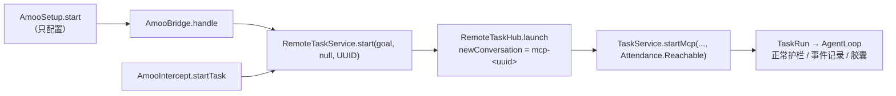

# Mika · amoo 链路实现流程图解

**整理日期**：2026-11-06 ｜ **代码基准**：`E:\project\daiyimo\Mika` @ `bbc8922`
**依据**：`app/src/main/java/com/wangzan101/mika/intercept/` 四个实现文件 + `docs/dev/amoo-bridge.md`、`amoo-intercept.md`、`amoo-connect.md` + 全部调用点回读
**说明**：本文的 Mermaid 源码可直接粘贴到支持 Mermaid 的编辑器 / 文档系统渲染；对话里另附了 4 张等效的纯 SVG 流程图。

---

## 0. 一句话

amoo 是 StepOS 的系统助手（`com.stepos.ailauncher`），跑在 stepclaw 的 OpenClaw 沙箱里。它**连不到手机上的 Mika HTTP/MCP 服务**，所以项目放弃网络，改用两端唯一都读得到的 `/sdcard/Android/media/<Mika包名>/amoo/` 目录当信箱；围绕这个信箱再配一条「用无障碍把技能说明打进 amoo 聊天」的一次性接入链路，以及一条早期遗留的「无障碍截获聊天消息」旁路。

## 1. 为什么不是网络（先理解这个，才看得懂后面所有设计）

`docs/dev/amoo-bridge.md:10-17` 的实测记录：

| 尝试 | 结果 |
|---|---|
| 沙箱 `curl http://127.0.0.1:18770/api/v1` | exit 7（连不上）；手机同一地址是 401/200 |
| 手机 `wlan0` 局域网地址 `10.x.x.x:18770` | exit 28（超时，路由丢包） |
| 手机可见的 `127.0.0.1:8765 / 18789 / 18791` | ClawX 从手机**单向前向**进沙箱，无反向通道 |
| 让 Mika 主动连网关 | `[ConfigGuard]` 强制 `gateway.bind=loopback`；握手要 Ed25519 设备密钥 + nonce 挑战 + `device.pair.approve` |

`docs/dev/amoo-connect.md` 是**更早一版**（配网关 MCP）的存档页，其中「amoo 的 VM 与手机共享 127.0.0.1」的假设后来被实测推翻；当前 `docs/dev/amoo-bridge.md:99-108` 明确说明 Amoo 页的连接状态卡已从「看电脑连接」改成「看文件桥」。读文档时注意这层演进，别把旧页当现状。

选目录也有讲究：`/sdcard/Android/data/<包名>/` 会被 scoped storage 对别的 App 隐藏成 `E_NOT_FOUND`，只有 `Android/media/` 双方都可读，且 Mika 是自己的目录属主、无需额外权限。

---

## 2. 三条路线总览

| 路线 | 触发 | 频率 | 开关 | 主要文件 |
|---|---|---|---|---|
| A 一键接入 | 用户在「设置 → 常用 → Amoo」点「开始接入」 | 一次（可重复覆盖升级） | 无开关，点按即启动；顺手 `setBridgeAmoo(true)` | `AmooSetup.kt` |
| B 文件桥 | amoo 技能写 `in/<id>.json` | 每任务一次，1.5s 轮询 | `FeatureFlags.bridge_amoo`（默认 false） | `AmooBridge.kt` |
| C 无障碍截获 | amoo 聊天页用户发出消息 | 每条消息 | `FeatureFlags.intercept_amoo`（默认 false，**界面已撤掉**） | `AmooIntercept.kt` / `AmooSendDetector.kt` |

> 三条路线**不是三选一**：A 是配置期（只跑一次，教 amoo 用 B），B 是运行期主链路，C 是 B 出现之前的历史方案，现在作为可选旁路保留。三者最终都汇到同一个 `RemoteTaskService`，不另造执行器。

---

## 3. 路线 A：一键接入（`AmooSetup.kt`）

### 3.1 状态机

### 3.2 为什么要绕这一圈

技能只能由 amoo 自己写进它的沙箱 `~/.openclaw/workspace/skills/`，Mika 没有那条路径；但 Mika 有无障碍服务，可以替用户把说明「打字 + 发送」进 amoo 聊天框，让 amoo 的模型自己装技能。聊天页 `ChatActivity` 未导出，Mika 拉不起来，所以 `Waiting` 阶段只能**等用户自己切过去**（`AmooSetup.kt:46-59`）。

`setupInstruction()`（`:195-211`）发给 amoo 的中文说明包含四件事：技能固定路径与 `version: 2`、整份覆盖禁止 `mika-bridge-2` 之类并存、哪些请求必须交给 Mika（任何屏幕内操作）、以及桥协议本身（写 `in/<ts>.json` → 每 2 秒读 `out/<ts>.json` → 最多等 15 分钟 → 把 `answer` 原样告诉用户）。装完立刻跑一次 `{"goal":"只回答三个字:你好呀"}` 作为试任务。

### 3.3 两个容易忽略的接线

- `AmooSetup.active`（`:38-39`）为 true 时，即使截获开关关着，`AmooIntercept.onAccessibilityEvent`（`:92`）也照收事件 —— 否则没人替我们填输入框。
- `AmooIntercept.handle()`（`:144-145`）在 `onAmooChat(root)` 返回 true 时**直接 return**，防止我们自己填进去的那段说明被当成用户消息误建任务。
- 验证只看 `out/`：`in/` 里的请求文件被桥领走后会删掉，经常看不到（`AmooSetup.kt:113-114`）。
- `SKILL_VERSION = 2`（`:180`）是契约版本；`skill.json` 版本对不上直接 `Failed`，避免「以为接好了其实跑的是旧技能」。

---

## 4. 路线 B：文件桥（`AmooBridge.kt`）—— 主运行链路

### 4.1 全链路时序

### 4.2 协议

| 项 | 约定 |
|---|---|
| 根目录 | `app.getExternalMediaDirs().firstOrNull()` + `amoo/`（`AmooBridge.kt:50-53`）；外部存储没挂上返回 null，不报错、下轮再试 |
| 请求 | `in/<id>.json` = `{"goal": "..."}`，`goal` 截 4000 字；`id` 必须匹配 `[A-Za-z0-9_-]{1,64}` |
| 结果 | `out/<id>.json` = `{id, task_id, status, answer, note}`（`:171-180`） |
| status | `running / done / failed / cancelled`，与 Mika `/api/v1` 任务接口同一套词，amoo 不用学第二套 |
| 认领 | `renameTo <id>.claimed` 占位后再读，读完删除文件（`in/` 里不残留） |
| 写回 | 先写 `<id>.tmp` 再 `renameTo` 原子替换；rename 失败才退化为直接覆盖写（`:135-147`） |
| 轮询/超时/并发 | `POLL_MS=1_500`、`WAIT_MS=15min`、`MAX_IN_FLIGHT=4`（`:154-156`） |

### 4.3 实现要点

- **不另造执行器**：`AmooBridge` 里 `private val tasks = RemoteTaskService(app.remoteTasks)`（`:35`），走的是与电脑 CLI / MCP `mika_run_task` 完全相同的底层路径（`RemoteTaskService.kt:35-44` → `RemoteTaskHub.kt:48-61` → `TaskService.startMcp`）。因此胶囊、任务页、取消、追问、运行记录全都自动具备。
- `conversation = null` ⇒ `RemoteTaskHub` 走 `newConversation()` 生成 `mcp-<uuid>`，**每个 amoo 请求一个独立对话**，多条并行互不干扰。
- 状态映射直接用 `RemoteStatus.of(TaskState)`（`core/remote/RemoteTasks.kt:45-74`），`finished()` 认 `done/failed/cancelled`；等待期间 `waiting_on_phone` / `waiting_for_answer` 等非终态继续轮询。
- **手写 JSON 解析**（`AmooBridge.kt:182-253`）：`jsonString()` 手写扫描而非正则，注释说明「goal 可能几千字，带分支的正则会在长串上把栈打爆」；`unescape` 支持 `\uXXXX`。只认平铺的 `{"goal":"..."}`，不引 JSON 库，这样单测不用碰 Android 的 `org.json`。
- 开关用 `callbackFlow` + `distinctUntilChanged()`（`FeatureFlags.kt:128-134`），`init` 里 collect → `start()/stop()` 立即生效，关着时完全不碰目录（`MikaApp.kt:350-351` 只触发一次 lazy 实例化）。
- `sweep()` 的异常被 `runCatching` 兜住并打一条 warn，轮询循环不会因单次 IO 错误退出（`:60-63`）。

### 4.4 真机踩过的两个坑（`docs/dev/amoo-bridge.md:49-55`）

1. **技能在会话启动时加载**：装完 `mika-bridge` 当前这轮对话看不到它，要**开新会话**才带上。
2. **轮询预算要给足**：第一次 amoo 4 分钟就放弃反问用户，而 Mika 跑完微信小程序约 6 分钟，结果晚到；把「每 2 秒读、最多 15 分钟、中途不要放弃」写死进技能说明后才稳定。

---

## 5. 路线 C：无障碍截获（`AmooIntercept.kt` + `AmooSendDetector.kt`）

### 5.1 判定流程

### 5.2 四层闸门（`docs/dev/amoo-intercept.md:26-30`）

| 闸门 | 实现 | 防的误判 |
|---|---|---|
| ① 前台 | `AmooSendDetector.isAmooChat()`：pkg 必须是 `com.stepos.ailauncher`，className 含 `chat`；className 未知才按包名兜底 | 设置页 / 搜索页被当成聊天；服务重连补记不能把已知非聊天页冲成兜底 |
| ② 草稿 | `noteInputText` + `pendingDraft(MAX_DRAFT_AGE_MS=10_000)` | 很久以前随手打过的字；AI 回复被当草稿（所以不跟踪 `TYPE_VIEW_TEXT_CHANGED`） |
| ③ 基线 | `AmooIntercept` 的 `baselineInput` / `bubbleAlreadyPresent`（`:150-156`） | 重打一句历史里说过的话（「继续」「好」）在点发送之前就误建任务 |
| ④ 去重+气泡 | `wasIntercepted(DEDUP_WINDOW_MS=60_000)` + `hasBubble(nodes, draft)` | 同一条气泡触发几十次窗口事件被一锅端；输入框自身文本被当成气泡 |

原则是**宁可漏，不可误建**：`docs/dev/amoo-intercept.md:139-148` 列了已知漏截场景（freeze 循环恰好在断开时发送、气泡文本被拆成多个 TextView / 富文本表情、同文本 60s 内重发）。

### 5.3 三个真机坑（同一文档 `:55-62`）

1. **StepOSFreeze 每 ~20s 断开重绑无障碍服务**，断期间窗口事件全丢 → `onServiceConnected` 必须主动读 `rootInActiveWindow` 补记前台；`scan` 里 root 包名是 amoo 时也自愈补记。
2. **输入法窗口会冲掉前台**：搜狗窗口 className 是 `android.inputmethodservice.SoftInputWindow`，不含常见 `InputMethod` 字样 → guard 同时匹配类名 `SoftInput` 和包名 `inputmethod`；Mika 自己的浮层窗口也一并忽略。
3. **amoo 输入框的无障碍特性**：class 是 `EditText` 但 `editable` 属性缺失（需类名兜底 `looksLikeInput`）；空态 `text` 返回 hint（必须过滤 `hintText`）；气泡认定要排除 `looksLikeInput` + `isFocused` 节点。

工程细节：`detector` 状态只在 `Dispatchers.Main.immediate` 读写（早期用 `Dispatchers.Default` 收开关 Flow，与主线程的 scan 并发改 `ArrayDeque`，是数据竞争）；`descendants(root)` 深度优先一次收集整棵树，输入框/回退/气泡共用，`finally` 里逐个 `recycle()`（minSdk 30 不回收会漏原生资源）。日志只打长度、不打用户输入原文。

---

## 6. 三条路线的汇合点与页面

- **页面**：`ui/AmooScreen.kt` 现在只剩两张卡 —— `AmooSetupCard`（一键接入 + 阶段文案）和「连接状态」（每 2s 读 `out/` 最新文件的 mtime，显示「文件桥没开 / 已开还没收到请求 / 最近一次请求 HH:mm:ss」）。**看的是文件桥，不是电脑连接**。
- **接线**：`MikaApp.kt:90-95` 三个 `by lazy`；`:350-351` 触发 `amooBridge` 实例化；`a11y/MikaAccessibilityService.kt` 把 `onServiceConnected` / `onAccessibilityEvent` 转给 `amooIntercept`。
- **开关**：`FeatureFlags.kt:98-134` 的 `intercept_amoo` / `bridge_amoo`，都是 `commit()` 写 SharedPreferences + `callbackFlow` 广播，`distinctUntilChanged()`。截获开关界面已撤掉，只能改 `feature_flags.xml` 或调 `setInterceptAmoo`。
- **测试**：`app/src/test/.../intercept/` 有 `AmooBridgeProtocolTest`、`AmooSendDetectorTest`（18 个用例）、`AmooSetupTest`；`docs/dev/amoo-intercept.md:64-91` 有真机 E2E 记录（logcat + `mika_list_tasks` 对账）。

---

## 7. 边界与风险（review 视角）

| 项 | 说明 |
|---|---|
| 明文信箱 | `in/` `out/` 全是明文，任何能读 `/sdcard/Android/media` 的 App 都能看；文档明说「不要往里放密钥」（`amoo-bridge.md:63`）。goal 与 answer 可能含用户隐私 |
| 权限等价 | amoo 写进来的 `goal` 会当成 Mika 的正常任务执行 —— 等于把「让它动手机」的权限交给 amoo（`amoo-bridge.md:64-65`）。仅在信任的 amoo 会话里用 |
| 硬耦合 | `AmooSetup` 把 `com.stepos.ailauncher:id/et_input_bar` / `btn_text_send` 写死；只对同一套 system app / 同版本 ROM 成立，换机型要重核 |
| 云端双跑 | 路线 C 不拦 amoo 发往 AgentBus 云端的消息，是「本机并行做一遍」，云端仍会执行一次；无法改路由（系统签名 + 无 root） |
| 漏截可接受 | freeze 每 ~20s 断连、气泡拆 TextView、60s 去重窗口，都会漏；设计上明确「宁可漏，不可误建」 |
| 15 分钟上限 | `AmooBridge.WAIT_MS` 与技能说明里的「最多等 15 分钟」必须一致；超时只写 running + note，任务本身继续跑，amoo 需自己再问 |
| 版本契约 | 改技能口径或桥协议要 `SKILL_VERSION + 1`，否则老用户点了「开始接入」也不会覆盖升级 |
| 页面一致性 | `docs/dev/amoo-connect.md` 是旧版（网关 MCP）存档，与现状冲突；以 `amoo-bridge.md` + 代码为准 |

---

## 8. 关键文件速查

| 文件（相对 `E:\project\daiyimo\Mika\`） | 职责 |
|---|---|
| `app/src/main/java/com/wangzan101/mika/intercept/AmooBridge.kt` | 文件桥：轮询、认领、起任务、状态轮询、原子写回、手写 JSON |
| `app/src/main/java/com/wangzan101/mika/intercept/AmooSetup.kt` | 一键接入状态机、`setupInstruction()`、技能版本校验 |
| `app/src/main/java/com/wangzan101/mika/intercept/AmooIntercept.kt` | 无障碍事件 glue、读树、基线判定、命中起任务 |
| `app/src/main/java/com/wangzan101/mika/intercept/AmooSendDetector.kt` | 纯 Kotlin 状态机（前台 / 草稿 / 去重），零 Android 依赖 |
| `app/src/main/java/com/wangzan101/mika/a11y/MikaAccessibilityService.kt` | 无障碍服务入口，转发事件与重连补记 |
| `app/src/main/java/com/wangzan101/mika/settings/FeatureFlags.kt` | `bridge_amoo` / `intercept_amoo` 开关与 Flow |
| `app/src/main/java/com/wangzan101/mika/ui/AmooScreen.kt` | 设置页两张卡：一键接入 / 文件桥状态 |
| `core/.../core/remote/RemoteTaskService.kt`、`RemoteTasks.kt` | 复用的远程任务用例与 `RemoteStatus` 状态映射 |
| `app/src/main/java/com/wangzan101/mika/task/RemoteTaskHub.kt` | `launch()`：newChat、收据落账、`TaskService.startMcp` |
| `docs/dev/amoo-bridge.md` / `amoo-intercept.md` / `amoo-connect.md` | 现状协议 / 截获 Spec 与真机验证 / 旧版连接页存档 |
