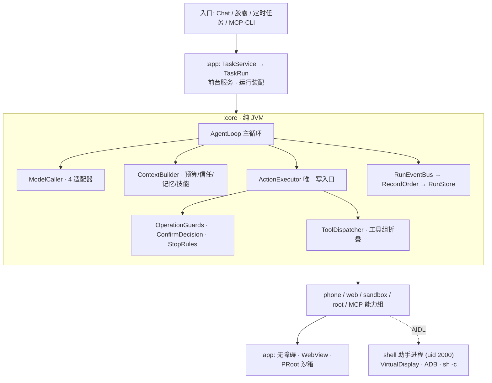

# Mika 源码深度分析与 Code Review

**审阅对象**：`E:\project\daiyimo\Mika`
**版本基准**：commit `bbc8922`（2026-11-05 23:39 +0800，「点击三层视觉闭环」），`origin = https://github.com/Daiyimo/Mika.git`，工作区干净
**审阅方式**：静态源码审计（架构 / 安全 / 并发 / 工程化四路交叉勘查 + 关键结论逐条回读复核），**未编译、未运行、未做动态验证**
**报告日期**：2026-11-06

---

## 0. 一句话结论

这是我看过的端侧 Agent 里工程规范度相当高的一档：**纯 JVM core / Android app 单向依赖、单一动作执行入口、系统化脱敏、Keystore 加密、SSRF 逐跳校验、事件溯源**，明显是长期迭代的生产级代码，不是 demo。

它的问题不在「常见反模式」（GlobalScope、awaitClose 缺失、CancellationException 被吞、资源不关、明文密钥 —— 这些基本都不存在），而集中在三类：

1. **少数 fire-and-forget 的裸 `CoroutineScope` 与「错误被降级成静默成功」**（录音线程挂死、删了又回来、配置静默丢失、MCP 请求卡到超时）；
2. **能力本身的权限面**：模型输出可驱动 `shell(uid 2000)` + 无障碍全屏 + PRoot 沙箱，提示注入的影响半径接近设备接管；
3. **若干刻意放宽但边界过宽的配置**（全局明文 HTTP、生产常开 WebView 调试、无障碍默认全放行）与**超大类/手写 DI 双轨**带来的长期维护成本。

> 评级说明：下文把「确证缺陷」「安全/配置风险」「工程化权衡」**分开列**，不把设计选择当 bug，也不把「有补偿控制的协议约束」渲染成漏洞。

---

## 1. 项目画像

| 项 | 值 |
|---|---|
| 规模 | 约 1455 个源码文件，Kotlin 约 1401 个；`app` + `core` 合计约 **205,388 行**（含测试） |
| 主源码 | `core/src/main` 388 个 `.kt`、`app/src/main` 355 个 `.kt`；测试 544 个 JVM + 110 个 androidTest |
| 模块 | `:core` = `kotlin.jvm`（纯 JVM，`java-test-fixtures`）、`:app` = `com.android.application`；`app/build.gradle.kts:84` 单向依赖 core |
| 边界验证 | 全量搜索 `core/src/main` 的 `import android|androidx|com.android|dalvik` → **零命中**；搜索 core 反向 import app 包 → **零命中** |
| 版本 | Kotlin 2.1.20 / AGP 8.7.3 / Compose BOM 2024.12.01 / OkHttp 4.12.0 / coroutines 1.10.2 / Java 17 |
| Android | `minSdk 30`、`targetSdk 35`、`compileSdk 36`、`versionName 0.1.37`、`versionCode 38` |
| DI | 无 Hilt/Koin/Dagger（`grep` 零命中），手写 `MikaApp` + 8 个 `Owner` 接口 + 40 个 `by lazy` |
| 导航 | 单 Activity + 手写 `NavStack` + `when(nav.current)`，未用 Jetpack Navigation |
| CI | `.github/workflows/ci.yml` 只跑 `:core:test`、`cliTest`、`:app:testDebugUnitTest + assembleDebug`、`relayTest`；文件头注释明确「发布（CD）仍是手工流程」 |

产品定位（README）：在手机上的**隐藏后台屏**里代替用户操作任意 App / 网页，主屏照常使用；无自有服务端，模型 Key 由用户自备。

---

## 2. 架构深度解析

### 2.1 分层与依赖方向



最巧妙的一点是**双进程 + 虚拟屏**：普通 App 拿不到跨屏启动/注入能力，项目用 `app_process` 以 `shell(uid 2000)` 起一个助手进程（`HelperProcess.kt:27-63`），经 `IMikaShell.aidl` 的 49 个编号方法暴露 `createDisplay` / `injectTap` / `injectStroke` / `runSystemCommand` / `openDevtoolsSocket`。交接走 `HelperHandoffProvider`，逐项核对 `uid / pid / APK 路径 / 签名指纹 / 一次性 nonce`（`HelperHub.kt:70-94`），启动命令参数单引号转义且口令走 stdin 避开 `/proc/<pid>/cmdline`（`HelperHandoff.kt:42-56`）。这套实现的工程完成度很高。

虚拟屏用 `DisplayManager.createVirtualDisplay`（`ShellService.kt:94-123`），Android 14+ 且 trusted 时加 `FLAG_OWN_FOCUS | FLAG_STEAL_TOP_FOCUS_DISABLED`（`:1635-1647`），这是「后台屏不抢主屏输入焦点」的关键；画面经 `ImageReader` 限速 ≤10 FPS 取帧（`AgentDisplay.kt:62-76`），不受防截屏标记限制。

### 2.2 一次任务的执行链路

```
ChatViewModel.send (:658) → TaskActions.start → TaskService.start (:939，startForegroundService)
→ onStartCommand → TaskCenter<TaskRun> → TaskRun.execute (:494，单函数约 545 行)
→ RunSpec + toolDispatcher (:802) + AgentLoop (:841) → agent.run (:985)
```

`AgentLoop.loop`（`core/agent/AgentLoop.kt:327-714`，约 390 行）每步固定做 7 件事：

1. `appendSteers` 注入用户插话（跑任务时可继续说话纠正）；
2. `TurnPolicy.beforeStep` 中途自查提醒；
3. `appendRuntimeState` 追加当前 App/站点、第几步、本地时间；
4. `_state.value = TaskState.Running(step, note)` 发布状态；
5. `refreshOffer()` 在展开新工具组时重拼系统提示词并 emit `PromptVersion`；
6. `routedOrRedirect` 调模型（大模型/轻量模型按 `SpeedFlags` 分工，用 `select { pending.onAwait / inbox.redirects.onReceive }` 支持**在途请求被打断**）；
7. 取 `calls.first()` 经 `ActionExecutor` 执行，`StopRules` / `OperationGuards` 判定结局。

**工具注册**是三层折叠：`TaskTools.toolDispatcher()` 收集能力 provider → `RunAssembler.assemble` 按 `capabilities/readOnly/attendance` 过滤 → `ToolGroups.layout` 把不常用组收成「入口工具」，用到才 expand。这是控制 token 成本的正确做法。

**上下文**由 `ContextBuilder` 统一封装（`:247-249`）：
```kotlin
fun envelope(kind: ContextKind, source: String, body: String): String =
    "$OPEN${kind.wire}\" source=\"${attr(source)}\" trust=\"${kind.trust.label}\">\n" + ...
```
每段都带 `source` 与 `trust` 标签 —— 对**不可信的网页/UI 文本做显式信任标注**，是抗提示注入的正确基础设施。`ContextBudget` 给总量 8000 / Task 4000 / Knowledge 5000 / 单条知识 2000 的硬预算；记忆走 `MemoryContext`（≤4000 token 全量注入以命中前缀缓存，超了退回 800 token 检索）；知识用**确定性字符串匹配**不调模型（`KnowledgeStore.matchTask`）；个人技能经 `SkillDrafter` 起草，送出前和收回后各脱敏一次，再做敏感词过滤与工具白名单校验（`SkillDrafter.kt:186-208`）。

**可中断性**是另一处亮点：`RunInbox` 的 `redirects` 是 `CONFLATED Channel`，`SteerSignal` 让「停留/等待」类挂起可被插话抢先返回，`UserExchange` 用 `CompletableDeferred` 管追问/确认/交回（15 分钟超时），`RunRecovery` 负责进程被杀后标记中断并补送。

### 2.3 安全护栏：单一入口 + 三层判定

`ActionExecutor.run`（`core/action/ActionExecutor.kt:73-184`）是**所有改变外部世界的动作唯一执行入口**，顺序固定：

> 操作守卫 → 锁屏/被拿走的 gate → `ConfirmDecision.judge` 不可逆判定与同意核对 → 执行 → 守卫复核 → 运行记录

关键设计：`RunProvenance`（origin = Ui/Channel/Trigger/Mcp/Child，attendance = Present/Reachable/Unattended）参与决策；`ApprovalPolicy.decide` 对 `origin != Ui` 或无人值守**一律 Deny**；`ConfirmationGate` 是**一次性**、绑定前台 App / 内容 / 金额 / step 过期，且 `pay` 永不在此放行，直接要求用户接管（`ConfirmationGate.kt:48-53, 77-89`）；通知里的 approve 按钮在 Android 12+ 要求锁屏认证、可见性 PRIVATE。网页脚本工具（写）也把每个动作回流到这个入口（`WebScriptTool.kt:22-29`），没有另开后门。

敏感界面：`ScreenDiagnosis.classify` 检测 captcha / 支付字样 / 密码框 / 验证码 / 防截屏黑帧并转 `NEEDS_HUMAN`；密码框不读文本、Mika 自身界面不截图、分享给模型前要用户浮层同意。

### 2.4 能力层要点

- **UI 树**：递归 `AccessibilityNodeInfo` → `UiElement`，坐标归一到 0–999，渲染成 `@e3 button "搜索" (500,50)` 一行一元素（`ScreenText.kt:10-32`），OCR 只补树里缺的字并主动避开 secret 区域。
- **点击降级链**：无障碍 `ACTION_CLICK` → `dispatchGesture` 定向虚拟屏 → shell helper 一笔 `injectStroke` → `input -d <id> tap`（`AndroidScreen.kt:1714-1731`）。动作后用 `ChangeWait` 等界面安静/树指纹/画面稳定，硬上限 2500ms。
- **Web**：主 WebView 关 file/content access、禁混合内容、开 Safe Browsing、禁第三方 Cookie、禁自动开窗、生产无 `addJavascriptInterface`；CDP 经抽象 LocalSocket 或 helper relay 驱动页面；下载有逐跳地址校验 + DNS 重绑定防护（`guardedDns` 连解析结果都查）+ 大小/数量/总字节上限，是教科书级 SSRF 防护。
- **沙箱**：PRoot（ptrace 用户态）跑 arm64 rootfs，绑工作区与 skills，`SandboxPaths` 做 `..` 规范化 + 逐段符号链接检查 + `canonicalFile` 落根校验。

---

## 3. Review：确证缺陷（Bug）

> 全部已回读源码复核。路径为相对 `E:\project\daiyimo\Mika\`。

### P0-1 录音读循环用错 `isActive` + `stop()` 用 `runBlocking`，可能永久挂死
`app/src/main/java/com/wangzan101/mika/voice/PcmRecorder.kt:83,121-129`
```kotlin
while (scope.isActive) {                    // 检查的是进程级 scope，恒为 true
    val n = rec.read(buf, 0, chunk)         // 阻塞式硬件读
```
```kotlin
if (rec != null) runBlocking { j?.join() } // 生产代码唯一 runBlocking；stop() 不 cancel job
```
`stop()` 只 `release(rec)` 不取消 job，循环退出全靠 `AudioRecord.read()` 在 release 后返回负值；部分厂商实现不唤醒阻塞读。后果：协程内阻塞一个 IO 线程、麦克风句柄不释放、后续语音任务饿死；`cancel()` 也因循环条件检查的是父 scope 而退不干净。
**修复**：`stop()` 改 suspend、循环改 `currentCoroutineContext().isActive`、`j?.cancelAndJoin()`，删掉 `runBlocking`。

### P0-2 删除对话双层空 catch → 「删了又回来」且错误完全不可见
`app/.../ui/ChatViewModel.kt:1097-1103`、`app/.../chat/ConversationDeleter.kt:45-48`（全项目仅这 2 处空 catch）
```kotlin
_deleted.update { it + id }               // UI 立刻移除
try { removeConversation(id) } catch (e: CancellationException) { throw e } catch (e: Exception) { }
```
删除失败时 `_deleted` 不回滚、无提示、无重试；对话记录删了但工作区文件残留成孤儿数据。
**修复**：catch 里回滚 `_deleted`，用 `SharedFlow<String>` 把失败送到 SnackBar；`ConversationDeleter` 至少 `Log.w` 并返回 `DeleteImpact`。

### P0-3 `ProviderStore.configOf` 的 `!!` 把「配置损坏」变成静默丢配置
`app/.../settings/ProviderStore.kt:834,959-971,995`
```kotlin
_configs.value = root["providers"]?.jsonArray?.mapNotNull { runCatching { configOf(it.jsonObject) }.getOrNull() }.orEmpty()
...
toolCalls = o["toolCalls"]!!.jsonPrimitive.boolean      // 缺字段/类型变化即抛
private fun JsonObject.str(k: String) = this[k]!!.jsonPrimitive.content
```
升级后旧 `providers.json` 少字段、或文件写一半 → 异常被 `getOrNull()` 吞成 null → `mapNotNull` **整条服务商配置静默丢弃**，下次 `writeConfig()` 回写永久丢失。用户感知「配好的模型不见了」。
**修复**：逐字段 `booleanOrNull/intOrNull ?: 默认值`、`valueOf` 改安全查找、丢弃时 `Log.w` 且备份 `.broken`。

### P1-1 `MemoryRuntime.items()` 每次调用泄漏一个永不结束的 collect
`app/.../memory/MemoryRuntime.kt:53,70-74`
```kotlin
fun items(): StateFlow<List<MemoryItem>> {
    val out = MutableStateFlow(emptyList())
    scope.launch(Dispatchers.IO) { runCatching { store() }.getOrNull()?.items?.collect { out.value = it } }
```
`scope` 是进程级永不取消，每次调用（Composable 重组、配置变更）都新建 Flow + 无限 collect。附带：`runCatching{}.getOrNull()` 把**解密/读盘失败变成永久空列表且零提示**。
**修复**：缓存单个 `stateIn(scope, WhileSubscribed(5_000), emptyList())`，另暴露 `error` 流。

### P1-2 `PdfDoc.close()` / `NetworkTracker.close()` 的裸作用域
`app/.../ui/viewer/FileViewerScreen.kt:272-292`、`app/.../cap/web/cdp/NetworkTracker.kt:118-126`
```kotlin
fun close() { CoroutineScope(Dispatchers.IO).launch { lock.withLock { renderer.close(); fd.close() } } }
...
fun close() { if (!scope.isActive) return          // 重复调用直接跳过清理
    CoroutineScope(Dispatchers.IO).launch { ... s.send("Network.disable") } }
```
`produceState` 的 `finally` 在协程已取消时执行，却 fire-and-forget 一个无引用新作用域，靠 `lock` 等正在 render 的协程 —— 若 render 挂起，`PdfRenderer` + `ParcelFileDescriptor` 永不关闭，反复进出 PDF 会耗尽 FD。`NetworkTracker` 重复 close 会跳过 `Network.disable` 并残留订阅。
**修复**：`suspend close()` + `withContext(NonCancellable)` 同步关；`close()` 幂等 guard 并把 `scope.cancel()` 放发送之后。

### P1-3 MCP 的 SSE 半包与坏消息静默丢弃，请求卡到超时
`core/.../cap/mcp/HttpMcpClient.kt:151-172`、`core/.../cap/mcp/LegacySseMcpClient.kt:248-260`
```kotlin
return client.newCall(request).awaitBody(timeoutSec) { response ->
    RawResponse(response.code, response.header("Mcp-Session-Id"), response.body?.string().orEmpty()) }
...
runCatching { json.parseToJsonElement(data.toString()) as? JsonObject }.getOrNull()?.let(out::add)
```
前者一次性 `body.string()`，末帧不完整/心跳注释 → 解析失败即丢；后者坏 JSON 或 `id` 非数字时两个 `?: return` 直接放弃，`pending[id]` 的 `CompletableDeferred` **永不 complete**，请求只能等满 `timeoutSec`。用户感知「MCP 工具卡住」而非报错。
**修复**：失败时抛 `McpClientException` 触发重试、`completeExceptionally` 通知 pending、流式 `readUtf8Line` 处理末帧。

### P1-4 69 处 `collectAsState()`，零生命周期感知收集
`app/src/main` 共 69 处 `collectAsState(`（26 个文件），全仓库 `collectAsStateWithLifecycle` / `repeatOnLifecycle` / `lifecycle-runtime-compose` **零命中**（已 grep 复核）。Activity 进 STOPPED 后 Composition 仍 active，热流持续收集与重组（`ChatViewModel` 里会 map 整条 exchanges 列表），后台耗电且触发后台 UI 更新。
**修复**：加 `lifecycle-runtime-compose` 依赖并机械替换；无限流的副作用收集统一 `repeatOnLifecycle(STARTED)`。顺带 `SettingsScreen.kt:135` 的 `bridgeOn` 用 `remember` 而非 `rememberSaveable`，配置变更会回退。

### P2-1 取消与日志
- `app/.../task/TriggerRuntime.kt:282-291`：`catch (e: Exception)` 会吞 `CancellationException`，且 `CoroutineScope(Dispatchers.IO)` 无 SupervisorJob / 无引用。
- `app/.../record/RunStore.kt:291-296`：`catch (e: Throwable)` 连 `Error` 都吞，日志本身再套 `runCatching`，写盘失败静默降级。
- `core/.../model/HttpSupport.kt:140-148`：`cont` 已非 active 时异常完全消失，真流错误与取消无法区分。
- `app/.../cap/web/WebTab.kt:342,382,396`、`ShellService.kt:1544-1556`：直接 `Log.i` 打印 URL 前 80 字符 / 整条 argv，URL 可能带 OAuth `code`/`state`/`token`，与项目自身「OAuth code 一律打码」的策略不一致；统一走 `Redactor.network()` 或只记 host。

---

## 4. Review：安全与配置风险

### S-0（最高）提示注入 → shell(uid 2000) + 无障碍全屏
`app/.../cap/phone/shell/ShellService.kt:1382-1417`
```kotlin
override fun runCommand(command: String): Bundle = exec(command, null)
private fun exec(command: String, displayId: Int?): Bundle {
    ProcessBuilder("/system/bin/sh", "-c", command).redirectErrorStream(true) ...
```
这不是命令注入漏洞 —— `command` 设计上就是模型给的完整命令，**且未发现字符串拼接注入**（固定命令一律 `ProcessBuilder(vararg)` 数组参数）。真正的风险是**权限边界**：`uid 2000` 可执行 `content query` / `pm` / `am` / `input` / `dumpsys`、读其他 App 的 ContentProvider 与 `/sdcard`、对任意 App 注入输入。`onTransact` 的 `getCallingUid()` 校验防的是外部 App，**防不住被网页/通知/OCR 文本劫持的模型输出**。现有护栏只覆盖结构化工具动作（付款确认门），`phone_command` 里的任意命令不逐条过门，只有 `Redactor` 事后打码记录。
**建议**：对 shell 命令分级确认或引入只读/可写白名单，重点管 `content`、`pm`、`am`、`run-as`、向私有目录 `cp/cat` 的组合；把 `AppAccess.denial` 的「不得用 shell 绕过」从提示词约束升级为代码约束。

### S-1 PRoot 沙箱不是 OS 级安全边界
`app/.../cap/sandbox/ProcRunner.kt:27-39` 把 `/proc`、`/sys` 整体 bind 进容器；PRoot 靠 ptrace 重写路径，不是 seccomp / 独立 uid / namespace。容器内跑模型生成的 shell/Python/原生代码，理论上可绕过路径重写或借 `/proc/<宿主 pid>/...` 探测宿主；`MIKA_TOKEN`（32 字节桥令牌）也能被容器内任意进程读取。项目自身在 `AndroidSandbox.kt:183-188` 对「网络隔离不可用」直接拒绝运行，说明没把它当强边界 —— 这点值得肯定，但应在文档里明说「沙箱仅隔离路径、不隔离能力」，并考虑收窄 `-b /proc`、`-b /sys`。

### S-2 全局明文 HTTP（有意设计，但边界过宽）
`app/src/main/res/xml/network_security_config.xml:7-13`
```xml
<base-config cleartextTrafficPermitted="true">
    <trust-anchors><certificates src="system" /></trust-anchors>
```
`base-config` 对 OkHttp / WebView / DownloadManager **全部生效**，无 domain-config 白名单。注释说明是为支持 `http://192.168.1.10:11434/v1` 这类本地模型；但用户也能填任意公网 `http://` 模型地址（`ModelSetupViewModel.kt:423,464`），此时 `Authorization: Bearer <API Key>`、完整对话与屏幕文本全部明文过网；`LocalHosts.unsafeCleartext()` 只提示不阻断。此外 OkHttp 默认跟随重定向，在明文放行下允许 HTTPS→HTTP 降级。
**可取之处**：`trust-anchors` 仅 `system`，挡住了「诱导用户装恶意 CA 做 MITM」。
**建议**：改成只对 `127.0.0.1` / 局域网段放开，公网 http 至少二次确认；显式 `followSslRedirects(false)`。

### S-3 生产构建常开 WebView 远程调试
`app/.../cap/web/cdp/WebDevtools.kt:302-307` 无条件 `WebView.setWebContentsDebuggingEnabled(true)`。项目用 CDP 控制网页，故生产包也开。副作用是创建 `webview_devtools_remote_<pid>` 抽象 socket，同设备可访问该 socket 的进程能读 DOM / Cookie / localStorage、注入 JS、劫持已登录会话。`ShellService.openDevtoolsSocket` 的 uid 校验是给 helper 的代理入口，不关闭 socket 本身。
**建议**：仅 debug 或按需开启、任务结束复位；评估 abstract socket 的本地可达性。

### S-4 无障碍默认全放行 + 通知正文进入模型上下文
`app/src/main/res/xml/accessibility_service.xml:3-10` 是 `typeAllMask`、无 `packageNames` 白名单、可读窗口内容与截图；`ScreenAccessibility.kt:70-84` 用黑名单式 `AppAccess.denial`（默认 `blocked` 为空 → 全放行），并把 `TYPE_NOTIFICATION_STATE_CHANGED` 的 `EXTRA_TITLE/EXTRA_TEXT` 取前 2000 字符推进事件流。等价于通知监听，验证码、聊天消息可能随上下文发给模型服务商，也给恶意 App 留了提示注入入口。
**建议**：改默认拒绝/白名单；通知正文读取做成显式开关并纳入 `Redactor.evidence()`。

### S-5 确认护栏的三处语义宽松（**当前无可用绕过，但要盯住死代码**）
1. `core/.../action/ConfirmDecision.kt:65-71`：自主模式第一行直接 `return Decision.Clear`，**付款也不问**（`Approval.kt:31-39` 注释明说，属设计）。
2. `app/.../settings/ApprovalControl.kt:43-46`：`runs.forEach { it.set(on) }` 让**正在跑的询问任务从下一步起变自主**（`:26-27` 注释自承）。
3. `core/.../mcp/McpServer.kt:49-51,88-91`：`McpToolSession` 硬编码 `autonomous = true` + `gate = {}` + 默认 `Unattended`，理论上一接线就整体跳过护栏。**已核实：生产链路不可达** —— `app/src/main` 无任何调用点，仅 `McpServerTest.kt` 使用；生产走 `McpRuntime → RemoteTaskHub → TaskService.ACTION_START_MCP`，`TaskRun.kt:784` 对 Mcp 来源 `start(remote = true)` 强制询问且不随开关变，`ApprovalPolicy` 又对非 Ui 来源一律 Deny。**建议删除该桩或补齐 confirmations，避免将来接线时静默绕过。**

### S-6 敏感界面检测的两处覆盖盲区
- `core/.../uistate/ScreenDiagnosis.kt:72-75`：`if (f.changing && f.blackFrames.any { it })` 在 captcha / 支付字样 / 密码框判定**之前**提前返回 `LOADING`；只要任一一帧为黑且界面在变就跳过敏感检测。而后一处 PROTECTED 判定用 `size >= 2 && all`（`:84`），两处标准不一致。支付页切换、验证码弹出的过渡黑帧可能漏判。
- `core/.../gate/IrreversibleDetector.kt:32,319-330`：注释自承「只有 submit 故意只认完全相等」，`SUBMIT_WORDS` 只有 4 个词；「确认下单」「立即提交订单」「Submit order」等语义等价按钮及自绘/图片按钮依赖词表 + OCR + `ScreenMap` 关联，存在漏判面。

### S-7 其余
- `app/.../ui/viewer/FileViewerScreen.kt:216-236`：`HtmlView` 开 JS + DOM storage，却**没有**主 WebView 的 `allowFileAccess=false` / `allowContentAccess=false` / `MIXED_CONTENT_NEVER_ALLOW` / `safeBrowsingEnabled`，也没有 WebViewClient 限制，且 `html` 可能来自网页下载或模型生成。建议补齐或直接禁 JS。
- **发布构建在仓库内不可复现**：`app/build.gradle.kts` 全文无 `signingConfigs {}`（唯一 `:66` 是 perf 用 debug 签名）、无 `minifyEnabled` / `shrinkResources` / `proguardFiles`（已全仓库 grep + find 复核）。CI 只构建 debug，CD 手工。这不等于「发布 APK 未签名」，但意味着**签名与混淆流程不在版本控制内**，且 release 产物不混淆 —— 对一个含 AIDL 反射、密钥逻辑、root 开关的 App 值得补上。
- `app/build.gradle.kts:26` 硬编码 `BETA = true`；`:39` 用 `gradle.startParameter.taskNames` 字符串匹配决定是否开 ABI splits，属脆弱 hack。

---

## 5. Review：架构与工程化权衡

| # | 问题 | 依据 | 评价 |
|---|---|---|---|
| E-1 | 产品路径**无步数上限** | `TaskRun.kt:859` 默认 `UNLIMITED_STEPS`，`AgentLoop.kt:453` `for (step in 1..maxSteps)`、`:990-992` 注释「正常任务没有固定步数截止」 | 有 `OperationGuards`（no_progress / read_loop / repeating_action / too_many_failures）+ `StopRules` + `ModelCaller` 5 分钟重试预算兜底，属**有意权衡**；但纯文本/沙箱/网页任务若界面指纹长期不变，守卫计数可能不推进，存在长时间空转与费用风险。建议加一个「墙钟时间 + 累计 token」软上限 |
| E-2 | 超大类 | `AndroidScreen.kt` 1974 行 / `ShellService.kt` 1691 / `ChatViewModel.kt` 1515 / `WebScreen.kt` 1486 / `ChatScreen.kt` 1385 / `CapsuleController.kt` 1373 / `TaskRun.kt` 1312 / `ProviderStore.kt` 1172 | `AgentLoop` 构造参数 34 个、`loop()` 单函数约 390 行、`TaskRun.execute()` 约 545 行。建议按 `RunLifecycle / RunChannels / RunResources / RunHandover`、`CapsuleWindowManager / Animator / Card / Voice` 拆分 |
| E-3 | 手写 DI 双轨 | `MikaApp.kt:74-75` 8 个 Owner + 40 lazy，另并存 `PhoneServices.of` / `ProviderStore.get` / `ConversationStore.shared` / `TaskEnvironment.of` 等静态单例；`:164` 注释自承「两份实例互相看不到对方的 set」 | 生命周期不统一，是真实隐患。另有 `app.record.RunStore` 与 `core.run.RunStore` **同名不同职责**，极易误用 |
| E-4 | 并行工具调用一律丢弃 | `AgentLoop.kt:574-580` 只执行 `calls.first()`，其余回 `parallel_tool_call_skipped` | 服务端若常返回多调用，会白耗步数并给模型误导性结果 |
| E-5 | 注释与产品实现不一致 | `AgentLoop.kt:112-113` 注释「独立核查…产品路径必须给」，但 `TaskRun.kt:860` 是 `reviewFinalAnswer = false` 且未传 `verifier` | 产品实际不请独立核查器，需修注释或补实现 |
| E-6 | 循环边界隐患 | `ModelCaller.kt:177` `while(true)` 无显式迭代上限（靠 `RetryPolicy.delayFor` 返回 null 退出）；`AgentLoop.kt:537-541` `beforeAccept` 返回 `Continue` 可无限 `continue`，无 once 标志（其他 nudge 都只提醒一次） | 目前产品默认不触发，属接口契约缺陷 |
| E-7 | 测试覆盖失衡 | 纯逻辑 `AgentLoop` 有 18 个测试、`ChatViewModelTest` 2198 行；而 `ShellService` / `WebScreen` / `CapsuleController` / `TaskRun` / `MikaApp` **零 JVM 单测** | 上文 P0-1、P1-2 这几处缺陷恰好都落在零测大类里。建议优先补 fake-based 单测 |
| E-8 | 测试 flaky | androidTest 约 72 处 `Thread.sleep/SystemClock.sleep`（单处 8 秒）；`AndroidSandboxRunTest.kt:62,70` 用 `GlobalScope` 起 60 秒任务 | 生产代码 GlobalScope **零命中**，仅测试违反约定。改 `pollUntil` / `waitUntil` / 虚拟时间 |
| E-9 | 阈值散落 | 录音 60_000 副本 3 处、确认超时 15min 副本 4 处、探测 15s 副本 4 处 | 建议 app 侧建 `Timeouts` / `UiTuning` object 集中 |
| E-10 | 无障碍语义偏薄 | `ui` 目录仅 24 个文件命中 `contentDescription/semantics`，`ChatScreen.kt` 仅 4 处、`SettingsScreen.kt` 仅 1 处 | 对 1385 行主聊天页偏少 |
| E-11 | 定时闹钟单槽 | `TriggerRuntime.kt:258-264` 固定 `requestCode = 0`，每次 `cancel` 后只 arm 最近一次 | 设计上可工作，但不支持多闹钟并存；`FLAG_IMMUTABLE` 下也无法追加 per-trigger extras |

---

## 6. 明确「未发现 / 误报澄清」

以下均为逐项核实后**不成立的常见指控**，请勿开单：

| 检查项 | 结论 |
|---|---|
| 生产代码 `GlobalScope` / `SupervisorJob` 缺失 / `callbackFlow` 漏 `awaitClose` | **零命中**；30+ 自建 scope 全带 SupervisorJob，suspend 边界普遍显式重抛 `CancellationException` |
| `TODO` / `FIXME` / `HACK` | `app/src/main` + `core/src/main` **零命中** |
| 硬编码真实密钥、明文 SharedPreferences 存 API Key/token | **未发现**；全部经 `AndroidKeyStore AES-256-GCM`（`KeyCipher.kt:39-51`），用途独立 alias，ADB 私钥放 `noBackupFilesDir`，`allowBackup=false` |
| 生产代码 `printStackTrace`、崩溃/统计/遥测 SDK（Firebase / Crashlytics / Sentry / Bugly / Umeng） | **未发现**；ML Kit、ZXing 全本地；OTLP 导出用户主动配置且不含 body |
| 日志打印对话原文 / 屏幕文本 | **未发现**（只记长度，配对码明确不记） |
| HTTPS 路径自定义 TrustManager / HostnameVerifier / `trustAllCerts` | **未发现**。唯一的 `TrustAll` 在 `AdbTls.kt:78-86`，只用于 ADB TLS 协议（自签名证书，身份靠 SPAKE2 配对 + TLS 1.3 导出密钥绑定 + adbd 公钥比对），**不适用于 HTTPS** |
| 典型命令拼接注入 | **未发现**（数组参数 / `quote()` 单引号转义 / base64 传 root 命令 / 口令走 stdin） |
| 模型可直接指定任意 URL 发起带凭据请求（SSRF） | **未发现**（下载逐跳校验 + DNS 重绑定防护 + 内网段拒绝，导航协议白名单，自配置排除模型/Key/代理） |
| 生产代码 `addJavascriptInterface` | **未发现**（仅 androidTest 一处） |
| `QUERY_ALL_PACKAGES` / `SYSTEM_ALERT_WINDOW` / `NotificationListenerService` | **未发现**（精确 `<queries>`；浮层走 AccessibilityService；通知能力由无障碍事件实现，见 S-4） |
| 资源不关 | 主干链路 Response / Cursor / Bitmap / WebSocket 均 `.use{}` 或 `try/finally recycle()`；**唯一确证泄漏路径是 P1-2** |
| 组件导出面失控 | 6 个 `exported=true` 中 3 个带 `INTERACT_ACROSS_USERS_FULL`、1 个 `BIND_ACCESSIBILITY_SERVICE`，其余必要入口；三个 FileProvider 均 `exported=false` 且路径收敛到 cache 子目录 |

**特别值得表扬的**：`Redactor`（API Key / Bearer / JWT / 密码框 / 验证码 / OAuth code-state / 脚本字面量 / 命令与输出 / 网络数据全面脱敏）、`SensitiveFilter`（记忆入库前拦密码/身份证/卡号，带 Luhn 与身份证校验位）、`ApkIntegrity`（官方 URL 强校验 + SHA-256 + 包名版本 + 签名证书含轮换历史 + 原子落盘失败即删）、`AdbHosts`（只收本机数字字面量、校验与连接同一 `InetAddress`，无 DNS 间隙）、金样测试与构建期知识索引校验。

---

## 7. 修复路线图

**第一批（正确性，改动小收益大）**
1. P0-1 录音 `stop()` / 循环条件；2. P0-2 两处空 catch + 回滚与提示；3. P0-3 `configOf` 字段容错；4. P1-3 MCP SSE 半包与 pending 报错。

**第二批（资源与生命周期）**
5. P1-2 把 `PdfDoc` / `NetworkTracker` 的 close 改 suspend + NonCancellable；6. P1-1 `MemoryRuntime.items()` 缓存 StateFlow + 错误透传；7. P1-4 引入 `collectAsStateWithLifecycle` 全量替换；8. P2-1 取消语义与日志脱敏。

**第三批（安全收口）**
9. S-2 明文 HTTP 按域收窄；10. S-3 WebView 调试改按需；11. S-4 无障碍默认拒绝 + 通知开关；12. S-5 删 `McpServer` 桩或补 confirmations；13. S-6 统一黑帧判定标准 + 补 submit 词表；14. S-7 HtmlView WebView 配置对齐、release 补混淆；15. S-0 给 shell 命令加分级确认/白名单。

**第四批（结构性）**
16. 给 `TaskRun` / `CapsuleController` / `WebScreen` 补 fake-based JVM 单测；17. 统一 DI 到单一容器、重命名同名 `RunStore`；18. 拆分 4 个 1300+ 行大类；19. 主循环加墙钟/token 软上限；20. 阈值集中、测试去掉 sleep 与 GlobalScope。

---

## 8. 总体评价

| 维度 | 评价 |
|---|---|
| 架构分层 | ★★★★★ core 纯 JVM 单向依赖、能力可插拔、双进程权限提升设计干净 |
| 安全工程 | ★★★★☆ 加密/脱敏/更新校验/SSRF 一流；扣分在提示注入面与几处刻意放宽的全局配置 |
| 主循环设计 | ★★★★☆ 可插话、可接管、可恢复、事件溯源完备；扣分在无墙钟上限、并行调用丢弃、超大类 |
| 代码规范 | ★★★★☆ 无 TODO、无 GlobalScope、取消语义严谨、资源 use 到位；扣分在少数静默失败 |
| 可维护性 | ★★★☆☆ 8 个千行级大类 + 手写 DI 双轨 + 同名类，是后续迭代的主要负债 |
| 测试 | ★★★☆☆ 纯逻辑覆盖极充分，但高风险大文件零单测，androidTest 依赖固定 sleep |

**结论**：可以放心用作端侧 Agent 的架构参考，尤其推荐读 `ActionExecutor` + `ConfirmDecision` + `ConfirmationGate` 这条护栏链、`ContextBuilder` 的信任标注、以及 `HelperHandoff` 的双进程交接。上线前建议至少完成第一、二批修复；若产品面向普通用户开放「自主模式」与 MCP/CLI 远程入口，第三批的安全收口应视为必做项。

---

*本报告基于静态审计，「可利用场景」为基于代码路径的推演，实际影响受 Android 版本、SELinux 策略与用户开关影响；所有标注「生产不可达」的结论均已通过全仓库调用点搜索核实。*
