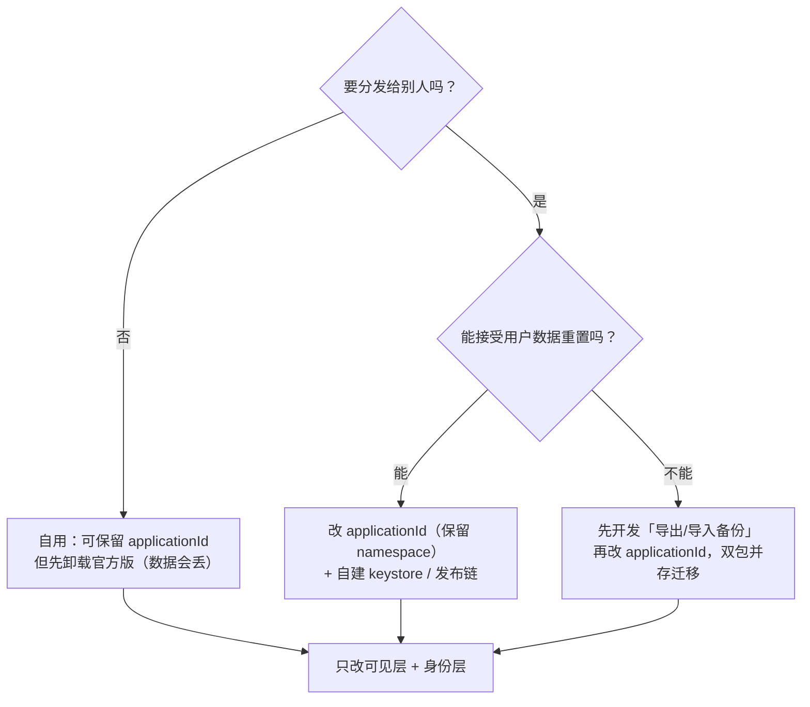

# Mika → 自有产品：品牌改造与深度优化路线图

**日期**：2026-11-06 ｜ **对象**：`E:\project\daiyimo\Mika` @ `bbc8922`（fork 自 `Daiyimo/Mika` → 上游 `wangzan101/Mika`）
**配套**：`Mika-源码深度分析与Code-Review.md`、`Mika-amoo链路实现流程图解.md`
**依据**：三路只读尽调（许可合规 / 品牌痕迹 / 迁移风险）+ 关键结论亲自回读复核

---

## 0. 先说结论（带观点的那部分）

1. **换图标、改 slogan 大约只占 5% 的工作量**。真正的成本在「身份层」（更新端点、反馈地址、签名、发布链、10 语言文案、生成段测试）和「合规层」（NOTICE / GPL / ML Kit）。只做前者，你会得到一个「换了皮但每次启动还在向上游仓库查更新、About 页还链着原作者 issue」的半成品。
2. **最贵、最不该先做的一步是改 `applicationId`**。它等于换一个全新 App：AndroidKeyStore 加密的 API Key、无线调试配对私钥、无障碍授权、全部对话/记忆/技能、amoo 信箱统统拿不回来，而且 `android:allowBackup="false"` 把所有系统级备份通道都封死了。**但只改 `applicationId`、保留 `namespace`，源码 package/import/AIDL/组件类名几乎不用动** —— 这是项目自带的设计（`core/shell/RecoveryPermissions.kt:74` 的注释 + `app/build.gradle.kts:57-61` 的 `-PdevInstall` 双包并存机制），也是改动面最小的换身份路径。
3. **别一上来重构 20 万行**。这个项目有 8 个 1300+ 行的类、手写 DI 双轨、无 R8、release 无签名，看起来到处该改；但单人/小团队维护这样一个「功能全都要」的 App，正确的第一步不是重构，是**砍功能**（见 §5.0）。先让它变成一个你能完全理解的产品，再谈深度优化。
4. **顺手把合规欠账补上，成本极低但收益很大**。当前 APK 里没有 GPL/LGPL 许可全文、没有 NOTICE 逐字副本、ML Kit 完全未披露。改造时一并补齐，比将来被问起来再补便宜得多。
5. **换名字 ≠ 可以抹掉来源**。Apache-2.0 §6 禁止你用原作者的产品名/商标，所以改名是**对的**；但 §4(c)(d) 要求保留版权与 NOTICE 归属，所以删署名是**错的**。这两件事必须同时做。

> ⚠️ **一处尽调冲突已纠正**：品牌盘点报告把 `NOTICE:1-2` 的 `Mika / Copyright 2026 wangzan101` 列为「必须改」，这是误判。`LICENSE` §4(d)（第 107-122 行）明确要求衍生作品保留 NOTICE 中归属声明的可读副本；正确做法是**原样保留这两行**，在其后以 addendum 追加自己的版权与 fork 说明。`about_author = "Made by Wang Zan · © 2026"`（`strings_about.xml:26`）则应从「产品作者」位置移到许可页的「原作归属」区块，UI 上的 "Made by" 换成你自己。

---

## 1. 三个必须先拍板的决策

后面的所有动作都取决于这三问，建议先定再动手：

| 决策 | 选项 A | 选项 B | 影响 |
|---|---|---|---|
| **① 分发范围** | 只自己用 / 内测 | 公开分发、上架、商用 | 决定是否必须换 `applicationId` + 自建签名；决定 ML Kit 条款核查是否变成硬门槛 |
| **② 是否闭源** | 继续 Apache-2.0 开源 | 闭源 / 商用 | 两者都**必须**履行 §4 义务；闭源额外要求把 LICENSE/NOTICE/GPL 全文打进 APK |
| **③ 是否换包名** | 保留 `com.wangzan101.mika` | 换成自己的 `com.yourbrand.xxx` | 换包名 = 数据全丢 + 需重做 amoo 接入、USB 脚本、无障碍授权；不换 = 与官方版签名冲突风险 |

**一个容易忽略的硬约束**：Android 要求覆盖安装的签名证书一致。如果你保留 `com.wangzan101.mika` 但用自己的 keystore 签名，**用户手机上装过官方版就装不上**（`INSTALL_FAILED_UPDATE_INCONSISTENT_CERTIFICATES`），而 App 自己还有第二道锁 `ApkUpdater.kt:126` → `ApkIntegrity.kt:48-51`。项目支持 v3 签名轮换，但那需要官方签名私钥 —— 你拿不到。

所以现实是：



---

## 2. 合规红线（这部分别自由发挥）

### 2.1 Apache-2.0 的四项硬义务（`LICENSE` §4，第 90-129 行）

| 义务 | 你要做的动作 |
|---|---|
| §4(a) 附 License 副本 | 保留根 `LICENSE` 与 `app/src/main/assets/licenses/Apache-2.0.txt`；建议补回被删掉的 APPENDIX（第 178-202 行） |
| §4(b) **修改过的文件加显著改动声明** | 这是你接手后**新增**的义务。当前 fork 的 29 次提交没逐个文件加；你的改动建议统一加 `// Modified by <你>, 2026: <摘要>`，或 CHANGELOG + 文件头组合 |
| §4(c) 保留所有版权/专利/商标/归属声明 | `ShellContext.kt:1-17` 的 scrcpy 版权头、5 个 SPDX 文件头、`THIRD_PARTY_NOTICES.md` 全部版权行，一个都不能删 |
| §4(d) NOTICE 归属声明可读副本 | `NOTICE` 原样保留；**在应用内许可页逐字显示**（`LicensesScreen.kt` 是现成落点）—— 当前只有 `about_author` 近似署名，不算逐字副本 |

**§6 Trademarks（第 139-142 行）**：不授予产品名/商标使用权 → 换名字、换 Logo、换 slogan 是**正确且必要**的；但别用 "Mika Pro"「Mika 增强版」这类衍生词，也别让原作者看起来在为你的产品背书。

**§4 末段（第 124-129 行）+ §2（第 67-72 行）+ §9（第 166-175 行）**：闭源分发与商用是允许的（Apache 不要求衍生作品开源），但**上游代码仍须履行 §4 义务**，不能把上游代码整体声明成专有后隐藏声明。§3 专利报复条款（第 82-88 行）也仍在。

### 2.2 必须保留（删掉即违规）

`LICENSE` · `NOTICE` · `tools/relay/NOTICE` · `licenses/{GPL-2.0,GPL-3.0,LGPL-3.0}.txt` · `licenses/THIRD_PARTY_NOTICES.md` · `app/src/main/assets/licenses/{Apache-2.0,Protocol-Buffers}.txt` · `app/src/main/assets/runtime/packages.json` · `tools/sandbox/` 全套（含 4 个补丁、`sources.lock`、`build-native.sh --check`）· `tools/relay/LICENSE.coder-websocket.txt` · `ShellContext.kt` 头 · 5 个 SPDX 头。

> 注意 `LicensesTest.kt:21-34` 会断言 `THIRD_PARTY_NOTICES.md` 存在且 headings ≥ 16、`gpl-sources.tar.gz`/`PRoot`/`talloc` 齐全 —— 删文件会直接让测试挂。

### 2.3 GPL / LGPL：不传染，但有分发义务

打包进 APK 的 `libproot.so`、`libproot_loader.so`（GPL-2.0-or-later）、`libmaeverun.so`、31MB 的 `rootfs.tar.xz`（65 个 Alpine 包，21 个含 GPL/LGPL/MPL）都是**独立可执行程序，Mika 只以子进程运行、不链接**（`tools/sandbox/README.md:3-4`），属 GPL §2 的 mere aggregation，**不限制你的主体代码闭源或商用**。

但每个副本仍须满足：附许可证全文 + 对应源码或**有效期 ≥3 年、面向任何第三方**的书面要约（GPL-2.0 §1/§3、GPL-3.0 §4/§6、LGPL-3.0 §4）。项目在源码侧做得很扎实（每次发版附 `mika-<版本>-gpl-sources.tar.gz`、`--check` 可逐字节重现、逐包 `packages.json`），**缺口在 APK 侧**：`app/src/main/assets/licenses/` 目前只有 2 个文件。

**改造时顺手补齐（成本极低）**：把 `NOTICE.txt`、`THIRD_PARTY_NOTICES.md`、`GPL-2.0.txt`、`GPL-3.0.txt`、`LGPL-3.0.txt`、一份明确的 `SOURCE_OFFER` 放进 `assets/licenses/`，并在 `LicensesScreen.kt` 加可访问入口。**前提**：别把 PRoot/talloc 改成 JNI 静态链接进 Kotlin 代码，否则聚合论证失效。

### 2.4 最需要优先处理的一项：ML Kit 未披露

`app/build.gradle.kts:99-100` 引入 `com.google.mlkit:text-recognition:16.0.1`（含中文包），APK 里带约 20 个 OCR 模型文件，但**全仓库没有任何许可文本或归属声明**（已 grep 复核 `THIRD_PARTY_NOTICES.md` / `LicensesScreen.kt` / `assets/licenses/` 均无匹配）。ML Kit on-device 通常受 Google APIs / ML Kit 服务条款约束，不是 Apache-2.0，可能含商用与模型再分发限制。

→ **闭源/商用前必须人工核查其条款**；若不允许随第三方 APK 再分发，需替换为可许可的 OCR 方案。仓库内查不到结论，这一项我标为「必须外部确认」。

### 2.5 署名链（你是二级 fork）

事实：`wangzan101/Mika`（原作者，363 提交，20+ 贡献者）→ `Daiyimo/Mika`（你当前的 fork，29 提交）→ 你的产品。当前 `.git/config` 只有 `origin = Daiyimo/Mika`，`upstream` 已移除。项目**没有 CLA/DCO**，贡献按 §5 默认 inbound=outbound，所以不必补签授权，也不能事后改上游代码的许可。

推荐在 `NOTICE` 末尾追加（§4(d) 明确允许 addendum，但不得写成「本产品改用其他许可证」）：

```
This product is a derivative work of Mika (https://github.com/wangzan101/Mika),
Apache-2.0, by wangzan101 and contributors, via the Daiyimo/Mika fork.
Modified by <你/你的公司> in 2026; see CHANGELOG.md and git history.
Copyright 2026 <你/你的公司>
```

README 的 License 段保留原有三个链接并加一句「independent derivative work, not affiliated with or endorsed by the original authors」。Contributors 图改成「上游贡献者」并保留链接，**别直接删**。建议保留完整 git 历史、不要 squash。

---

## 3. 三层改造清单

### ① 可见层（放心改）

| 项 | 位置 |
|---|---|
| 应用名 | `res/values/strings.xml:3`（`translatable="false"`，一处改全局生效）+ `app/build.gradle.kts:60` 的 `"Mika Dev"` |
| 图标 | `res/drawable-nodpi/mika_launcher_art.png`、`res/mipmap-anydpi-v26/ic_launcher.xml:4`、`res/drawable/ic_notification.xml`（通知小图标形状就是 logo，也要重画） |
| 主题 | `res/values/themes.xml:4-7` 与 `values-night/themes.xml:3-6` 的 `Theme.Mika` / `mika_bg`；`AndroidManifest.xml:96,118` 引用 |
| UI 硬编码 | `AboutScreen.kt:183`、`ChatCopy.kt:36`、`ChatDrawer.kt:235`、`CapsuleContent.kt:107,115`、`CapsuleCardModel.kt:213`、`Diagnostics.kt:125`、`McpServerStore.kt:405,407`（OAuth 回调 HTML）、`LicensesScreen.kt:34-37,52` |
| AI 身份 | `core/src/main/resources/prompts/system/identity.md:1` 「You are Mika…」及各 `feedback/`、`capabilities/` 提示词 —— **改了会改变模型行为**，且必须刷新金样 |
| 文案 | 10 个语言目录（`values`, `-ar`, `-b+zh+Hant`, `-es`, `-in`, `-ja`, `-ko`, `-pt`, `-ru`, `-zh`；`values-night` 非语言）里的 `about_author` / `about_tagline` / `settings_about` / `welcome_title` / `chatgpt_page_title` / `strings_mcp.xml` 品牌句 |
| 素材 | `docs/media/logo.png` + 11 个演示 GIF/JPG（画面里是旧品牌 UI，需重录）、`assets/selfcheck/page*.html` 的 title/h1 |

### ② 身份与渠道层（必须成对改）

- **`about/MikaLinks.kt:9-15` 一处集中了 5 个上游 URL**（REPO / REPO_LABEL / README / RELEASES / NEW_ISSUE / LATEST_RELEASE_API）。改这里能带动 About、更新检查、反馈、源码链接。
- **但必须同步 `about/ApkIntegrity.kt:24` 的官方 URL 白名单**：`official = "${MikaLinks.RELEASES}/download/"`，`requireOfficialUrl` 校验 host / 443 / path 前缀 / `.apk` 后缀。只换端点不换白名单 → 所有更新包被拒。
- 另需同步：`UpdateChecker.kt:62,119`（默认 API 与 `User-Agent: Mika/<ver>`）、`Releases.kt:30-73`（GitHub `releases/latest` 字段解析与附件命名）、`ApkUpdater.kt:81,126`、`ProviderStore.kt:279` 与 `MikaApp.kt:162` 的 User-Agent、`McpServerStore.kt:303` 的 `clientName`。
- **发布链**：`app/build.gradle.kts` 目前无 `signingConfigs {}`、release 无签名、无 `minifyEnabled/shrinkResources`；`ci.yml:3` 明说「发布（CD）仍是手工流程」、只构建 debug。建立自己的 keystore + CI 签名 + Release 附件 + `digest`/`size` 元数据，是「改成自己的」最实质的一步。
- 文档侧：`README.md`（徽章、star history、contributors、X 群聊、`@wangzan101`）、5 份语言 README、`.github/` 的 ISSUE_TEMPLATE 与 CONTRIBUTING、约 47 个 `docs/*.md` 里的上游 URL、`tools/mika/` CLI 与 SKILL.md、`tools/relay/go.mod:1` 的 module path、`settings.gradle.kts:15` 的 `rootProject.name`。
- **生成段不要手改**：`README.md:102-119` 的 `generated:knowledge` / `generated:providers` 由 `./gradlew updateReadme` 生成。品牌名来自 `core/src/main/resources/skills/configure-mika/SKILL.md:3-4` —— 改源再重跑，直接改 README 会被覆盖；`ReadmeTranslationsTest` 还会校验译文首行 `translated-from` 指纹。

### ③ 契约层（尽量别碰）

| 别改 | 原因 |
|---|---|
| `mika_run_task` 等 7 个 MCP 工具名、`serverInfo.name="mika"`、`mcp.servers.mika`、`X-Mika-Client` 头 | 外部 AI 客户端 / stepclaw 网关 / 单测断言依赖，改了协议就断。`McpRpc.kt:174` 的 `title="Mika"` 是显示名，可以改 |
| `IMikaShell.aidl` 的 package / interface / 事务号 1–49 | 独立 shell 助手进程靠它 Binder 通信 |
| `.a11y.MikaAccessibilityService` 组件全名 | 系统设置按组件名存授权 |
| 11 个 Keystore alias（`mika-provider-keys` / `mika-memory` / `mika_adb_key_wrap` 等） | 改别名 = 已存密钥全部读不出 |
| 通知渠道 ID `task_attention` / `task_progress` / `task_result_v2` | 持久化契约 |
| 自检页 `SELFCHECK-READ-OK`、`ASCII="Mika 123"` | 自检按字面量比对 |
| `tools/mika` 的 `mika` CLI 命令名 | 保留命令名，只改面向用户的描述文案；全改会破坏已有 CLI 安装 |

**两处澄清（避免误改）**：`AmooSetup.setupInstruction` 的 `/sdcard/Android/media/$pkg/amoo/` 是**运行时参数**（`:155` 传 `app.packageName`），改 applicationId 会自动跟随，不用手改；`AndroidManifest.xml:209/220/231/248` 的 FileProvider authority 用 `${applicationId}` 占位，也自动跟随。**真正写死包名的是电脑端 CLI** `tools/mika/scripts/mika_cli.py:22`（`PHONE_FILES`）、`docs/setup-guide*.md:205,263`、`docs/install-with-agent*.md:138` 的无障碍组件名判断、以及 amoo 沙箱里已装技能固化下来的旧路径（需重跑「一键接入」覆盖）。

---

## 4. 改包名 / 签名的代价清单

**确证会丢（`allowBackup=false` 封死所有系统迁移通道）**：

- API Key / OAuth token / MCP token / 微信账号 / 代理密码 —— `AndroidKeyStore` 按 UID 隔离且不可导出，**双重锁死**：旧密文在旧 `filesDir`，密钥在旧 UID 的 Keystore，即使 root 拷文件也解不开。
- 无线调试 ADB 配对私钥 —— 在 `noBackupFilesDir/adb/adbkey.bin`，且用 Keystore AES 二次包装；用户必须重新 `adb pair`。
- 无障碍授权 —— 系统 `enabled_accessibility_services` 存的是 `<包名>/.a11y.MikaAccessibilityService`，换包名后失效；更麻烦的是恢复逻辑依赖已有的 shell 连接，而连接依赖配对，存在「先有鸡还是先有蛋」，实际要用户手动重新开。
- 全部对话 / 运行记录 / 记忆 / 个人技能 / 沙箱工作区 / SharedPreferences / 定时任务注册。
- amoo 信箱（`getExternalMediaDirs()` 路径含包名）与 USB 启动脚本（里面写死了 `apkPath` / `certPin` / `nonce`）。

**推荐做法**：

1. **能不改就不改**，只改 `applicationId` 显示层；如果手机装过官方版，接受一次卸载重装。
2. **必须改时：只动 `applicationId`，保留 `namespace`**。源码 package/import、AIDL、组件相对名、`R`/`BuildConfig`、core 全限定名全部不动，改动面从「1419 个文件」降到「Gradle 一行 + 外部脚本/文档若干」。项目自己就是这么设计双包并存的。
3. 连 `namespace` 一起改要额外处理 `HelperHandoff.kt:18` 的 `HELPER_CLASS`、`RecoveryPermissions.kt:75` 写死的服务类名、`core/build.gradle.kts:54,66,84` 的 mainClass、`tools/sandbox/build-runtime.py:481` 生成的包名、`baseline-prof.txt`、全部测试目录 —— **收益仅是源码包名好看，不建议**。
4. 换包名之前先开发**应用内导出/导入备份**：用户口令重新加密，把 11 类 Keystore 密文解密后打包；导入端用新 UID 的 Keystore 重新加密。注意别把明文写进 `Android/media/amoo`（那是明文可读目录）。当前代码没有这个能力。
5. 换签名/换包名后，助手进程交接（`HelperHub` 的 uid/pid/APK 路径/签名指纹/nonce 校验）理论上打开一次 App 就能自洽重写 USB 脚本，但**首次切换时序需真机验证**；OEM 对 `shell → app provider` 的 SELinux 策略也要实测。

---

## 5. 深度优化路线图（按阶段，不是按难度）

### 阶段 0 · 先把已知的坑填了（1 周内，收益最高）

直接复用前一份 Code Review 的结论，这些是**确证缺陷**，品牌化之前修掉，避免以后分不清是「改坏的」还是「本来就坏」：

- P0：`PcmRecorder.kt:83,129` 录音线程可能永久挂死；`ChatViewModel.kt:1102` + `ConversationDeleter.kt:48` 两处空 catch 导致「删了又回来」；`ProviderStore.kt:834,959-971` 旧配置静默丢失。
- P1：`MemoryRuntime.items()` 每次调用泄漏一个无限 collect；`PdfDoc.close` / `NetworkTracker.close` 裸作用域导致 FD 泄漏；MCP SSE 半包静默丢弃；69 处 `collectAsState` 无生命周期感知。
- 安全：全局明文 HTTP（`network_security_config.xml:8`）、生产常开 WebView 调试（`WebDevtools.kt:305`）、无障碍 `typeAllMask` + 通知正文默认全放行、`McpServer.kt:49-51` 的 `autonomous=true` 死代码（当前生产不可达，但接线就会静默绕过护栏 —— 建议直接删）。

### 阶段 1 · 建立「这是你的产品」的工程底座

1. 自建 keystore + `signingConfigs` + release 构建；CI 加 release 签名与发布附件（当前 CD 手工）。
2. 把 `MikaLinks` / `ApkIntegrity` / `Releases` 的发布端点迁到自己的渠道；或直接移除自动更新。
3. 合规补齐：`assets/licenses/` 五个文件 + `SOURCE_OFFER` + 许可页逐字显示 NOTICE + **核查 ML Kit 条款**。
4. 加 `NOTICE` addendum、`CHANGELOG.md`/`FORK.md`、每个改动文件的 §4(b) 声明。
5. 先只开 `shrinkResources`，稳定后再上 R8 —— 要写 keep 规则（AIDL `IMikaShell`、kotlinx.serialization、Compose、`app_process` 反射加载的 `HelperMain`/`ShellService`、nativeLibraryDir 执行），必须全量真机回归。当前 debug 包 105MB（含 31MB rootfs），压缩空间很大。

### 阶段 2 · 品牌化（严格按 SOP 顺序，否则 CI 会挂）

```
1. 定 applicationId / namespace 策略（见 §4）
2. 改 MikaLinks.kt:9-15 → 同步 ApkIntegrity.kt:24 白名单 → 改 UpdateChecker/Releases/User-Agent
3. 改 values/strings.xml:3 + 3 个图标资源 + themes.xml ×2 + Manifest 引用
4. 改 UI 硬编码自称（§3① 清单）→ 改 prompts/identity.md 等提示词
5. 批量替换 10 语言品牌字符串 → 跑 tools/i18n/translations.py check + StringResourcesTest
6. 改 configure-mika/SKILL.md 后跑 ./gradlew updateReadme（别手改生成段）
   → 更新 5 份译文首行 translated-from 指纹
7. 替换 docs/media 素材，处理 README 的社交链接 / star history / contributors
8. 改 NOTICE（保留原署名 + 追加 addendum）、about_author 位置、settings.gradle.kts:15、发布附件名
9. 全量回归：./gradlew :core:test :core:cliTest :app:testDebugUnitTest :app:assembleDebug
   必要时 -PupdateSnapshots 刷新提示词金样
```

### 阶段 3 · 结构性优化（长期，别和阶段 2 混做）

| 项 | 收益 | 备注 |
|---|---|---|
| **垂直化裁剪（我最推荐的一项）** | 大幅降低维护面、权限面与攻击面 | 见 §5.0 |
| 统一 DI（消除 `MikaApp` 50 个 `by lazy` + 静态工厂双轨） | 依赖可见、可测试、换实现只改一处 | 建议渐进式，先统一静态工厂；同名 `app.record.RunStore` / `core.run.RunStore` 顺手改名 |
| 拆分 8 个千行大类 | 可测试性、并行开发 | 优先 `TaskRun` / `CapsuleController` / `WebScreen`（恰好零 JVM 单测） |
| 69 处 `collectAsStateWithLifecycle` | 后台不再空转收集 | 加 `lifecycle-runtime-compose` 依赖，改动机械但面广 |
| 品牌/包名常量单一来源化 | 换品牌只改一处 | 把 action 常量、`HELPER_CLASS`、Keystore alias、CLI `PHONE_FILES` 收敛到 `BuildConfig.APPLICATION_ID` / 常量对象 |
| 应用内导出/导入备份 | 解决换设备、换包名、重装的迁移 | 阶段 1 之前若有换包名计划就先做 |
| baseline profile + Compose 稳定性 + `SharingStarted` 治理 | 首启与滚动流畅度 | 项目注释已指出 debug 包不做预编译「界面慢好几倍」 |

### 5.0 最关键的一条战略建议：先砍，再优化

这个 App 同时拥有：手机 App 操作（无障碍 + shell uid 2000 + 虚拟屏）、桌面级 WebView 浏览器 + CDP、PRoot Linux 沙箱、定时任务、语音、悬浮胶囊、MCP/CLI 远程控制、微信通道、root 能力、amoo 集成、20+ 服务商适配、10 语言、内置 App 知识库。这是**一个团队**的维护量。

改成自己的产品，最有价值的动作不是让它「什么都做且换个皮」，而是**选一条主线**，把不用的能力从 `TaskTools.toolDispatcher()` 的 provider 列表里摘掉：

- 主线若是「隐私优先的本机助手」→ 砍掉云端通道、微信/amoo/远程 MCP、root，只留本地模型 + 手机操作 + 沙箱；顺带把全局明文 HTTP 收窄、WebView 调试关掉，安全审计报告里的高危项一次性消失。
- 主线若是「垂直场景自动化」（例如电商比价、客服、信息采集）→ 砍掉通用浏览器/沙箱/语音，把知识库和提示词做成该场景专用，效果会明显好过通用 Agent。
- 主线若是「开发者工具」→ 保留 MCP/CLI/沙箱，砍掉手机 GUI 操作与无障碍，能去掉整个双进程 shell 助手（也就去掉了 `WRITE_SECURE_SETTINGS`、虚拟屏、 largest 攻击面）。

每砍一块，就少一块要翻译、要测试、要合规、要适配新 Android 版本的负担。**这比重构 8 个大类更能决定这个项目能不能长期活下去。**

---

## 6. 验收清单

- [ ] 全新克隆 + `assembleRelease` 能出**已签名、已混淆**的包；CI 能自动发布
- [ ] 断网启动，logcat 里没有任何指向 `wangzan101/Mika` 或 `api.github.com/repos/wangzan101` 的请求
- [ ] About 页、反馈、更新、帮助链接全部指向自己的域名；更新包能通过 URL 白名单 + SHA-256 + 同签名校验
- [ ] 10 语言无残留 "Mika"；`translations.py check` / `StringResourcesTest` / `ReadmeTranslationsTest` 全绿
- [ ] `updateReadme` 重跑后 README 生成段无回退；提示词金样已用 `-PupdateSnapshots` 刷新
- [ ] `LICENSE` / `NOTICE`（含原署名）/ `THIRD_PARTY_NOTICES.md` / GPL-LGPL 全文 / `tools/sandbox/` 全在；APK `assets/licenses/` 补齐；许可页能逐字看到 NOTICE
- [ ] 已确认 ML Kit 的许可/服务条款，结论写入 `THIRD_PARTY_NOTICES.md`
- [ ] 改过的文件有 §4(b) 改动声明；`FORK.md` 记录三层来源链与 fork 点
- [ ] 若换了 `applicationId`：已准备好数据重置说明或导出/导入；真机重验无障碍、无线调试配对、amoo 一键接入、USB 启动脚本、助手进程首次交接
- [ ] 前一份 Review 的 P0 全部修完，P1 有明确排期

---

## 7. 需要你拍板的三件事

1. **只自己用，还是要分发/商用？** —— 决定要不要换 `applicationId` 和自建发布链。
2. **能不能接受用户数据全部重置？** —— 决定要不要先做导出/导入备份。
3. **产品主线是什么？** —— 决定该砍哪些能力；这是「深度优化」里回报最高的一步。

告诉我这三点（以及新品牌名 / 是否已有自己的签名证书），我可以直接按选定方案落地：从改 `MikaLinks` + 图标 + 10 语言文案，到补合规文件、建 release 签名，或者按主线裁掉整块能力。

---

*本文为工程与合规梳理，不是法律意见；ML Kit 条款、PRoot(GPL-2.0-or-later) 与 talloc(LGPL-3.0-or-later) 的版本兼容性等标为「需确认」的项，商用前建议由法务复核。所有代码位置均已在本地仓库回读核实。*
